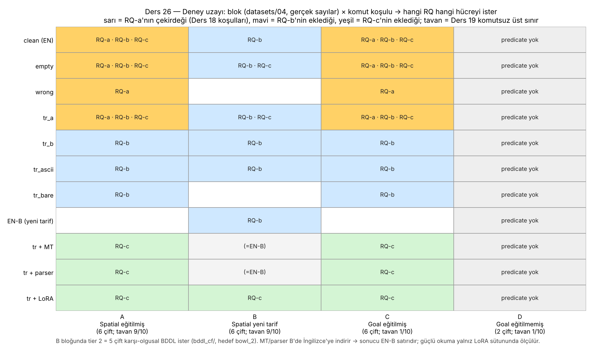

# Ders 26 — Üç Aday Araştırma Sorusu: Tohumdan Sınanabilir Soruya — Null Hipotez, Değişkenler, Ölçüt ve Eşik, Suite + Blok, Sistemler, "Evet/Hayır Çıkarsa Tez Ne Der"

**Faz 4 / Gün 26** · **Süre:** ~55 dk (okuma 40 + görev 15)
**Ön koşul:** Ders 25 (S1–S10, RQ tohumları), Ders 18–19 (dört koşul, A/B/C/D), Ders 20 (bloklar), Ders 24 (zayıf/güçlü okuma) · **Kod:** `code/day26/` (`rq_power.py` güç/eşdeğerlik hesabı, `rq_lint.py` taslak kontrolü — ikisi de bu oturumda koştu) · **Çıktı:** `thesis/rq-candidates.md` (3 RQ × 6 alan, v0.1; tahmin bloğu sende)

> **Bugünün tek cümlesi:** Bir araştırma sorusu, yanlış çıkabileceği koşul önceden yazılmışsa sorudur — Ders 25'in üç tohumunu (*fark var mı / nerede kırılıyor / nasıl kapanır*) bugün altı alanla kilitliyoruz: null hipotez (eşli fark = 0, artı "fark yok" diyebilmek için bir eşdeğerlik sınırı δ), bağımsız/bağımlı/ortak değişkenler, ölçüt ve **sayısal** eşik (McNemar p < 0,05 **ve** |Δ| ≥ 15; TOST %90 CI ⊂ ±δ), suite + blok + n, iki sistem (S-OV / S-VN — *sistem* farkı, omurga farkı değil) ve her dal için "tez ne der" cümlesi; ve `rq_power.py` bir şeyi düzeltiyor: r = 0,05 ters gürültüyle n = 50 ancak ≥ 23 puanlık farkı %80 güçle yakalar, 15 puan için n ≈ 100, "tr ≈ clean" demek için δ = 15'te n ≈ 25 yeter.

---

## 1. Sınanabilir soru nedir, neden altı alan?

"Türkçe komutlar VLA'larda çalışıyor mu?" bir merak cümlesi, araştırma sorusu değil: hangi model, hangi görev, "çalışmak" kaç puan, neye göre, kaç koşuda? Cevabı "evet" de "hayır" da olabilen ama hangisinin *ne zaman* söyleneceği belli olmayan bir soru, sonuç geldikten sonra istenen yöne çekilebilir — tez savunmasında ilk sorulacak şey budur.

Klinik araştırmanın FINER ölçütü (Hulley vd.: feasible, interesting, novel, ethical, relevant) ve PICO şablonu (population / intervention / comparison / outcome) bu alanı çoktan standartlaştırmış; makine öğrenmesinde aynı disiplin **ön kayıt** (pre-registration) adıyla geldi — NeurIPS 2020 atölyesi (Bertinetto vd., PMLR 148) sonuçtan önce soru, hipotez ve analiz planının yazılıp dondurulmasını, sonuçların sonra eklenmesini önerdi. Bizim uyarlamamız altı alan; her RQ için aynı sırayla doldurulur:

| alan | PICO karşılığı | bizde |
|---|---|---|
| **Null hipotez** | — (istatistik) | eşli fark = 0; "fark yok" iddiası için ayrıca eşdeğerlik sınırı δ (§2) |
| **Değişkenler** | I + C | bağımsız (komut koşulu, sistem), bağımlı (episode başarı), ortak (token sayısı, tavan), sabit (init state'ler, seed) |
| **Ölçüt ve eşik** | O | success rate + Wilson (koşu içi) + PI (koşular arası); McNemar exact; **sayısal** eşik önceden |
| **Suite / blok / n** | P | LIBERO Spatial A/B, Goal C (`datasets/04`); 10 pilot → 50 tez; ≥3 tekrar |
| **Sistemler** | P | S-OV (`openvla-7b-finetuned-libero-spatial`, LLaMA-2) / S-VN (VLANeXt-B, Qwen3-VL); fark **sistem** farkı |
| **Evet / hayır çıkarsa** | — (yorum) | her dal için tezin cümlesi; hiçbir dal "deney boşa gitti" olmamalı |

Altıncı alan en çok atlanan ve en önemlisi: sonuç gelmeden "hayır çıkarsa ne yazacağım" sorusuna cevabın yoksa, hayır çıkınca eşiği oynatırsın. Üç RQ'nun tamamı `thesis/rq-candidates.md`'de; `rq_lint.py` bu oturumda dosyayı okudu: 3 RQ × 7 alan (Soru + 6) **TAM**, selftest'te bozuk bir taslağın 7 eksiğini yakaladı. Tez bağlantısı: Türkçe mekânsal grounding iddiası ancak bu altı alanla yazılınca Tatar vd.'nin (Ders 5) "L2 = 0,50" türü bulgusundan ayrılır — orada ölçüt var, null yok, eşik sonradan.

---

## 2. "Fark var" ile "fark yok" aynı test değil: McNemar ve TOST

Ders 18'in güç hesabı "fark var" içindi: aynı init state'te `clean` başarıp `tr` başaramazsa bu bir uyumsuz çift, McNemar exact uyumsuz çiftlerin içinde binom(0,5) testi; p < 0,05 için en az 6 tek yönlü uyumsuz çift gerekir (Ders 25: b=5 → 0,0625, b=6 → 0,0312). O hesap iyimserdi (r = 0: koşul yalnızca kaybettirir). `rq_power.py` buna bir "ters" gürültü oranı r ekledi — politika gürültülüyse `tr`'nin `clean`'i geçtiği çiftler de olur — ve (b, c) çiftlerini multinom dağılımla kesin topladı:

| n (eşli init) | MDE, r = 0 | MDE, r = 0,05 | MDE, r = 0,10 | güç Δ=15 (r=0,05) | güç Δ=30 (r=0,05) |
|---|---|---|---|---|---|
| 10 | 68 | 78 | — | %0,5 | %7 |
| 20 | 37 | 46 | 54 | %10 | %46 |
| 50 | 16 | **23** | 29 | %48 | %94 |
| 100 | 8 | 15 | 18 | %84 | %99,9 |

Okuması: Ders 25'in "50 episode fark söyler" cümlesi Δ ≈ 30 için doğru (%94), **Δ = 15 için değil** (%48 — yazı tura). Türkçe düşüşü Dong vd.'nin ölçeğindeyse (Spatial 97,6 → 49–64, yani 35–50 puan) 50 yeter; Chen'in Qwen3-VL Çince hücresi gibi 7 puanlıksa 50 init state ile *hiçbir şey* söylenemez. Bu yüzden RQ-a'nın eşiği |Δ| ≥ 15: altındaki farklar bu bütçede ölçülemez, tezde "ölçülemedi" diye yazılır, "yok" diye değil.

"Yok" demek ayrı bir iştir. Null hipotezi reddedememek eşitliği kanıtlamaz; eşitlik için **TOST** (two one-sided tests; Lakens 2017): önce "ne kadar küçük fark 'yok' sayılır" (δ, *smallest effect size of interest*) yazılır, sonra farkın %90 güven aralığının (−δ, +δ) içine düştüğü gösterilir. Eşli oranlar farkında %90 CI yarı genişliği ≈ 1,645·√(q/n) (q = uyumsuz çift oranı; Wald yaklaşımı, planlama için): q = 0,20'de n = 10 → ±23, n = 50 → ±10, n = 100 → ±7. Dolayısıyla "tr ≈ clean" (δ = 15) demek için n ≈ 25, "tr ≈ empty" (δ = 10, Ders 19'un eşiği) demek için n ≈ 55, δ = 5 için n ≈ 217. İki şeyi aynı anda planla: fark varsa yakalayacak n (Δ'ya göre) ve yoksa "yok" diyebilecek n (δ'ya göre) — ikisi aynı sayı değil, ve δ'yı **sonuçtan önce** yazmazsan TOST anlamsızlaşır.

---

## 3. RQ-a — Fark var mı?

**Soru:** Aynı başlangıç sahnesinde `tr_a` ile `clean` arasında kapalı-döngü success farkı var mı; varsa `empty` tabanına göre nerede; S-OV ile S-VN'de örüntü aynı mı?

Altı alanın özeti (tam metin `thesis/rq-candidates.md`):

- **Null:** H0-a1 P(başarı | tr_a) = P(başarı | clean), δ = 15. H0-a2 P(tr_a) = P(empty), δ = 10. İkisi *birlikte* okunur: a1 red + a2 red değil → **B** (Türkçe okunmuyor); ikisi de red → **D** (okunuyor ama eksik); a1 red değil → `empty` ayırır (A: dil görmezden geliniyor / D: Türkçe çalışıyor). Bu, Ders 19'un A/B/C/D ağacının hipotez diline çevrilmiş hâli.
- **Değişkenler:** bağımsız = koşul {clean, empty, wrong, tr_a} (sahne içi, eşli) ve sistem {S-OV, S-VN}; bağımlı = episode başarı; ortak = token sayısı (`datasets/05`), komutsuz tavan (Spatial 9/10, Goal 1/10); sabit = init state kümesi, `num_steps_wait`, checkpoint, seed listesi.
- **Ölçüt:** eşli Δ + McNemar exact + Wilson + PI (≥3 tekrar). "Var": p < 0,05 **ve** |Δ| ≥ 15. "Yok": TOST CI ⊂ ±δ. Aksi hâlde "belirsiz": n artır, eşik oynatma. İkincil: `grasped_bowl` (yanlış hedef mi, hareket yok mu).
- **Suite/blok/n:** Spatial A (6) + Goal C (6); pilot = Ders 18 koşusu + tekrar; tez 50 init/görev; Spatial'da `empty` ≥ 80 ise ağırlık Goal'a (S7). Tez toplamı 12 × 50 × 4 × 2 = 4.800 episode (+ tekrar) — T4 bütçesi Ders 27.
- **Sistemler:** S-OV (Spatial ve Goal LoRA checkpoint'leri), S-VN (VLANeXt-B). Sistemler arası karşılaştırma **betimsel**: omurga + action başı + eğitim verisi birlikte değişiyor (Chen vd.: aynı Qwen3-VL omurgasında OFT başı Arapça'da −47, GR00T başı −36).
- **Evet/hayır:** evet → tezin ölçüm katkısı, RQ-b'ye geç; hayır + `empty ≈ clean` → "bu görevlerde dil ölçülemiyor, Goal/B'ye geç"; hayır + `empty ≪ clean` → "Türkçe bu sistemde okunuyor" (o da bulgu); belirsiz → yön kipi.

Sınırını çizen iki uyarı: LangGap'in 1/k argümanı (k görevli sahnede komutu okumayan model en çok 1/k alır) Spatial'da `tr`'nin 80'e düşmesini "Türkçe okunmadı" diye okumayı yasaklar — `empty` zaten 80 olabilir; Chen'in "sistem farkı" uyarısı da "Qwen3-VL Türkçe'yi daha iyi anlıyor" cümlesini yasaklar — "S-VN sistemi daha az düşüyor" denir.

---

## 4. RQ-b — Nerede kırılıyor?

**Soru:** Düşüş komutun hangi özelliğine bağlı — ilişki ailesi (CDC/yön, RCC/topoloji, mesafe, bölge), yüzey (`tr_a / tr_b / tr_ascii / tr_bare`), referans çerçevesi (B07–B09) — ve eğitimde olmayan Türkçe tarif (blok **B**) boş komutun üstüne çıkıyor mu?

Görsel 03 üç RQ'nun deney uzayını tek ızgarada gösteriyor (blok sayıları `pairs.csv`'den gerçek: A 6 / B 6 / C 6 / D 2; B'nin 5 çifti tier 2 = karşı-olgusal BDDL ister). Sarı hücreler RQ-a'nın çekirdeği (Ders 18'in dört koşulu, A ve C bloklarında); RQ-b mavi satırları ekler (öbür yüzeyler, B bloğu, **EN-B**); RQ-c yeşil satırları (müdahaleler). D sütunu bütün RQ'larda boş: *sağına/soluna* için predicate yok (Ders 20 tier 3).

RQ-b'nin dört null'u: **H0-b1** aile × koşul etkileşimi yok; **H0-b2** yüzey etkisi yok — özelde Δ(tr_ascii) = Δ(tr_a) iki sistemde (Ders 22: Türkçe harf bedeli LLaMA-2'de 4,9 token, Qwen3'te 0,9 → S-OV'de red, S-VN'de red değil çıkarsa tokenizasyon açıklaması ilk kanıtını alır — Tatar vd.'nin hipotezinin kapalı-döngü testi); **H0-b3** (güçlü okuma) blok B'de P(tr_B) = P(empty); **H0-b4** (çerçeve) *soldaki/sağdaki* için gidilen kâse üç çerçeveden rastgele. Kritik tasarım kararı: B bloğunun **EN sütunu da koşulur** — EN-B − clean "yeni tarif" bedelini, TR-B − EN-B "Türkçe" bedelini ayırır; LangGap'in "Spatial Description" hücresi (π0.5 %11, 5 görev) EN-B'nin dış referansıdır. Ölçüt betimsel kalır (aile başına 1–3 görev; Ders 23: küçük hücrelerde "yön" kipi); H0-b3 için tr_B − empty ≥ 15 ve p < 0,05 "güçlü okuma kanıtı", TOST δ = 10 içi "yok".

Evet/hayır: aile/yüzey etkisi varsa "düşüş tekdüze değil, [topoloji/CDC] ve [tr_ascii]'de yoğunlaşıyor" → tokenizasyon ile ön-eğitim ayrışır; yoksa "dilin kendisinden" → yüzey düzeltmeleri (ASCII, eksiz) elenir, RQ-c omurga/eğitim yoluna daralır; H0-b3 reddi tezin en iddialı cümlesi, reddedilememesi RQ-c'nin ölçütünü zayıf okumaya indirir (S10).

---

## 5. RQ-c — Nasıl kapanır?

**Soru:** Modele dokunmayan iki müdahale (MT çeviri katmanı, kural tabanlı parser → EN şablon) ve dokunan bir müdahale (EN+TR co-training LoRA, S9 izin verirse) Türkçe açığını ne kadar kapatır — kapanış **zayıf okuma** (A/C'de tr ≈ clean) mı, **güçlü okuma** (B'de empty üstü) mı?

Ölçütün çekirdeği **kapanış oranı** κ = [SR(tr, M) − SR(tr)] / [SR(clean) − SR(tr)]: 0 hiç, 1 tam; bootstrap %95 CI (eşli episode'lar). "İşe yarıyor" κ ≥ 0,5 ve McNemar p < 0,05; "tam kapatıyor" H0-c2 (= clean) TOST δ = 15 içinde. Dört null: **c1** müdahale etkisiz, **c2** tam kapatır, **c3** (yalnız LoRA) B'de tr_B = empty, **c4** (yan etki, yalnız LoRA) clean bozulmuyor — δ = 5, çünkü Chen'in M-CT'si Arapça'yı 59 → 89 yaparken İngilizce'yi 95,3 → 92,6 düşürdü ve Dong'un E-FT'si çok dilli yeteneği tabanın altına indirdi; yan etki raporlanmazsa "kapandı" cümlesi yarım kalır.

MT ve parser B bloğunda tanım gereği İngilizce'ye indirir → sonuçları EN-B satırıdır (görsel 03'te "(=EN-B)"); güçlü okuma yalnızca LoRA sütununda ölçülür. MT/parser'ın ayrı bir ara çıktısı var: çeviri/parse birebir mi, "yanlış ama geçerli" mi (Ders 24 H04: *kaseyi ocağa koy* → `put the bowl on the stove`, yani Ders 18'in `wrong`'u) — açığın ne kadarı ara katmandan, ne kadarı modelden, bu sayımla ayrılır. Evet/hayır: MT/parser κ ≥ 0,5 → "açık büyük ölçüde girdi düzeyinde kapanıyor; model Türkçe anlamıyor, indirilmiş komutla çalışıyor" (S10'a göre tez bununla biter ya da taban olur); κ < 0,5 ve çeviri doğruyken de düşükse → model içi sorun, LoRA/omurga gerekçelenir; LoRA c3 reddi → güçlü okuma, ana katkı; c3 red değil → "co-training cümleyi öğretti, tarifi değil" = LangGap'in "veri tek başına yetmez" bulgusunun Türkçe karşılığı — negatif sonuç olarak yazılır, saklanmaz.

---

## 6. Sıralama koşullu: S1 hangi örüntüyü verirse hangisi birincil?

Ders 25'in uyarısı duruyor: S1 (Ders 18 tablosu) bu sabah da repoda yoktu (`projects/05-spatial0-4kosul/` yok, `plan/faz3-open-questions.md` Durum sütunu boş). Üç RQ yazıldı; *sıralanmadı*. Sıralama kuralı önceden yazılır ki sonuç geldiğinde seçim de ön kayıtlı olsun:

| S1 örüntüsü | Birincil | Neden | İlk adım |
|---|---|---|---|
| **A** dil görmezden geliniyor | RQ-b (suite ekseni) | Spatial görev 0'da ölçek yok | `conditions_goal8.json` (Goal C) + Spatial B |
| **B** tr ≈ empty | RQ-c (MT/parser önce) | açık büyük, ucuz müdahale önce; LoRA S9'a bağlı | Ders 18'e `tr_mt` koşulu (`mt_layer_mac.py`) |
| **C** wrong biased | RQ-b (çerçeve + `grasped_bowl`) | hedef sahneden seçiliyor; Türkçe payı B'de görünür | 10 `wrong` videosunu etiketle |
| **D** Türkçe okunuyor | RQ-a (iki sistem, eşdeğerlik) → RQ-b (yüzey) | fark küçükse TOST; S-OV karşılaştırması öne çıkar | S-OV Spatial 4 koşul |
| belirsiz | RQ-a devam | n = 10'un normal sonucu | 50 init + ≥3 tekrar, eşik sabit |

Literatürdeki boşluk da sıralamayı etkilemiyor, gerekçelendiriyor (görsel 05): Türkçe satırında yalnızca Tatar vd. (açık döngü, tek kare) ve bizim Ders 15 mini'si var; "aynı sahnede karşı-olgusal × kapalı döngü × boş-komut tabanı" kesişiminde İngilizce'de bile yalnızca LIBERO-CF; Türkçe'de kimse yok. Üç RQ o hücreye konuyor.

Tezin iddiasına bağ: üç RQ, Ders 25'in üç cümlesinin (iddia / kanıt zinciri / koşul) sınanabilir hâlidir — RQ-a iddianın "ölçülebilir düşüş" yarısı, RQ-b "suite/aile/yüzey/omurgaya göre farklılaşır" yarısı, RQ-c katkı cümlesi; hangisinin tezin başlığına çıkacağı S1 + S7 + S10 ile belirlenir.

---

## 7. Yazılımcı için köprüler

- **RQ = kabul testi, Gherkin'le yazılmış.** *Given* aynı 50 init state, *When* komut `tr_a`, *Then* success `clean`'den en çok 15 puan düşük (ya da en az 15 düşük — hangisini iddia ettiğin önceden yazılı). Null hipotez, "assert" satırının kendisidir; altı alan, testin fixture + parametre + beklenen değer üçlüsü.
- **Ön kayıt = contract-first / spec freeze.** `thesis/rq-candidates.md`'nin commit hash'i tarih damgasıdır; sonuç geldikten sonra eşik değişirse bu bir *breaking change* ve changelog'a (dosyanın sürüm bölümü) gerekçeyle girer. Sessizce değiştirmek, prod'da testi geçsin diye assert'i gevşetmekle aynı şey.
- **MDE = SLA'nın ölçülebilir alt sınırı.** p99 gecikmede 5 ms'lik iyileşmeyi 100 istekle göremezsin; önce "kaç örnekle kaç ms görünür" hesaplanır. `rq_power.py` o hesaptır: n = 50 ile 23 puan görünür, 15 görünmez — SLA'yı yazarken örneklem bütçesini de yaz.
- **TOST = toleranslı eşitlik.** `Assert.Equal(0.1 + 0.2, 0.3)` kırmızıdır; `Assert.Equal(…, tolerance: 1e-9)` yeşil. "Fark yok" iddiası tolerans (δ) olmadan tanımsızdır ve toleransı testi yazarken seçersin, sonucu gördükten sonra değil.
- **Sistem farkı = iki mikroservisi karşılaştırmak.** S-OV ve S-VN farklı runtime, farklı serializer, farklı veri — "Qwen daha iyi" demek, "Go servisi .NET'ten hızlı" demek kadar nedensel: ölçüm sistem düzeyinde, açıklama ablation ister (Ders 28).
- **`rq_lint.py` = PR template checker.** Alan eksikse merge yok; içerik doğru mu diye bakmaz (o reviewer'ın işi — danışman), ama "null hipotez bölümünde H0 yok" gibi yapısal eksikleri CI'da yakalar.

---

## 8. Kendini sına (cevaplar aşağıda)

1. "Türkçe komutlar VLA'larda çalışıyor mu?" sorusunu altı alanla yeniden yaz: hangi alan hangi belirsizliği kapatıyor? En az üç alanı somut doldur.
2. `rq_power.py`'ye göre n = 50 eşli init state Δ = 30'u %94, Δ = 15'i %48 güçle yakalıyor (r = 0,05). Bu iki sayı RQ-a'nın "|Δ| ≥ 15" eşiğini nasıl gerekçelendiriyor ve 15'in altındaki bir fark tezde nasıl yazılır?
3. "Null reddedilemedi" ile "eşdeğerlik gösterildi" arasındaki fark ne? TOST'ta δ'nın sonuçtan önce yazılması neden zorunlu; RQ-a'da δ = 15 ve δ = 10 neden farklı?
4. RQ-b'de B bloğunun EN sütununun da koşulması neyi ayırıyor? LangGap'in hangi sayısı bu sütunun dış referansı ve neden π0.5 %11'in üstüne çıkmak Türkçe için güçlü bir iddia olur?
5. RQ-c'nin H0-c4'ü (İngilizce bozulmuyor, δ = 5) hangi iki makale bulgusundan doğdu ve bu null olmadan "açık kapandı" cümlesi neden yarım kalır?

## 9. Bugünün görevi (15 dk)

`thesis/rq-candidates.md`'yi aç, en alttaki **"Önceden yazılan tahminler"** bloğunu doldur — koşmadan önce: RQ-a için S-VN ve S-OV'de beklediğin Δ(tr_a − clean) (puan), tr − empty; RQ-b için en çok kırılacağını düşündüğün aile ve yüzey, tr_B > empty? evet/hayır; RQ-c için MT ve parser'ın κ tahmini; ve tek cümleyle hangi RQ'nun birincil çıkacağını düşündüğün. Sonra `cd code/day26 && python rq_lint.py ../../thesis/rq-candidates.md` (TAM çıkmalı) ve `python rq_power.py | head -8` çıktısındaki n = 50 satırını tahminlerinin yanına yaz: tahmin ettiğin Δ o n'de görünür mü? Commit mesajı: `Ders 26: RQ tahminleri (ön kayıt)`. Bu commit'in hash'i tezde "tahminler koşudan önce yazıldı" cümlesinin kanıtı.

## Çoktan seçmeli (kutuları işaretle, sonra cevabı aç)

**1. `rq_power.py` bu oturumda ne buldu (r = 0,05, %80 güç)?**  _(tek seçim)_
- [ ] A) n = 50 her büyüklükte farkı yakalar
- [ ] B) n = 50 en küçük ≈ 23 puanlık farkı yakalar; Δ = 15 için n ≈ 100 gerekir
- [ ] C) n = 10 Δ = 30'u %90 güçle yakalar
- [ ] D) Güç r'den bağımsızdır

Cevap

**B.** n = 10'da Δ = 30 için güç %7 (C yanlış); r arttıkça MDE büyür (r = 0: 16, r = 0,05: 23, r = 0,10: 29 — D yanlış).

**2. TOST (eşdeğerlik testi) için doğru olan?**  _(tek seçim)_
- [ ] A) Null reddedilemeyince eşitlik kanıtlanmış olur
- [ ] B) Sonuca bakıp en dar δ seçilir
- [ ] C) δ önceden yazılır; farkın %90 CI'ı (−δ, +δ) içindeyse eşdeğerlik; q = 0,2'de δ = 15 için n ≈ 25, δ = 10 için n ≈ 55
- [ ] D) TOST yalnız sürekli değişkenlerde çalışır

Cevap

**C.** A klasik hata ("absence of evidence ≠ evidence of absence"); B ön kaydın tam tersi; D yanlış — eşli oranlar farkına Wald yaklaşımıyla uygulandı (planlama için).

**3. RQ-b'de EN-B sütunu neden koşulur?**  _(tek seçim)_
- [ ] A) İngilizce başarıyı artırmak için
- [ ] B) "Yeni tarif" bedelini (EN-B − clean) "Türkçe" bedelinden (TR-B − EN-B) ayırmak için; dış referans LangGap Spatial Description %11
- [ ] C) LIBERO-Plus Language ile karşılaştırmak için
- [ ] D) Goal suite'inde tavanı ölçmek için

Cevap

**B.** B bloğunda EN komut da eğitimde yok; EN-B olmadan TR-B'deki düşüşün ne kadarı dilden ne kadarı yeni tariften, ayrılamaz.

**4. Altı alandan hangileri "sonuç gelmeden" yazılmak zorunda? (birden fazla)**  _(birden fazla seçim)_
- [ ] A) Null hipotez ve eşdeğerlik sınırı δ
- [ ] B) Sayısal eşik (|Δ| ≥ 15, p < 0,05, κ ≥ 0,5)
- [ ] C) "Evet / hayır çıkarsa tez ne der" cümleleri
- [ ] D) Gözlenen Δ değeri
- [ ] E) Birincil RQ'nun hangisi olduğu

Cevap

**A, B, C.** D sonuçtur; E koşullu bırakılır — sıralama *kuralı* önceden yazılır (§6), seçim S1 gelince yapılır.

**5. "Sistem farkı" uyarısı hangi cümleleri yasaklar? (birden fazla)**  _(birden fazla seçim)_
- [ ] A) "Qwen3-VL omurgası Türkçe'yi LLaMA-2'den iyi anlıyor"
- [ ] B) "S-VN sistemi Türkçe'de S-OV'den az düşüyor"
- [ ] C) "Tokenizer farkı Türkçe açığının nedenidir" (yalnızca RQ-a sonucuyla)
- [ ] D) "İki sistem aynı 50 init state'te koşuldu"

Cevap

**A, C.** B betimsel ve izinli; D yöntem cümlesi. Omurga/tokenizer nedenselliği ablation (Ders 28) ya da RQ-b'nin `tr_ascii` zıt-yön testi ister.

## Takılırsan

| Belirti | Çözüm |
|---|---|
| `rq_power.py` dakikalarca sürüyor | Normal (n ≤ 100 için multinom toplamları ~1 dk); yalnız tabloyu istiyorsan `--png` verme |
| `rq_lint.py` → `'Ölçüt ve eşik' alanı yok` | Alan başlığı birebir `**Ölçüt ve eşik:**` olmalı (kalın, iki nokta içeride); boş satırla ayrılmalı |
| `rq_lint.py` → `ölçütte sayısal eşik yok` | Ölçüt metninde `Δ ≥ 15`, `δ = 10`, `κ ≥ 0,5`, `p < 0,05` ya da `… puan` geçmeli — niyet değil, sayı |
| `rq_lint.py` → `tahmin bloğu yok` | "Önceden yazılan tahminler" başlığını silme; doldur |
| `plot_day26.py`: `pairs.csv` bulunamadı | Script'i `code/day26/` içinden çalıştır (yol göreli) |
| Tahmin yazarken "bilmiyorum" | Normal; yine de bir sayı yaz — ön kaydın amacı doğru tahmin değil, sonradan "zaten biliyordum"u imkânsızlaştırmak |

---

## Sonraki ders (Ders 27)
**Her RQ için deney matrisi: veri, model, benchmark, metrik, hesaplama maliyeti.** Bugünkü altı alan satır başlıklarına dönüşür: her RQ × {veri (hangi blok, kaç komut, karşı-olgusal BDDL sayısı), model/checkpoint (S-OV Spatial/Goal, S-VN Spatial/Goal; LoRA için eğitim verisi), benchmark (suite, init state sayısı, tekrar), metrik (Δ, κ, Wilson/PI, TOST), maliyet (T4 saati — Ders 12/16/18'in gerçek episode süreleriyle; 4.800 episode kaç Colab oturumu, Kaggle'ın 30 sa/haftasına sığıyor mu)} hücreleri doldurulur, toplam bütçe çıkarılır ve bütçeye sığmayan hücreler işaretlenir. `rq_power.py` o derste tersine çalışır: bütçe kaç init state'e yetiyorsa, o n'de görünen en küçük fark RQ'nun eşiğini sınar. S1 repoya girdiyse matris birincil RQ'dan başlar; girmediyse üç RQ eşit ağırlıkta yazılır, toplam bütçe üçünün toplamı olur.

---

## Cevaplar

1. Örnek: **Null** — aynı 50 init state'te P(başarı | tr_a) = P(başarı | clean), δ = 15 (hangi büyüklük "çalışıyor" sayılır). **Değişkenler** — bağımsız: koşul {clean, empty, wrong, tr_a}, sistem {S-OV, S-VN}; bağımlı: episode başarı (predicate); ortak: token sayısı, komutsuz tavan (hangi model, ne ölçülüyor, neye göre). **Ölçüt/eşik** — eşli Δ, McNemar p < 0,05 ve |Δ| ≥ 15; Wilson + PI, ≥3 tekrar (kaç puan, kaç koşu). **Suite/blok/n** — Spatial A + Goal C, 50 init (hangi görevler). **Sistemler** — iki açık VLA, fark sistem düzeyinde. **Evet/hayır** — her dalın cümlesi (sonuç ne olursa olsun tez ne yazar). Her alan "çalışıyor mu"daki bir belirsizliği sayıya ya da isme bağlar.
2. 50 init state ile 30 puanlık fark güvenle görünür (%94), 15 puanlık fark yazı tura (%48): eşiği 15'e koymak "bu bütçede ölçülebilenin alt sınırı budur" demektir; eşiği daha aşağı koymak, görülemeyecek farkı iddia etmek olur. 15'in altındaki gözlenen fark tezde "**ölçülemedi** (n = 50'de MDE ≈ 23; 95% CI …)" diye yazılır; "fark yok" diye değil — "yok" için ayrıca TOST (δ) gerekir.
3. Null reddedilememek "kanıt yok"tur; eşdeğerlik "farkın δ'dan küçük olduğunun kanıtı"dır (%90 CI ⊂ ±δ). δ sonuçtan önce yazılmazsa CI'a bakıp içine sığan en dar δ seçilir ve test anlamsızlaşır (tolerans sonradan ayarlanmış assert). RQ-a'da δ = 15 "tr ≈ clean" (Türkçe çalışıyor) iddiası için, δ = 10 "tr ≈ empty" (Türkçe okunmuyor; Ders 19'un eşiği) iddiası için — iki farklı iddia, iki farklı tolerans, iki farklı n (≈25 / ≈55, q = 0,2).
4. B bloğunda EN komut da eğitimde yok; EN-B − clean "eğitimde olmayan tarif" bedelini, TR-B − EN-B yalnızca "Türkçe" bedelini verir — EN-B olmadan TR-B'deki düşüş iki nedene bölünemez. Dış referans: LangGap Tablo VIII "Spatial Description" π0.5 %11 (5 görev × 20 episode; aynı sahnede mekânsal tarif değişince). Türkçe yeni tarifin `empty`'nin üstüne çıkması güçlü iddia çünkü İngilizce'de bile tarif değişince model çöküyor; Türkçe'de çökmemesi "cümleyi ezberledi" açıklamasını dışlar (tarif ezberde yok) ve mekân kodlamasının içeride görüntüye bağlandığını gösterir.
5. Chen vd.: M-CT (çok dilli devam eğitimi) Arapça'yı 59,3 → 89,4 yaparken İngilizce'yi 95,3 → 92,6 düşürdü; E-FT (yalnız İngilizce ek eğitim) çok dilli skoru taban modelin altına indirdi. Dong vd.: ZH fine-tune 51,7 → 86,8 (kazanç tarafı). Yan etki null'u olmadan "Türkçe açığı kapandı" cümlesi, İngilizce'nin ne kadar bozulduğunu söylemez — tez "Türkçe kazandı, İngilizce kaybetti mi?" sorusuna cevapsız kalır; δ = 5 Chen'in −2,7'sini ancak n ≈ 217'de ayırt eder (q = 0,2), yani bu null muhtemelen "belirsiz" kalır ve öyle yazılır.

---

## Kaynaklar
- Çıktı: `thesis/rq-candidates.md` (3 RQ × 6 alan + sıralama kuralı + tahmin bloğu; v0.1). Girdiler: `plan/faz3-open-questions.md` (S1–S10, tohumlar), Ders 18 (dört koşul, güç), Ders 19 (A/B/C/D, `--near 15 --far 25`, tavan 9/10 ve 1/10), Ders 20 (`datasets/04` blokları, B07–B12), Ders 22 (harf bedeli 4,9 / 0,9), Ders 23 (PI, küçük hücrelerde yön kipi), Ders 24 (zayıf/güçlü okuma, parser, LoRA bütçesi), Ders 25 (LangGap, sistem farkı).
- **[1]** Bertinetto, Henriques, Albanie, Paganini, Varol (2021). *The pre-registration experiment: an alternative publication model for machine learning research.* NeurIPS 2020 atölyesi, [PMLR 148](https://proceedings.mlr.press/v148/bertinetto21a.html) · [atölye sayfası](https://neurips.cc/virtual/2020/public/workshop_16158.html) — ön kayıt: soru/hipotez/analiz planı sonuçtan önce.
- **[2]** Lakens (2017). *Equivalence Tests: A Practical Primer for t Tests, Correlations, and Meta-Analyses.* Social Psychological and Personality Science 8(4):355–362, [PMC5502906](https://pmc.ncbi.nlm.nih.gov/articles/PMC5502906) · [TOSTER](https://cran.r-project.org/web/packages/TOSTER/vignettes/IntroductionToTOSTER.html) — TOST, SESOI (δ). Eşli oranlar farkına Wald yaklaşımı bu dersin uyarlaması (planlama amaçlı).
- **[3]** Hulley, Cummings, Browner, Grady, Newman. *Designing Clinical Research* (3. baskı, 2007) — FINER ölçütü; PICO şablonu (kanıta dayalı tıp standardı). Alan-dışı kaynaklar; altı-alan şablonu bu dersin uyarlaması.
- **[4]** Hou, Zhao (2026). *LangGap.* [arXiv:2603.00592](https://arxiv.org/abs/2603.00592) — Tablo VIII Spatial Description 11,0; 1/k argümanı. Chen vd. (2026). *Beyond English.* [arXiv:2606.15714](https://arxiv.org/abs/2606.15714) — Tablo 1 (sistem farkı; Qwen3-VL + OFT ar −47, + GR00T −36), Tablo 5 (M-CT: ar 59,3 → 89,4, EN 95,3 → 92,6; E-FT). Dong vd. (2026). *When Does Language Matter?* [arXiv:2606.11906](https://arxiv.org/abs/2606.11906) · [ACL 2026](https://aclanthology.org/2026.acl-long.2066/) — Spatial 97,6 → 49–64; ZH fine-tune 51,7 → 86,8.
- **[5]** Görsel 05'teki öbür konumlar: LIBERO-Plus [arXiv:2510.13626](https://arxiv.org/abs/2510.13626), LIBERO-PRO [arXiv:2510.03827](https://arxiv.org/abs/2510.03827), LIBERO-CF [arXiv:2602.17659](https://arxiv.org/abs/2602.17659), Zhan vd. [arXiv:2601.04052](https://arxiv.org/abs/2601.04052); Tatar vd. (2026) SIU (Ders 5). Checkpoint'ler: [openvla/openvla-7b-finetuned-libero-spatial](https://huggingface.co/openvla/openvla-7b-finetuned-libero-spatial), [DravenALG/VLANeXt](https://github.com/DravenALG/VLANeXt).
- Kod: `code/day26/` — `rq_power.py` (bu oturumda koştu; tablo `results/rq_power.txt`, görsel 02), `rq_lint.py` (selftest OK; `thesis/rq-candidates.md` → TAM; `results/rq_matrix.csv`), `plot_day26.py` (görsel 03, 05).
- Görseller: 01 ve 04 Mermaid (`.mmd` yanında); 02 kesin hesap (McNemar exact multinom toplamı; TOST Wald yaklaşımı — başlıkta yazılı); 03 blok sayıları `datasets/04/data/pairs.csv`'den, tavan Ders 19'dan; 05 konumlar çalışmaların raporladığı özelliklerden (sınıflama, sayı değil). Temsili veri yok; model bu oturumda çalıştırılmadı (RQ'lar yazıldı, koşulmadı).
