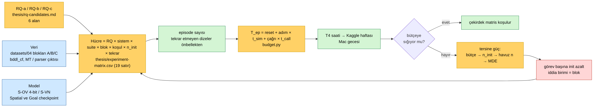
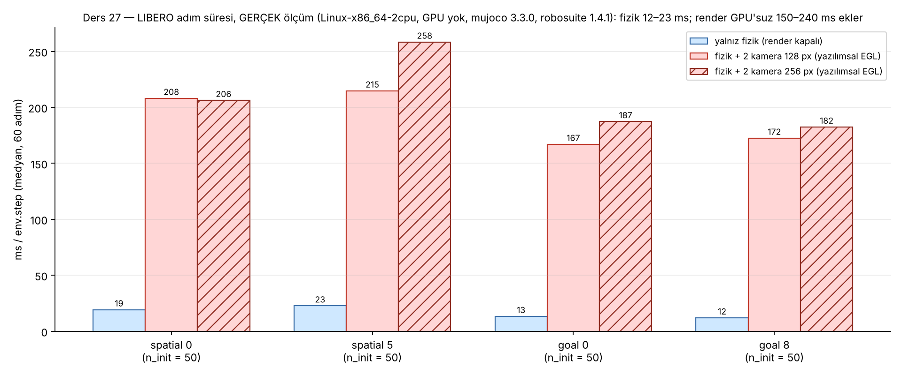
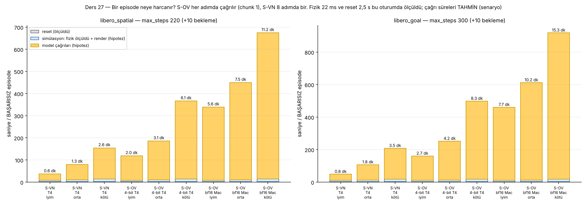
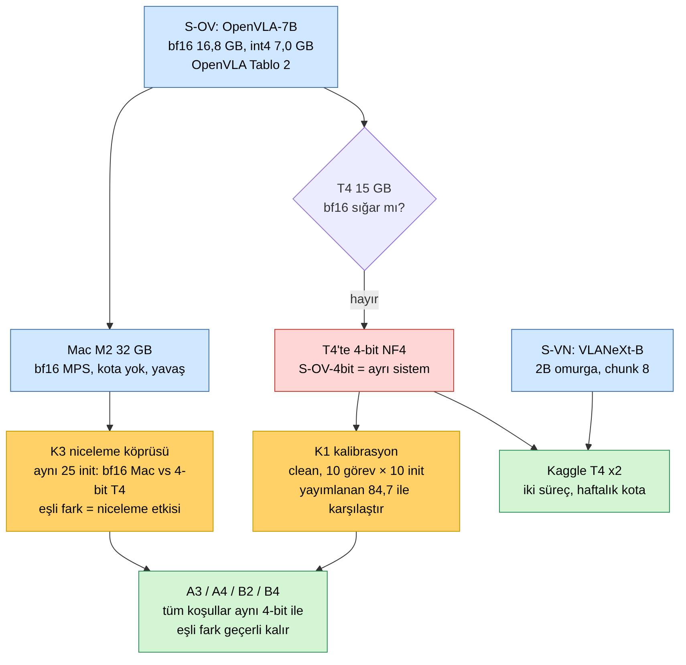
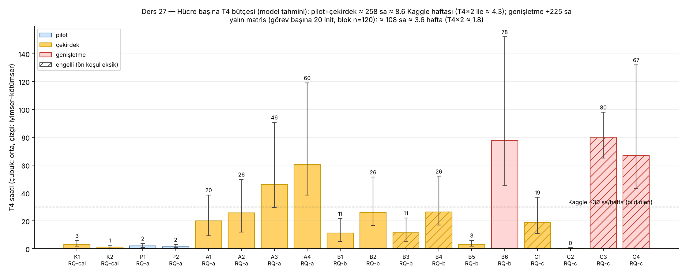
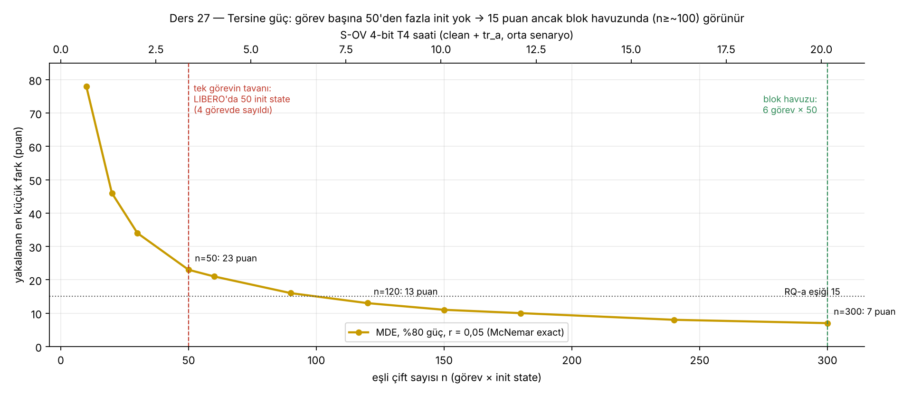

# Ders 27 — Deney Matrisi: Her RQ için Veri, Model, Benchmark, Metrik, Maliyet — 19 Hücre, Episode Süresi Modeli, T4 Bütçesi ve Tersine Güç

**Faz 4 / Gün 27** · **Süre:** ~55 dk (okuma 40 + görev 15)
**Ön koşul:** Ders 26 (RQ-a/b/c, `rq_power.py`), Ders 12 ve 18 (T4 notebook'u, chunk 8, `num_parallel_envs`), Ders 14 (OpenVLA tek adım, Mac MPS), Ders 24 (QLoRA bütçesi, parser 79/80) · **Kod:** `code/day27/` (`sim_step_bench.py` gerçek LIBERO ölçümü, `budget.py` bütçe + tersine güç, `plot_day27.py` — üçü de bu oturumda koştu) · **Çıktı:** `thesis/experiment-matrix.csv` (19 hücre, v0.1)

> **Bugünün tek cümlesi:** Üç RQ'yu 19 hücrelik bir matrise açınca (sistem × suite × blok × koşul × init × tekrar) pilot + çekirdek ≈ 8.400 koşan episode ve orta senaryoda ≈ 258 T4 saati çıkıyor (iyimser 150, kötümser 500) — bunun %63'ü S-OV, çünkü OpenVLA her adımda bir kez çağrılıyor (chunk 1) ve T4'e ancak 4-bit sığıyor; ama tersine güç hesabı bütçenin nereye gittiğini değiştiriyor: LIBERO'da görev başına yalnızca 50 init state var (n = 50 → en küçük görünen fark 23 puan), 15 puan ancak blok havuzunda görünür ve havuzda n = 120 (görev başına 20 init) zaten 13 puanı yakalar — **iddia birimini görevden bloğa taşırsan** aynı matris ≈ 108 saate, yani T4×2 ile ~2 Kaggle haftasına iner.

---

## 1. Matris ne, hücre ne?

Ders 26'nın altı alanı "ne soruluyor"u kilitledi; bugün "neyle, kaç kez, kaça" sorusu. Plan tablosu beş sütun istiyor — veri, model, benchmark, metrik, hesaplama maliyeti — ama bunları RQ başına bir satırla yazmak işe yaramıyor: RQ-a'nın içinde iki sistem, iki suite, dört koşul var ve her birinin maliyeti farklı. Doğru birim **hücre**: *bir sistem, bir suite, bir blok, bir koşul kümesi, görev başına n init state, bir tekrar sayısı*. Hücre koşulabilir en küçük iş paketi; CI'daki bir job gibi.

`thesis/experiment-matrix.csv` 19 hücre içeriyor (sütunlar: `cell_id, rq, tier, purpose, system, suite, block, n_tasks, conditions, n_init, repeats, data_dep, model_dep, metric, status`). Özet:

| grup | hücreler | ne ölçer | veri | model | metrik |
|---|---|---|---|---|---|
| **Kalibrasyon** | K1, K2, K3 | sistemler yayımlanan sayıları tutturuyor mu; niceleme ne kadar kaydırıyor | LIBERO orijinal komutları | S-OV 4-bit (T4), S-VN, S-OV bf16 (Mac) | Wilson; K3'te eşli Δ(4-bit − bf16) |
| **Pilot** | P1, P2 | Ders 18 koşusu + tekrar; S-OV ilk koşu | `datasets/03` | S-VN, S-OV 4-bit | Wilson + PI (3 tekrar) |
| **RQ-a** | A1–A4 | dört koşul × iki sistem × Spatial A / Goal C | `datasets/04` A, C | iki sistem, Spatial ve Goal checkpoint'leri | McNemar + TOST, **blok havuzunda** |
| **RQ-b** | B1–B5 çekirdek, B6 genişletme | `tr_ascii` zıt-yön testi; B bloğu EN-B / TR-B; B'nin `empty`'si | `datasets/04` A+C, B + `bddl_cf/` | iki sistem | eşli Δ; tr_B − empty |
| **RQ-c** | C1, C2 çekirdek; C3, C4 genişletme | MT ve parser kapanışı; QLoRA eğitimi + eval | MT/parser çıktıları; EN+TR RLDS | iki sistem; S-OV-LoRA | κ, H0-c3, H0-c4 (δ = 5) |

Ders 26'dan bir değişiklik öneriyorum (dosyada `repeats` sütunu): RQ-a "≥3 tekrar" diyordu; matris tekrarı **yalnızca pilotta** (P1) tutuyor, çekirdekte 1. Gerekçe §5'te — tekrar, bağımsız init state'in yerini tutmuyor. Bu bir ön kayıt değişikliği; `thesis/rq-candidates.md` v0.2'ye senin onayınla girer.

---

## 2. Bir episode neye harcanır? Ölçülen yarı ve tahmin edilen yarı

Bütçe = Σ hücre (episode sayısı × episode süresi). Episode süresini parçalarına ayırınca neyi ölçebildiğimiz, neyi tahmin ettiğimiz netleşiyor:

`T_ep = t_reset + (W + L) · t_sim + ⌈L / chunk⌉ · t_call`

- **W = 10** bekleme adımı (`num_steps_wait`; model çağrılmaz) ve **L** = başarılıysa episode'un uzunluğu, değilse `max_steps`. `max_steps` gerçek kod: Spatial 220, Goal 300 (OpenVLA `c8f03f4`, `run_libero_eval.py:173-180`; yorum satırı "longest training demo has 193/270 steps"). Başarılı uzunluk Spatial için ~100 (Ders 18'in Ders 11'den aldığı ~96), Goal için 120 — **hipotez**.
- **chunk**: S-VN 8 (Ders 12, `num_steps_execute: 8`), S-OV **1** — OpenVLA her adımda bir 7-DoF action üretir; makale action chunking'i "gelecek iş" diye anıyor (§6). Başarısız bir Spatial episode'unda S-VN 28 kez, S-OV 220 kez çağrılır. Bütçenin asıl asimetrisi bu.
- **t_sim** ve **t_reset**: bunları bu oturumda **gerçekten ölçtüm** (`sim_step_bench.py`; LIBERO deposu, robosuite 1.4.1, mujoco 3.3.0, 2 çekirdekli Linux, GPU yok):

Render kapalıyken bir `env.step` fizik olarak Spatial'da 19–23 ms, Goal'da 12–13 ms; reset 0,9–1,5 s (render'lı 2,1–2,7 s). Dört görevin dördünde `get_task_init_states` tam **50** init state döndürdü — bu sayı §5'te bütün hesabı belirliyor. Render ise bu makinede adım başına 150–240 ms ekliyor, çünkü GPU yok ve EGL yazılımsal çalışıyor. Colab/Kaggle'da EGL T4 üstünde donanımsal çalışmalı (iki küçük kamera, ms mertebesi — **hipotez**); `MUJOCO_GL` yanlış ayarlanıp render yazılıma düşerse her episode'a 30–60 s eklenir. Bu yüzden Takılırsan tablosunda ilk satır bu.

**t_call** ölçemediğimiz yarı ve bütçenin %90'ından fazlası. Senaryolarım şu dayanaklarla kuruldu:

| sistem / yer | iyimser | orta | kötümser | dayanak |
|---|---|---|---|---|
| S-VN, T4 | 1,0 s | 2,5 s | 5,0 s | Ders 18'in "başarılı episode ~1 dk / 12 çağrı" tahmini üst uç; bf16 T4'te emülasyon (Ders 12) |
| S-OV 4-bit, T4 | 0,5 s | 0,8 s | 1,6 s | OpenVLA §5.4: int4 A5000'de **3 Hz**; T4 bellek bant genişliği 320 GB/s, A5000 768 GB/s → 3 × 320/768 ≈ 1,25 Hz ≈ 0,8 s (7B'de üretim bant genişliğine bağlı varsayımı) |
| S-OV bf16, Mac M2 | 1,5 s | 2,0 s | 3,0 s | Ders 14 tahmini (1,5–3 s/action) |

Karşılaştırma için makalenin tek bf16 hız cümlesi: RTX 4090'da "approximately 6Hz" (§3.5). Ve VLAQuantBench (Xu vd., Eyl 2026) OpenVLA-OFT'yi RTX 4090'da gerçek çekirdeklerle ölçtü: tam çıkarım bf16 139,9 ms, NF4 152,6 ms, LLM.int8() 379,5 ms (Tablo 10) — yani 4-bit belleği yarıdan fazla düşürüyor ama **hızlandırmıyor**, 8-bit ise 2,7× yavaşlatıyor. 8-bit'i bu yüzden hiç düşünmüyoruz.

Görsel 02 başarısız (en pahalı) episode'u gösteriyor: S-VN T4'te orta senaryoda 1,3 dk, S-OV 4-bit T4'te 3,1 dk, S-OV bf16 Mac'te 7,5 dk (Spatial). Sarı (model çağrısı) her çubuğu domine ediyor; ölçtüğümüz mavi kısım ince bir şerit. Dolayısıyla matrisin ilk yapılacak işi **t_call'u ölçmek**: K1 ve K2 kalibrasyon hücreleri aynı zamanda saat ölçümüdür; `budget.py --calls-sv X --calls-ov Y` ile ölçülen değerler yerine konup bütçe yeniden çıkarılır.

---

## 3. S-OV T4'e nasıl sığar — ve sığdırmak neyi değiştirir?

OpenVLA bf16 ağırlıklarla 16,8 GB ister (makale Tablo 2; §3.5'te "15GB" deniyor — iki sayı makalenin kendi içinde farklı). T4'ün kullanılabilir belleği ~15 GB; görüntü + KV önbelleği eklenince bf16 sığmıyor. Seçenekler: 8-bit (10,2 GB; A5000'de 1,2 Hz ve Tablo 2'de BridgeData başarısı 71,3 → **58,1**), 4-bit (7,0 GB; 3 Hz; başarı **71,9** — bf16 ile aynı). Resmî LIBERO eval script'i 4-bit'i bayrakla destekliyor (`--load_in_4bit`, `openvla_utils.py:48`), yani kod yazmak gerekmiyor. Seçim belli: **T4'te S-OV = 4-bit.**

Ama "4-bit S-OV" yayımlanan sistemle aynı sistem değil. Tablo 2'nin eşitliği BridgeData'da 8 görevde, 80 rollout'ta; LIBERO checkpoint'inde ölçülmemiş. VLAQuantBench'in OpenVLA-OFT satırı uyarıcı: basit 4-bit yuvarlama (RTN W4) Spatial'da 100 → 96 ama **Goal'da 96 → 82** (Tablo 1). Bu OFT, bizim OpenVLA değil, ve RTN, bizim NF4 değil (aynı makalenin NF4 satırları yalnız LLM kısmı nicelendiğinde Spatial'da ~98; ilgili ek tabloyu doğrudan okuyamadım, **doğrulanmadı**). Yine de ders net: niceleme bir suite'te zararsız, ötekinde 14 puanlık bir kayma olabilir.

Bunun deney tasarımına iki sonucu var:

1. **Eşli fark geçerli kalır.** RQ-a'nın soruları koşullar arası fark (`tr_a − clean`); bütün koşullar aynı 4-bit modelde koşulursa niceleme her iki tarafta da aynı. Değişen şey yorumun öznesi: tezde "OpenVLA" değil "**OpenVLA (4-bit NF4)**" yazılır.
2. **İki kalibrasyon hücresi zorunlu.** K1: 4-bit S-OV, `clean`, 10 Spatial görevi × 10 init (~3 T4 saati) — yayımlanan 84,7 ± 0,9'un Wilson aralığı içinde mi? K3: Mac'te bf16 S-OV ile **aynı** 25 init'te `clean` ve `tr_a` — 4-bit'le eşli karşılaştırma, niceleme etkisini doğrudan ölçer ve "Türkçe düşüşü nicelemeden mi" itirazını kapatır. K3 Mac'te ~4 saat (orta) = bir gece; kota harcamaz. Mac'in matristeki asıl rolü bu: yavaş ama bf16 ve bedava bir **referans**.

---

## 4. Toplam: 19 hücre, 258 saat — nereye gidiyor?

`budget.py` matrisi okuyup her hücreyi (sistem, suite, koşul) parçalarına açıyor ve beklenen episode süresini koşulun beklenen başarısıyla karıştırıyor (başarılı episode kısa: `clean` 0,8, `empty` 0,3, `tr_a` 0,5 … — bunlar **sonuç tahmini değil**, yalnızca maliyet karışımı için; ±0,2 oynatınca toplam ~%10 değişiyor).

| | episode (koşan) | T4 saati iyimser / **orta** / kötümser |
|---|---|---|
| Kalibrasyon K1–K2 (+ K3 Mac 4 sa) | 200 | 2 / **4** / 8 |
| RQ-a (P1, P2, A1–A4) | 4.960 | 91 / **156** / 305 |
| RQ-b çekirdek (B1–B5) | 2.500 | 46 / **78** / 153 |
| RQ-c çekirdek (C1, C2) | 735 | 11 / **19** / 38 |
| **Pilot + çekirdek** | **≈ 8.400** | **149 / 258 / 497** |
| Genişletme (B6, C3 eğitim, C4) | 4.200 + eğitim | 154 / **225** / 382 |

Üç okuma:

- **S-OV hücreleri 258 saatin 163'ü (%63).** A3 + A4 tek başına 106 saat. Chunk farkı sistem karşılaştırmasının maliyetini asimetrik yapıyor: S-VN'nin bir episode'u ~1 dk, S-OV'unki ~2–3 dk.
- **Kaggle'da ≈ 8,6 hafta, T4×2 ile ≈ 4,3.** Kaggle'ın haftalık GPU kotası resmî belgede sayı olarak yazılmıyor, hesap ayarlarında görünüyor; ikincil kaynaklar "~30 saat" diyor (biri bunun kullanıcı raporu olduğunu ayrıca belirtiyor). Oturum 12 saatle sınırlı. Kaggle T4×2 veriyor: iki GPU'ya iki ayrı eval süreci (`CUDA_VISIBLE_DEVICES=0/1`, her biri bir hücre) duvar saatini yarıya indirmeli — **hipotez**; RAM (Ders 18: ~29 GB) iki sürece yetmeli. Kota saati ikisinde de aynı yanar mı, yoksa GPU başına mı sayılır — hesabında kontrol et.
- **C2 neredeyse bedava: 1.200 episode'dan 15'i koşar.** Parser çıktısı `clean` cümlesiyle birebir aynıysa, o episode `clean` episode'unun kendisidir (S-OV greedy: `do_sample=False`, `openvla_utils.py:169` → aynı girdi aynı action; S-VN'de dağılım aynı). Ders 24'te parser set içinde 80'in 79'unu birebir çevirdi → koşulacak olan 1/80. MT için aynı önbellek %60 koşu varsayıyor (**hipotez**; HF erişimi olmadığı için MT çıktısı hâlâ yok → C1 engelli). Yazılımcı dilinde: girdi dizesine göre memoization.

---

## 5. Tersine güç: bütçe → n → görünen en küçük fark

Ders 26'nın tablosu "n = 100 ile 15 puan görünür" diyordu. Bugün gerçek ölçüm bir kısıt ekledi: **bir LIBERO görevinde 50'den fazla init state yok.** Görev başına n'yi 50'nin üstüne çıkaramazsın; tekrar (aynı init'i yeniden koşmak) da çare değil — S-OV'da greedy çözüm aynı init'te aynı sonucu verir (GPU belirlenimsizliği hariç), S-VN'de ise tekrarlar aynı init'e bağlı oldukları için bağımsız çift sayılmaz. Yani tek bir görevde %80 güçle görünen en küçük fark, ne kadar bütçe koyarsan koy, ~23 puanda kalır.

Çıkış yolu iddia birimini değiştirmek: RQ-a'nın sorusu zaten blok düzeyinde ("Spatial A'da Türkçe düşüş var mı"). Blok altı görevden oluşur; eşli çiftleri görevler arasında havuzlayınca n = 6 × n_init. Havuzlu McNemar, "hiçbir görevde fark yok" null'u altında geçerli bir testtir — her görevde uyumsuz çiftler simetrik — ama bulduğu fark **blok ortalamasıdır**; tek tek görev için betimsel kalır. `budget.py`'nin tersine tablosu (S-OV, Spatial, `clean` + `tr_a`, orta senaryo):

| T4 saati | görev başına init | havuz n | MDE görev | MDE blok |
|---|---|---|---|---|
| 5 | 12 | 72 | 68 | 18 |
| 10 | 24 | 144 | 41 | 12 |
| 20 | 49 | 294 | 24 | 7 |
| 30+ | 50 (tavan) | 300 | 23 | 7 |

`budget.py`'nin güç fonksiyonu `rq_power.py` ile aynı model ama vektörleştirildi (b + c ~ Binom, b | m ~ Binom); selftest Ders 26'nın üç değerini birebir veriyor (23 / 15 / 16), n = 300 saniyeler sürüyor. Okuma: blok düzeyinde 15 puanlık eşik için n ≈ 100 yeter (MDE 15), n = 120 ile 13. **Yalın matris** çekirdek hücrelerde görev başına 20 init kullanıyor: RQ-a 64, RQ-b 31, RQ-c 8, kalibrasyon 4 → **≈ 108 T4 saati, ≈ 3,6 Kaggle haftası, T4×2 ile ≈ 1,8** (iyimser 63, kötümser 211).

İki uyarı. (i) Havuz hesabı görevlerin aynı r ters gürültüsüne ve aynı Δ'ya sahip olduğunu varsayıyor; görevler arasında Δ çok değişirse (biri −40, biri 0) havuz ortalaması 20 der ama "her görevde düşüş" demez — o yüzden görev başına Δ'lar yine tabloda, "yön" kipinde raporlanır. (ii) TOST için de aynı mantık: δ = 15 eşdeğerliği n ≈ 25'te, δ = 10 n ≈ 55'te kuruluyordu; görev başına 20 init ile bunlar ancak blokta mümkün. Yalın matris "fark yok" iddiasını da bloğa taşır. Bu, tezin iddia biriminin ne olacağına dair bir karar ve **danışmanla konuşulacak** (Ders 30 listesi): "LIBERO Spatial'ın şu altı görevinde ortalama" mı, "her görevde" mi?

Tez bağlantısı: Türkçe mekânsal grounding iddiası tek görevde 23 puandan küçük bir düşüşü asla "ölçülemez"den öteye taşıyamaz; Dong vd.'nin Spatial'daki 35–50 puanlık düşüşleri görev düzeyinde de görünür, Chen'in 7 puanlık Qwen3-VL Çince hücresi gibi bir fark ise ancak blok havuzunda ve n ≥ ~250'de. S-VN ile S-OV arasındaki "hangisi daha az düşüyor" sorusu da aynı sınırla yaşıyor.

---

## 6. Bütçeye sığmayanlar ve engelliler — matrisin kırmızı ve taralı hücreleri

Görsel 03'te taralı çubuklar ön koşulu eksik hücreler, kırmızılar genişletme:

| hücre | neden bekliyor | açan şey |
|---|---|---|
| **B3, B4** (B bloğu, 52 sa orta) | 5 tier-2 çift karşı-olgusal BDDL ister (`datasets/04/data/bddl_cf/`); dosyalar hazır, gerçek env'de yüklenip `check_success`'in `bowl_2`'yi saydığı test edilmedi | bir `env.reset()` + bir `check_success` denemesi (Mac, 5 dk) |
| **C1** (MT, 19 sa) | MT çıktısı yok (bu ortamda HF erişimi yok) | `mt_layer_mac.py` (Ders 24) Mac'te bir kez → çıktılar CSV |
| **C3** (QLoRA eğitimi, 65–98 sa) | S9: danışman kararı; Ders 24'ün bütçesi tahmin | danışman + K1 (4-bit S-OV LIBERO'da çalışıyor mu) |
| **C4** (LoRA eval, 67 sa) | C3'e bağlı | C3 |
| **B6** (öbür yüzeyler `tr_b`, `tr_bare`; 78 sa) | sığar ama ancak RQ-b birincilse değer | S1 örüntüsü (Ders 26 §6) |
| **P1** (Ders 18 pilotu) | S1 hâlâ repoda değil (`projects/05-spatial0-4kosul/` yok, `plan/faz3-open-questions.md` Durum boş) | Ders 18 notebook'u |

Bir de engel olmayan ama sırayı belirleyen şey: her şey **S1 ve K1/K2'den** sonra. S1 örüntüyü (dolayısıyla hangi RQ'nun birincil olduğunu), K1/K2 gerçek t_call'u (dolayısıyla bütçenin kendisini) verir. Matrisin ilk haftası bu üç küçük hücre: P1 (~2 sa), K1 (~3 sa), K2 (~1 sa). Sonra `budget.py --calls-sv … --calls-ov …` ile bütçe yeniden çıkar, birincil RQ'nun çekirdeği koşulur, öbürleri yalın sürümde.

---

## 7. Yazılımcı için köprüler

- **Hücre = CI matrix job'u.** GitHub Actions'taki `strategy.matrix: {os: [...], dotnet: [...]}` gibi: RQ × sistem × suite × koşul açılımı, her kombinasyon ayrı job. `experiment-matrix.csv` o YAML'ın kendisi; `budget.py` "bu matris kaç runner-dakikası yakar" hesabı. Gereksiz kombinasyonu `exclude` ile atarsın — B6 ve C4'ün kırmızı olması bu.
- **T_ep formülü = kapasite planlaması.** İstek süresi = sabit maliyet (reset) + işlem başı maliyet (adım × t_sim) + downstream çağrı (çağrı × t_call). Profiler'ı açmadan önce hangi terimin domine ettiğini bil: burada downstream (model) %90+; fizik optimizasyonu boşa emek.
- **chunk = batching / N+1 problemi.** S-OV her adımda modele gidiyor (ORM'de satır başına bir sorgu), S-VN 8 adımı tek çağrıda alıyor (`Include` ile toplu yükleme). Aynı iş, 8 kat az round-trip.
- **4-bit = farklı build konfigürasyonu.** Release ile Debug aynı kaynak koddan çıkar ama performans testini Debug'da yapıp Release için rapor etmezsin; K1/K3 "bu konfigürasyon yayımlanan davranışla aynı mı" smoke testi, tezde etiket "OpenVLA (4-bit)".
- **String önbelleği = idempotent istek için memoization.** Aynı girdi + deterministik servis → cevabı yeniden hesaplama. C2'nin 1.200 episode'dan 15'e inmesi bu; önbellek anahtarı komut dizesi + init state + checkpoint hash'i.
- **50 init tavanı = örneklem tavanı olan A/B testi.** Bir tenant'ta yalnızca 50 kullanıcı varsa o tenant için küçük etkiyi asla göremezsin; tenant'ları havuzlarsın ve sonucu "tüm tenant'larda ortalama" diye raporlarsın. Tekrar ölçüm aynı kullanıcıdan yeni kullanıcı yaratmaz.

---

## 8. Bugünün görevi (15 dk)

`thesis/experiment-matrix.csv`'yi aç ve **iddia birimi** kararını ver: RQ-a'nın ana iddiası görev düzeyinde mi, blok düzeyinde mi? Karara göre çekirdek hücrelerin `n_init` değerini değiştir (blok → 20, görev → 50) ve `cd code/day27 && python budget.py --lean 20` çalıştır; çıkan "pilot + çekirdek" orta toplamını ve Kaggle hafta sayısını dosyanın altına bir satırla yaz. Sonra iki şeyi kendi hesabından kontrol et: Kaggle → Settings'te haftalık GPU kotan kaç saat görünüyor, ve Mac'te `python sim_step_bench.py --libero <LIBERO klonu> --tasks libero_spatial:0 --steps 30` ile fizik + 128 px render süresini ölç (Mac'te render donanımsal; sayıyı bu dersteki 208 ms ile karşılaştır). Commit: `Ders 27: iddia birimi + kota`. K1'i koşacak vaktin varsa (Kaggle, ~3 saat) ilk çağrı süresini `--calls-ov` ile yerine koy — bu, matrisin ilk gerçek maliyet sayısı olur.

## Takılırsan

| Belirti | Çözüm |
|---|---|
| Colab/Kaggle'da episode beklenenden 3–5× yavaş | Render yazılıma düşmüş olabilir: `MUJOCO_GL=egl` ayarlı mı, `PYOPENGL_PLATFORM=egl` da ayarla; `sim_step_bench.py --tasks libero_spatial:0 --steps 20` ile 128 px adım süresine bak (yazılımsal ~200 ms, donanımsal çok daha az olmalı) |
| `sim_step_bench.py`: `AssertionError` (`get_joint_qpos_addr`) | mujoco çok yeni (4.x) — robosuite 1.4.1 ile uyumsuz. Mac'te pin `mujoco==2.3.7`; Python 3.12+ Linux'ta 3.3.0 bu oturumda çalıştı |
| `OSError: libmujoco.so... cannot open` | Eski sürüm kalıntısı: `pip uninstall mujoco`, `site-packages/mujoco` klasörünü sil, yeniden kur |
| `No module named 'gym'` | LIBERO `envs/venv.py` eski `gym`'i içe aktarıyor: `pip install gym` |
| `torch.load` → `Weights only load failed` | torch ≥ 2.6; script `weights_only=False` yamasını içeriyor, kendi kodunda da aynısını yap (init dosyaları güvenilir kaynak: LIBERO deposu) |
| LIBERO interaktif olarak dataset yolu soruyor | Script `LIBERO_CONFIG_PATH`'i `results/.libero_cfg`'ye yönlendirip `config.yaml` yazıyor; kendi kodunda da aynı ortam değişkeni |
| `budget.py`: `KeyError: 'goal'` | `suite` sütununda iki suite `libero_spatial+libero_goal` diye tam adla yazılmalı |
| OpenVLA 4-bit T4'te `bitsandbytes` hatası | `pip install bitsandbytes` (CUDA'lı runtime'da); Mac'te 4-bit yok — Mac'te yalnız bf16 (K3) |

---

## Sonraki ders (Ders 28)
**Baseline + ablation tasarımı.** Bugünkü matris *ne koşulacağını* söyledi; Ders 28 *neyle karşılaştırılacağını* yazar. Her RQ için baseline'lar (koşulsuz tavan, `empty`, `wrong`, İngilizce `clean`, LangGap'in EN-B dış referansı) ve ablation'lar: RQ-b'de yüzey ablation'ı (`tr_a → tr_ascii → tr_bare`: harf, ek, ikisi), RQ-c'de MT ve parser'ın "kâhin" sürümleri (insan çevirisi = MT'nin tavanı; doğru şablon = parser'ın tavanı), niceleme ablation'ı (K3: bf16 vs 4-bit) ve sistem farkını parçalamanın bütçemizde mümkün olmadığı (Chen'in StarVLA düzeni) — ne zaman "ablation" deyip ne zaman "betimsel karşılaştırma" diyeceğimiz. Her ablation matrise yeni bir hücre ya da var olan bir hücrenin yeniden okunması olarak eklenir ve `budget.py` ile fiyatlandırılır.

---

## Kaynaklar
- Çıktı: `thesis/experiment-matrix.csv` (19 hücre, v0.1). Girdiler: `thesis/rq-candidates.md` (Ders 26), `datasets/04/data/pairs.csv` (blok A 6 / B 6 / C 6), Ders 12 (`t4_bench_config.yaml`: chunk 8, `num_parallel_envs`), Ders 14 (Mac MPS tahmini), Ders 18 (episode süresi tahmini, ~96 adım), Ders 24 (`qlora_budget.py` 65–98 sa, parser 79/80).
- **[1]** Kim vd. (2024). *OpenVLA: An Open-Source Vision-Language-Action Model.* [arXiv:2406.09246](https://arxiv.org/abs/2406.09246) — §3.5 (bf16 ~15 GB; RTX 4090'da ~6 Hz), §5.4 + Tablo 2 (bf16 71,3 % / 16,8 GB; int8 58,1 % / 10,2 GB / A5000 1,2 Hz; int4 71,9 % / 7,0 GB / A5000 3 Hz; BridgeData 8 görev), §6 (action chunking gelecek iş). Kod: [openvla/openvla](https://github.com/openvla/openvla) `c8f03f4` — `experiments/robot/libero/run_libero_eval.py:72-73,156,173-180` (`num_steps_wait` 10, 50 trial, 256 px, max_steps 220/280/300/520), `experiments/robot/openvla_utils.py:48,169` (`load_in_4bit`, `do_sample=False`).
- **[2]** Xu, Jin, Chen, Wang, Sui, Shi (2026). *VLAQuantBench: Closed-Loop Evaluation of Post-Training Quantization for Vision-Language-Action Models.* [arXiv:2609.25376](https://arxiv.org/abs/2609.25376) · [kod](https://github.com/jiuyixu25/VLAQuantBench) — Tablo 1 (OpenVLA-OFT RTN W4: Spatial 100 → 96, Goal 96 → 82; W8 tabana yakın), Tablo 10 (RTX 4090, OFT: bf16 139,9 ms / 15,0 GiB, NF4 152,6 ms / 6,3 GiB, LLM.int8() 379,5 ms / 9,0 GiB). Doğruluk deneyleri simüle niceleme (makalenin kendi notu). NF4 LIBERO satırları (ek tablo) doğrudan okunamadı.
- **[3]** Kaggle kotası ve oturum sınırı (ikincil kaynaklar; Kaggle belgesini doğrudan okumadım): [gpuperhour.com, Eyl 2026](https://gpuperhour.com/blog/free-cloud-gpus-and-credits) (Kaggle belgesinden alıntı: 12 sa oturum; "~30 saat" kullanıcı raporu, belgede sayı yok), [awesome-free-compute-2026](https://amitpandeytiktok.github.io/awesome-free-compute-2026/compute.html) (30 GPU sa/hafta, T4×2). Colab ücretsiz katman limitleri yayımlanmıyor ([Colab SSS](https://research.google.com/colaboratory/faq.html)).
- **[4]** Bellek bant genişlikleri (üretici belgeleri): [NVIDIA T4](https://www.nvidia.com/en-us/data-center/tesla-t4/) 320 GB/s, [RTX A5000](https://www.nvidia.com/en-us/design-visualization/rtx-a5000/) 768 GB/s. "7B üretimi bant genişliğine bağlı" ölçeklemesi bu dersin varsayımı (hipotez).
- **[5]** LIBERO: Liu vd. (2023), [arXiv:2306.03310](https://arxiv.org/abs/2306.03310) · [Lifelong-Robot-Learning/LIBERO](https://github.com/Lifelong-Robot-Learning/LIBERO) — `get_task_init_states` (4 görevde 50 sayıldı). Güç ve TOST: Ders 26 kaynakları (McNemar exact; Lakens 2017). Dong vd. [2606.11906](https://arxiv.org/abs/2606.11906), Chen vd. [2606.15714](https://arxiv.org/abs/2606.15714) (§5'teki büyüklük karşılaştırması).
- Kod: `code/day27/` — `sim_step_bench.py` (bu oturumda koştu: Linux, 2 çekirdek, GPU yok, Python 3.13, mujoco 3.3.0, robosuite 1.4.1, torch 2.15; `results/sim_step.csv`), `budget.py` (koştu; selftest OK; `results/budget.csv`, `budget_lean.csv`, `inverse.csv`, `budget_stdout.txt`), `plot_day27.py` (koştu).
- Görseller: 01 ve 05 Mermaid (`.mmd` yanında); 02 ve 03 `budget.py` **model tahmini** (reset ve fizik ölçülmüş; t_call, render ve başarılı episode uzunluğu senaryo — başlıklarda yazılı); 04 kesin güç hesabı + orta senaryo saat ekseni; 06 **gerçek ölçüm** (`sim_step.csv`). Model bu oturumda çalıştırılmadı (GPU yok); sistem t_call değerleri Mesut'un K1/K2 koşusuyla yerine konacak.
