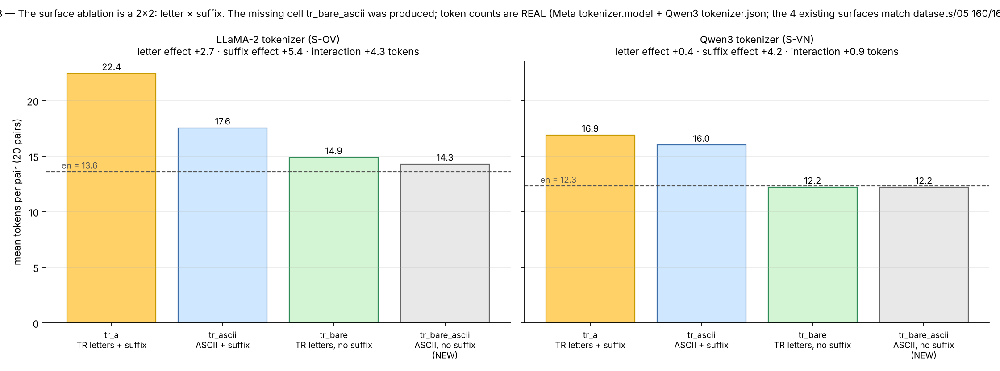

# Lecture 28 — Baseline + Ablation: What We Read Against, Which Difference Belongs to Which Factor — the Surface 2×2, Oracle Versions, Quantization, System Difference

**Phase 4 / Day 28** · **Time:** ~55 min (reading 40 + task 15)
**Prerequisites:** Lecture 19 (command-free ceiling, 1/k), Lecture 20 (`datasets/04` surfaces), Lecture 22 (two tokenizers, letter cost), Lecture 24 (MT, parser, code-switching), Lecture 26 (RQs), Lecture 27 (matrix, `budget.py`) · **Code:** `code/day28/` (`ablation_check.py` real surface analysis + real tokenizer counts, `price_ablations.py` budget, `plot_day28.py` — all three ran in this session) · **Output:** `thesis/ablation-plan.md` v0.1, `thesis/experiment-matrix.csv` v0.2 (+3 cells)

> **Today in one sentence:** A difference can be attributed to a factor only if a single factor changes between the two conditions; today's real check shows this holds only half the time on RQ-b's surface axis: `tr_a → tr_ascii` changes only the letters in 20 of 20 pairs, but `tr_a → tr_bare` strips the suffixes and also deletes 66 of the 97 Turkish letters — so the surface axis turns into a four-cell 2×2 (letters × suffixes), the missing cell `tr_bare_ascii` was generated (in LLaMA-2 letters +2.7, suffixes +5.4, interaction +4.3 tokens; in Qwen3 +0.4 / +4.2 / +0.9), the "oracle" versions of MT and the parser fall onto the `clean` cell without needing new episodes, the quantization ablation is actually two-factor, and the S-OV vs S-VN difference is never an ablation, it is a **descriptive comparison**.

---

## 1. Baseline and ablation: two separate questions

Lecture 27 wrote *what will be run*. Today two more questions:

- **Baseline:** What do I read a number against? If `tr_a` comes out at 70% on Spatial, is that good or bad? If `clean` is 85% it is bad; if `empty` is also 70% then Turkish has added nothing; if the command-free ceiling is 90% (Lecture 19: on Spatial 9 of 10 tasks can be solved from the scene) this number says almost nothing about language.
- **Ablation:** Which factor can I attribute the difference between two conditions to? If there is a 15-point difference between `tr_a` and `tr_ascii`, for me to write it as "Turkish letters" *only* the letters must have changed between the two commands.

The term "ablation" comes from neuroscience: remove a region of the brain and see which function is lost. Meyes et al. (2019) carried the same idea to artificial neural networks and examined how the network's behavior changes by removing units one at a time. Lipton & Steinhardt (2018) list exactly its absence among the "troubling trends" in machine learning publications: if a paper makes several changes at once and ties the gain to a single idea, where the gain comes from stays unclear. In our thesis the "change" is not the model architecture but the command itself; but the logic is the same.

The baselines are already in the matrix; they need no new cells (`thesis/ablation-plan.md` table 1):

| baseline | what it says | from where |
|---|---|---|
| **Command-free ceiling / 1/k** | the highest success reachable without language: Spatial 9/10, Goal 1/10 | Lecture 19, analytic (no episodes) |
| **`empty`** | the *real* success of the language-free policy; the reference of H0-a2 | A1–A4, B5 |
| **`wrong`** | does the model follow the language (faithful), does it choose the target from the scene (biased) | A1–A4 |
| **`clean`** | upper reference; Δ(tr − clean) | A1–A4 |
| **EN-B** | English recipe not in training; external reference LangGap's Spatial Description cell (π0.5 11%, 5 tasks) | B3, B4 |
| **published numbers** | system calibration (S-OV Spatial 84.7 ± 0.9) | K1, K2 |

One baseline I leave out on purpose: "random action" or "zero action". On LIBERO both give ~0% and separate no hypothesis; the ceiling and the floor are already drawn by `clean` and `empty`. Link to the thesis: the claim of Turkish spatial grounding is meaningful only in the interval above `empty` and below the command-free ceiling; this interval is narrow on Spatial (almost non-existent on task 0), wide on Goal. This is the baseline-language counterpart of Lecture 19's "weight to Goal" suggestion.

---

## 2. Surface ablation: we thought a three-step ladder, a 2×2 came out

Lecture 26 defined RQ-b's surface axis with four Turkish forms (`datasets/04`): `tr_a` (generated, with Turkish letters, with suffixes), `tr_b` (hand-written), `tr_ascii` (letters folded to ASCII), `tr_bare` (suffixes stripped). Lecture 27's "Next lecture" paragraph wrote this as a ladder: `tr_a → tr_ascii → tr_bare`, each step one factor (letters, suffixes, both). `ablation_check.py` tested this claim on real data in each of the 20 pairs:

| check | result |
|---|---|
| `tr_a` after removing the hyphens in `tr_a_seg` | 20/20 |
| letter step: `fold(tr_a) == tr_ascii` (same words, suffixes, order; only ç/ğ/ı/ö/ş/ü change) | **20/20** |
| suffix step: every word of `tr_bare` is the stem of `tr_a_seg` (undoing consonant softening if needed: *tabağ-ın → tabak*) | **20/20** |
| word count `tr_a` = `tr_bare` | 20/20 |
| suffix count | 111 in `tr_a` (5.5 per pair), 0 in `tr_bare` |
| Turkish letter count | `tr_a` 97, `tr_ascii` 0, **`tr_bare` 31** |

The last row is the problem itself. The suffix step strips the suffixes but **also takes away 66 (68%) of the Turkish letters**: the *ı/ü* in the suffixes (*ara-sı-nda-ki*, *üst-ü-ne*) and the softened stem endings (*tabağ-* → *tabak*). So the `tr_a − tr_bare` difference is not "the cost of suffixes", but the cost of "suffixes + two thirds of the Turkish letters".

And the "third step" (`tr_ascii → tr_bare`) is not a single step at all: it *brings the letters back* (0 → 31) and deletes the suffixes — two factors in opposite directions. The ladder was drawn wrong. The right thing is a two-factor design:

| | with suffixes | without suffixes |
|---|---|---|
| **Turkish letters** | `tr_a` | `tr_bare` |
| **ASCII** | `tr_ascii` | **`tr_bare_ascii`** (missing cell) |

The script produces the missing cell (by folding `tr_bare` to ASCII; the `results/ablation_surface.csv` column). Now every effect can be read *with the other factor held fixed*: letter effect = the average of (`tr_a − tr_ascii`) and (`tr_bare − tr_bare_ascii`); suffix effect = the average of (`tr_a − tr_bare`) and (`tr_ascii − tr_bare_ascii`); interaction = the difference of the letter effect in suffixed and suffix-less words. The clean measurement of the suffix effect is in the ASCII row: `tr_ascii − tr_bare_ascii`, because there neither side has Turkish letters.

---

## 3. The 2×2 on the token side: the letter cost grows with suffixes in LLaMA-2

Before running episodes we can measure the **input** side of the 2×2: how many tokens is each surface? I downloaded Lecture 22's tokenizers again (Meta `tokenizer.model`, sha256 `9e556afd…` identical; npm `@lenml/tokenizer-qwen3` `tokenizer.json`). The counts of the four existing surfaces came out **160/160 identical** to `datasets/05` `tokens.csv` (4 surfaces × 20 pairs × 2 tokenizers); the new `tr_bare_ascii` was counted with the same tokenizers:

| tokenizer | en | `tr_a` | `tr_ascii` | `tr_bare` | `tr_bare_ascii` | letter effect | suffix effect | interaction |
|---|---|---|---|---|---|---|---|---|
| LLaMA-2 (S-OV) | 13.6 | 22.4 | 17.6 | 14.9 | 14.3 | **+2.7** | **+5.4** | **+4.3** |
| Qwen3 (S-VN) | 12.3 | 16.9 | 16.0 | 12.2 | 12.2 | +0.4 | +4.2 | +0.9 |

Three readings:

1. **In LLaMA-2 the letter cost is large in a suffixed word and almost zero in a suffix-less one** (suffixed: 22.4 − 17.6 = 4.8; suffix-less: 14.9 − 14.3 = 0.6). The reason is that the 32,000-piece SentencePiece vocabulary has no Turkish-lettered suffix strings like *-ını*, *-üne*: if the letter is inside the suffix the word is split into byte fragments (Lecture 22). Lecture 22's "Turkish-letter cost 4.9 tokens" figure was actually an interaction measured on suffixed words.
2. **In Qwen3 the letter is almost free (+0.4), the suffix cost is close to LLaMA-2's (+4.2).** The 151-thousand-piece byte-level BPE keeps Turkish letters as a single piece; but the suffixes are still separate pieces. So between the two systems there is a *letter* difference and no *suffix* difference — RQ-b's "tr_ascii in opposite directions in the two systems" hypothesis (Lecture 26) is sharper with this table: the opposition is expected in the letter effect, not in the suffix effect.
3. **`tr_bare_ascii` equals English in length** (Qwen3 12.2 vs 12.3; LLaMA-2 14.3 vs 13.6). So at this corner of the 2×2 the *token length* covariate almost disappears: if `tr_bare_ascii` still fails, the reason is not length but the words themselves (Turkish stems).

All of these are **input** measurements; how they reflect on success rate is a hypothesis and the job of cell AB1. The reading rule written in advance (`ablation-plan.md`): if the letter ablation comes out ≥ 15 points in S-OV and within TOST δ = 15 in S-VN, "the letter cost is consistent with tokenization" — Tatar et al.'s hypothesis (Lecture 5) would be tested in closed loop for the first time.

A warning for the interaction: by Gelman's (2018) calculation the standard error of an interaction is twice that of a main effect; if the interaction is half the size of the main effect, **16 times** the sample is needed for the same power. In Lecture 27's lean matrix n = 120 per block catches 13 points in a main effect; it does not in an interaction. That is why the interaction is written in the thesis only in "direction" mode.

---

## 4. Oracle versions: ablations that need no new episodes

For RQ-c's two interventions (MT translation layer, rule-based parser) the natural ablation is the **oracle** version: what would happen if the component worked perfectly? The oracle of MT is human translation, the oracle of the parser is the correct English template. The question of how much of the gap comes from the component's error and how much from the model is answered here.

Something interesting happens in our design: on blocks A and C `tr_a` was already generated from LIBERO's English command (`datasets/04`). So the perfect English translation of `tr_a` is **the `clean` command itself**. The oracle cell needs no new episodes: the `clean` episodes in A1–A4 are the oracle's result. On block B the oracle is EN-B (B3/B4). Both are already in the matrix. Combined with Lecture 27's string cache the decomposition becomes exact. Since S-OV is greedy (`do_sample=False`), every episode whose MT output is identical to `clean` is the `clean` episode itself; the different ones are the episodes carrying translation errors. Therefore

`κ_MT = [SR(tr_mt) − SR(tr_a)] / [SR(clean) − SR(tr_a)]`, the oracle's κ is 1 by definition, and **1 − κ_MT is directly "the share of the gap that comes from translation error"**. No extra runs are needed.

For the parser the same calculation hides a trap. In Lecture 24 the parser was written by looking at `datasets/04` and translated 79 of the set's 80 sentences exactly. On A/C κ_parser ≈ 1 will come out, but this is a **tautology**: the parser's test data is its training data. The real evidence is the held-out set (12 new sentences, 5/12 correct). In the thesis the parser's A/C result is written as an "upper bound", not as evidence. This is an example that a re-reading as an ablation may not be *valid* even when it is possible.

---

## 5. Code-switching and quantization: one is a clean ablation, the other two-factor

**Code-switching (`tr_cs`, AB3).** Chen et al. (Jun 2026) showed that when the skeleton of the sentence is left in the target language and the keywords are written in English, the drop on LIBERO shrinks markedly. On OpenVLA-OFT full translation zh/fr/ru/ar −28.6 / −28.6 / −27.8 / −29.8 points; with keywords left in English −25.3 / −14.3 / −17.4 / −17.0. On π0.5 −39.6…−41.4 → −13.8…−21.9 (Table 1 vs Table 3; Lecture 24). Its counterpart for us is `tr_cs`: *"plate ile ramekin arasındaki black bowl'u al…"*. `tr_cs − tr_a` changes a single factor (the language of the object names), the relation suffix and the skeleton stay Turkish. This is the ablation that most directly separates the spatial grounding question: if the drop comes from the object name, it means the relation suffixes are read. But the `tr_cs` surface has not been written yet (the Lecture 24 log's v0.3 proposal); Turkish suffix harmony (*bowl'u*, *plate'in*) is too variable to generate by rules, a human must write it. The cell is in the AB3 extension, **blocked**.

**Quantization (K3).** In Lecture 27 we set K3 up as a "quantization ablation": the same 25 init states with S-OV bf16 (Mac MPS) vs S-OV 4-bit NF4 (T4 CUDA). Looking again with today's rule, two factors change: numeric precision **and** device/kernel (MPS's bf16 matmuls vs CUDA's 4-bit dequantize + fp16 kernels). Because bf16 S-OV does not fit on the T4 (16.8 GB) and there is no `bitsandbytes` on the Mac, we cannot separate the two. K3 is still valuable; its name changes: "the difference between S-OV-4bit-T4 and S-OV-bf16-MPS". In the thesis one does not write "quantization lowered X points", but "the 4-bit T4 setup differs from the bf16 Mac setup by X points". But the real question is still answered: is the Turkish gap (`clean − tr_a`) the same in the two setups? This is a difference-in-differences, and if the device difference acts equally on both conditions it cancels (**hypothesis**).

---

## 6. System difference: why it is never an ablation

Between S-OV and S-VN three things change together: the backbone (LLaMA-2-7B + DINOv2/SigLIP ↔ Qwen3-VL-2B), the action head (256-bin tokens, chunk 1 ↔ flow-matching, chunk 8) and the training data/recipe. To separate this, Chen et al. attached the same action heads to different backbones in the StarVLA framework and compared. The result is a warning: on the same Qwen3-VL backbone the OFT head drops −47 in Arabic, the GR00T head −36 points (Lectures 25–26). So you cannot form the sentence "the backbone reads Turkish better" without holding the head fixed.

Setting up this design on our budget would mean training at least one new VLA from scratch on LIBERO. Even Lecture 24's single QLoRA estimate was 65–98 T4 hours. Out of scope. I write the decision in advance: **the S-OV − S-VN comparison is descriptive**. In the thesis "the S-VN system drops less in Turkish" may be written, "Qwen3-VL understands Turkish better" may not. The only *ablation-like* reading that can be done between the two systems is the 2×2 itself. That the letter effect shows up in S-OV and not in S-VN, and the suffix effect shows up in both, is a pattern *consistent* with the tokenizer difference. Consistency is not evidence, but it is the closest place to a causal sentence.

---

## 7. Price: matrix v0.2

The ablations that need new episodes added three cells to the matrix; `price_ablations.py` imported Lecture 27's `budget.py` and priced them with the same model (it does not touch Lecture 27's `results/` folder; the v0.1 copy is `code/day28/results/experiment-matrix_v0.1.csv`):

| cell | what | tier | T4 hours (middle; optimistic–pessimistic) |
|---|---|---|---|
| **AB1** | `tr_bare`, `tr_bare_ascii` × Goal C × two systems (the two missing cells of the 2×2; `tr_a`, `tr_ascii` from A2/A4/B1/B2) | core | 46 (27–90) |
| AB2 | the same on Spatial A | extension | 35 (21–68) |
| AB3 | `tr_cs` × A+C × two systems | extension, blocked | 34 (20–67) |
| B6 (changed) | only `tr_b` (`tr_bare` moved to AB1/AB2) | extension | 37 (was 78) |

Total pilot + core: v0.1 258 → **v0.2 303 h** (middle; 178–594), ≈ 10.1 Kaggle weeks. In the lean matrix (20 init per task) 108 → **126 h**, ≈ 4.2 weeks (with T4×2 ~2.1). Extension 225 → 254. My justification for taking AB1 into the core: without it RQ-b's "letter or suffix" question is answered only on the input side (token count), not on the behavior side. My justification for choosing Goal C: on Goal the command-free ceiling is 1/10, so the language effect is visible (on Spatial `empty` may already be high).

---

## 8. Bridges for the software developer

- **Ablation = a single-variable A/B test.** If in one PR you both add a cache and rewrite the query, you cannot know which to credit for the p99 improvement; you turn the feature flags on one at a time. `tr_a → tr_bare` flipped two flags at once (suffixes + 68% of the letters); the 2×2 is the four combinations of two flags.
- **2×2 = a parametric test, `[Theory]` + `[InlineData]`.** `(letters: TR, suffix: present)`, `(ASCII, present)`, `(TR, absent)`, `(ASCII, absent)`: a four-row test matrix. The missing row (`tr_bare_ascii`) is an unwritten test case; red in the coverage report.
- **Oracle = a mocked dependency.** You replace the MT service with a stub that "always returns the correct translation" and run the end-to-end test; the remaining error is the downstream's (the model's). In our case the stub's output is already known (`clean`), so the result is in the cache without even running the test.
- **Parser tautology = testing with the training data.** Like writing unit tests by looking at the implementation and saying "100% passed". The held-out set is the real integration test.
- **K3 = "Debug-on-Mac vs Release-on-Linux".** Two things change at once (build configuration and platform). You cannot attribute the difference to either, but the question "is the same regression present in both environments" (difference-in-differences) is still answered.
- **System difference = two different tech stacks.** Comparing a Go service with a .NET service is not a language comparison: runtime, libraries and team change together. "Which is faster" is descriptive; for "why" you would have to write the same service in both languages (StarVLA).

---

## 9. Today's task (15 min)

Open `code/day28/results/ablation_surface.csv`, read the 20 sentences in the `tr_bare_ascii` column. For each write one word: **understandable** / **ambiguous** / **nonsensical** (e.g. would a Turkish speaker still read *kase tabak ust koy* as "kâseyi tabağın üstüne koy"?). This is a check of whether the outermost corner of the 2×2 is still the same instruction *for a human*. If any sentence comes out ambiguous (*sol siyah kase al…* which bowl?), it means that in that pair the suffix ablation also changes the meaning; note it in `thesis/ablation-plan.md` as "pairs to drop from the suffix ablation". Then compare the output of `cd code/day28 && python ablation_check.py` (tokenizer-less mode; the numbers come from `datasets/05`) with the summary. Commit: `Lecture 28: tr_bare_ascii human check`.

## If you get stuck

| Symptom | Fix |
|---|---|
| `ablation_check.py` in tokenizer-less mode, `tr_bare_ascii` columns empty | Normal: the new surface is not in `datasets/05`. For counting give `--llama tokenizer.model --qwen package/models/tokenizer.json` (download commands in `code/day25/README.md`) |
| `ModuleNotFoundError: sentencepiece` / `tokenizers` | `pip install sentencepiece tokenizers` |
| `datasets/05 tokens.csv cross-check: mismatches > 0` | A different tokenizer file: the Meta `tokenizer.model` sha256 must be `9e556afd…`; for Qwen npm `@lenml/tokenizer-qwen3` |
| `price_ablations.py`: `ModuleNotFoundError: budget` | Run the script from inside `code/day28/`; the `../day27/budget.py` path is relative |
| "suffix step strips only suffixes" is not 20/20 | `tr_bare` or `tr_a_seg` in `datasets/04` may have been changed by hand; look at the pair id in the output (consonant softening: *tabağ-* → *tabak*, but *sağ-da-ki* → *sağ*) |
| `plot_day28.py`: `budget_v01_v02.csv` missing | Run `price_ablations.py` first |

---

## Next lecture (Lecture 29)
**A one-page thesis proposal draft (in English, with the Turkish title).** The pieces accumulated over four lectures come down to a single page: Lecture 25's thesis sentences (claim / chain of evidence / condition), Lecture 26's three RQs, Lecture 27's matrix and budget, today's baseline + ablation plan. Output `thesis/proposal-v0.1.md`: title, problem and motivation ("language is the compressed form of the world, not the world itself"), aim and RQs, method (two systems, LIBERO Spatial/Goal, four conditions + surface 2×2, paired McNemar/TOST), expected contribution (the Turkish × closed-loop × counterfactual cell is empty), schedule (a Gantt from the budget hours) and a risk table. The one-page constraint will force choosing what is the core of the thesis and what is extension.

---

## References
- Outputs: `thesis/ablation-plan.md` v0.1, `thesis/experiment-matrix.csv` v0.2 (AB1–AB3, B6 changed). Inputs: `datasets/04-tr-spatial-commands/data/pairs.csv` (20 pairs × `tr_a`, `tr_a_seg`, `tr_ascii`, `tr_bare`), `datasets/05-tokenization-tr-commands/data/tokens.csv` (Lecture 22), Lecture 19 (command-free ceiling), Lecture 24 (parser 79/80, held-out 5/12; code-switching numbers), Lecture 27 (`budget.py`, K3).
- **[1]** Meyes, Lu, de Puiseau, Meisen (2019). *Ablation Studies in Artificial Neural Networks.* [arXiv:1901.08644](https://arxiv.org/abs/1901.08644): applying the ablation idea borrowed from neuroscience to artificial neural networks.
- **[2]** Lipton, Steinhardt (2018). *Troubling Trends in Machine Learning Scholarship.* [arXiv:1807.03341](https://arxiv.org/abs/1807.03341): a critique of work that does not separate the source of the gain (no ablations).
- **[3]** Gelman (2018). *You need 16 times the sample size to estimate an interaction than to estimate a main effect.* [statmodeling.stat.columbia.edu](https://statmodeling.stat.columbia.edu/2018/03/15/need16/) · [2023 explanation](https://statmodeling.stat.columbia.edu/2023/11/09/you-need-16-times-the-sample-size-to-estimate-an-interaction-than-to-estimate-a-main-effect-explained/): the SE of an interaction is 2× that of a main effect.
- **[4]** Chen et al. (2026). *Beyond English: Uncovering the Multilingual Gap in Vision-Language-Action Models.* [arXiv:2606.15714](https://arxiv.org/abs/2606.15714): Table 1 (full translation), Table 3 (code-switching), the StarVLA setup (same head, different backbone; OFT ar −47, GR00T −36). Hou, Zhao (2026). *LangGap.* [arXiv:2603.00592](https://arxiv.org/abs/2603.00592): Spatial Description 11% (external reference for EN-B).
- **[5]** Tokenizers: Meta LLaMA-2 `tokenizer.model` ([karpathy/llama2.c](https://github.com/karpathy/llama2.c) copy, sha256 `9e556afd44213b6bd1be2b850ebbbd98f5481437a8021afaf58ee7fb1818d347`); Qwen3 `tokenizer.json` (npm [`@lenml/tokenizer-qwen3`](https://www.npmjs.com/package/@lenml/tokenizer-qwen3)). OpenVLA [arXiv:2406.09246](https://arxiv.org/abs/2406.09246) (Spatial 84.7 ± 0.9; `do_sample=False`).
- Code: `code/day28/`. `ablation_check.py` ran in this session with the real tokenizers (`results/ablation_surface.csv`, `results/summary.md`; 160/160 identical with datasets/05). `price_ablations.py` ran (`results/budget_v01_v02.csv`, `results/ablation_cells.csv`). `plot_day28.py` ran.
- Figures: 01 and 05 are Mermaid (`.mmd` alongside). 02 and 03 are **real** (surface analysis + tokenizer counts). 04 is Lecture 27's budget model (**model estimate**: t_call is a scenario). The model was not run in this session; everything about success rate is hypothesis.
