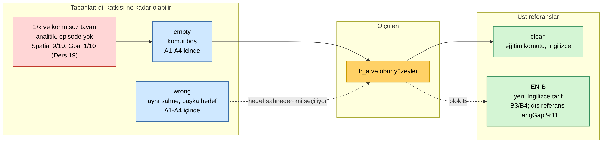
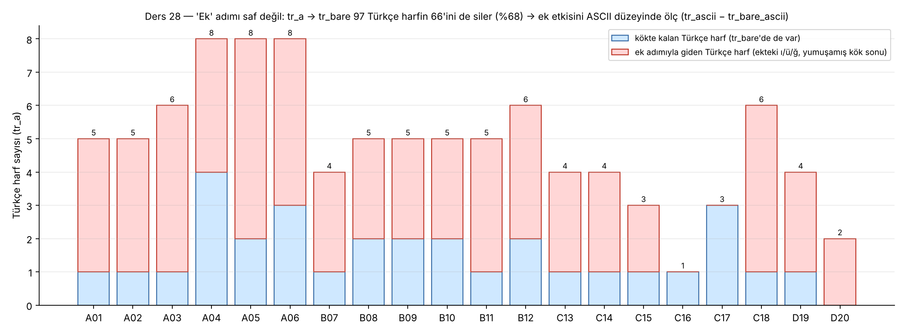
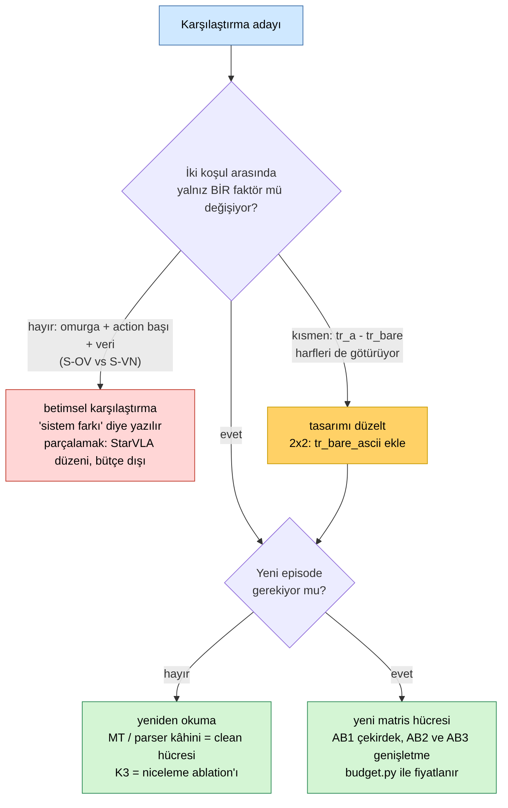
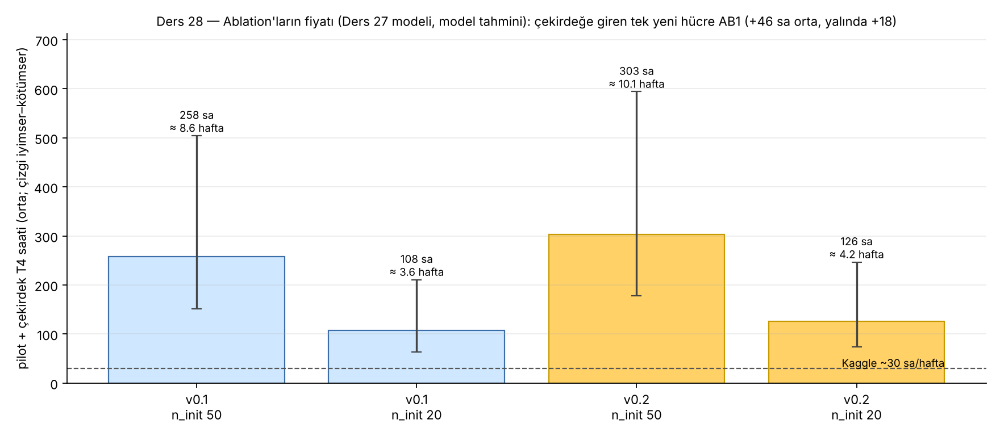

# Ders 28 — Baseline + Ablation: Neye Göre Okuyoruz, Hangi Fark Hangi Faktörün — Yüzey 2×2'si, Kâhin Sürümleri, Niceleme, Sistem Farkı

**Faz 4 / Gün 28** · **Süre:** ~55 dk (okuma 40 + görev 15)
**Ön koşul:** Ders 19 (komutsuz tavan, 1/k), Ders 20 (`datasets/04` yüzeyleri), Ders 22 (iki tokenizer, harf bedeli), Ders 24 (MT, parser, code-switching), Ders 26 (RQ'lar), Ders 27 (matris, `budget.py`) · **Kod:** `code/day28/` (`ablation_check.py` gerçek yüzey analizi + gerçek tokenizer sayımı, `price_ablations.py` bütçe, `plot_day28.py` — üçü de bu oturumda koştu) · **Çıktı:** `thesis/ablation-plan.md` v0.1, `thesis/experiment-matrix.csv` v0.2 (+3 hücre)

> **Bugünün tek cümlesi:** Bir fark ancak iki koşul arasında tek bir faktör değişiyorsa o faktöre yazılabilir; bugünkü gerçek kontrol bunun RQ-b'nin yüzey ekseninde yarı yarıya tuttuğunu gösteriyor: `tr_a → tr_ascii` 20 çiftin 20'sinde yalnızca harfleri değiştiriyor, ama `tr_a → tr_bare` ekleri soyarken 97 Türkçe harfin 66'sını da siliyor — bu yüzden yüzey ekseni dört hücreli bir 2×2'ye (harf × ek) dönüşüyor, eksik hücre `tr_bare_ascii` üretildi (LLaMA-2'de harf +2,7, ek +5,4, etkileşim +4,3 token; Qwen3'te +0,4 / +4,2 / +0,9), MT ve parser'ın "kâhin" sürümleri yeni episode istemeden `clean` hücresine düşüyor, niceleme ablation'ı aslında iki faktörlü ve S-OV ile S-VN farkı hiçbir zaman ablation değil, **betimsel karşılaştırma**.

---

## 1. Baseline ve ablation: iki ayrı soru

Ders 27 *ne koşulacağını* yazdı. Bugün iki soru daha:

- **Baseline:** Bir sayıyı neye göre okuyorum? `tr_a` Spatial'da %70 çıkarsa bu iyi mi kötü mü? `clean` %85 ise kötü; `empty` de %70 ise Türkçe hiçbir şey katmamış; komutsuz tavan %90 ise (Ders 19: Spatial'da 10 görevin 9'u sahneden çözülebilir) bu sayı dil hakkında neredeyse hiçbir şey söylemiyor.
- **Ablation:** İki koşul arasındaki farkı hangi faktöre yazabilirim? `tr_a` ile `tr_ascii` arasında 15 puan fark varsa bunu "Türkçe harfler" diye yazabilmem için iki komut arasında *yalnızca* harflerin değişmiş olması gerekir.

"Ablation" terimi sinirbilimden geliyor: beynin bir bölgesini çıkarıp hangi işlevin kaybolduğuna bakmak. Meyes vd. (2019) aynı fikri yapay sinir ağlarına taşıyıp birimleri tek tek çıkararak ağın davranışının nasıl değiştiğini incelediler. Lipton & Steinhardt (2018) makine öğrenmesi yayınlarındaki "sorunlu eğilimler" arasında tam bunun yokluğunu sayıyor: bir makale birkaç değişikliği birden yapıp kazancı tek bir fikre bağlıyorsa, kazancın nereden geldiği belirsiz kalır. Bizim tezde "değişiklik" model mimarisi değil komutun kendisi; ama mantık aynı.

Baseline'lar zaten matriste var; yeni hücre istemiyorlar (`thesis/ablation-plan.md` tablo 1):

| baseline | ne söyler | nereden |
|---|---|---|
| **Komutsuz tavan / 1/k** | dil olmadan erişilebilecek en yüksek başarı: Spatial 9/10, Goal 1/10 | Ders 19, analitik (episode yok) |
| **`empty`** | dilsiz politikanın *gerçek* başarısı; H0-a2'nin referansı | A1–A4, B5 |
| **`wrong`** | model dili izliyor mu (faithful), hedefi sahneden mi seçiyor (biased) | A1–A4 |
| **`clean`** | üst referans; Δ(tr − clean) | A1–A4 |
| **EN-B** | eğitimde olmayan İngilizce tarif; dış referans LangGap'in Spatial Description hücresi (π0.5 %11, 5 görev) | B3, B4 |
| **yayımlanan sayılar** | sistem kalibrasyonu (S-OV Spatial 84,7 ± 0,9) | K1, K2 |

Bir baseline'ı bilerek dışarıda bırakıyorum: "rastgele action" ya da "sıfır action". LIBERO'da ikisi de ~%0 verir ve hiçbir hipotezi ayırmaz; tavanı ve tabanı `clean` ile `empty` zaten çiziyor. Tez bağlantısı: Türkçe mekânsal grounding iddiası ancak `empty`'nin üstünde ve komutsuz tavanın altında bir aralıkta anlamlı; bu aralık Spatial'da dar (görev 0'da neredeyse yok), Goal'da geniş. Ders 19'un "ağırlık Goal'a" önerisinin baseline dilindeki karşılığı bu.

---

## 2. Yüzey ablation'ı: üç basamaklı merdiven sandık, 2×2 çıktı

Ders 26 RQ-b'nin yüzey eksenini dört Türkçe biçimle tanımladı (`datasets/04`): `tr_a` (üretilmiş, Türkçe harfli, ekli), `tr_b` (elle yazılmış), `tr_ascii` (harfler ASCII'ye katlanmış), `tr_bare` (ekler soyulmuş). Ders 27'nin "Sonraki ders" paragrafı bunu bir merdiven olarak yazdı: `tr_a → tr_ascii → tr_bare`, her basamak bir faktör (harf, ek, ikisi). `ablation_check.py` bu iddiayı 20 çiftin her birinde gerçek veriyle sınadı:

| kontrol | sonuç |
|---|---|
| `tr_a_seg`'deki tireler kaldırılınca `tr_a` | 20/20 |
| harf adımı: `fold(tr_a) == tr_ascii` (sözcük, ek, sıra aynı; yalnız ç/ğ/ı/ö/ş/ü değişiyor) | **20/20** |
| ek adımı: `tr_bare`'in her sözcüğü `tr_a_seg`'in kökü (gerekirse ünsüz yumuşaması geri alınarak: *tabağ-ın → tabak*) | **20/20** |
| sözcük sayısı `tr_a` = `tr_bare` | 20/20 |
| ek sayısı | `tr_a`'da 111 (çift başına 5,5), `tr_bare`'de 0 |
| Türkçe harf sayısı | `tr_a` 97, `tr_ascii` 0, **`tr_bare` 31** |

Son satır sorunun kendisi. Ek adımı ekleri soyuyor ama Türkçe harflerin **66'sını (%68) da götürüyor**: eklerdeki *ı/ü* (*ara-sı-nda-ki*, *üst-ü-ne*) ve yumuşamış kök sonları (*tabağ-* → *tabak*). Yani `tr_a − tr_bare` farkı "eklerin bedeli" değil, "ekler + Türkçe harflerin üçte ikisi"nin bedeli.

Ve "üçüncü basamak" (`tr_ascii → tr_bare`) aslında hiç tek adım değil: harfleri *geri getiriyor* (0 → 31) ve ekleri siliyor — iki faktör ters yönde. Merdiven yanlış çizilmiş. Doğrusu iki faktörlü bir tasarım:

| | ekli | eksiz |
|---|---|---|
| **Türkçe harf** | `tr_a` | `tr_bare` |
| **ASCII** | `tr_ascii` | **`tr_bare_ascii`** (eksik hücre) |

Eksik hücreyi script üretiyor (`tr_bare`'i ASCII'ye katlayarak; `results/ablation_surface.csv` sütunu). Artık her etki *öbür faktör sabitken* okunabilir: harf etkisi = (`tr_a − tr_ascii`) ve (`tr_bare − tr_bare_ascii`)'nin ortalaması; ek etkisi = (`tr_a − tr_bare`) ve (`tr_ascii − tr_bare_ascii`)'nin ortalaması; etkileşim = harf etkisinin ekli ve eksiz sözcükteki farkı. Ek etkisinin temiz ölçümü ASCII satırında: `tr_ascii − tr_bare_ascii`, çünkü orada iki tarafta da Türkçe harf yok.

---

## 3. Token tarafında 2×2: harf bedeli LLaMA-2'de eklerle büyüyor

Episode koşmadan önce 2×2'nin **girdi** tarafını ölçebiliriz: her yüzey kaç token? Ders 22'nin tokenizer'larını yeniden indirdim (Meta `tokenizer.model`, sha256 `9e556afd…` aynı; npm `@lenml/tokenizer-qwen3` `tokenizer.json`). Mevcut dört yüzeyin sayımı `datasets/05` `tokens.csv` ile **160/160 birebir** çıktı (4 yüzey × 20 çift × 2 tokenizer); yeni `tr_bare_ascii` aynı tokenizer'larla sayıldı:

| tokenizer | en | `tr_a` | `tr_ascii` | `tr_bare` | `tr_bare_ascii` | harf etkisi | ek etkisi | etkileşim |
|---|---|---|---|---|---|---|---|---|
| LLaMA-2 (S-OV) | 13,6 | 22,4 | 17,6 | 14,9 | 14,3 | **+2,7** | **+5,4** | **+4,3** |
| Qwen3 (S-VN) | 12,3 | 16,9 | 16,0 | 12,2 | 12,2 | +0,4 | +4,2 | +0,9 |

Üç okuma:

1. **LLaMA-2'de harf bedeli ekli sözcükte büyük, eksiz sözcükte neredeyse yok** (ekli: 22,4 − 17,6 = 4,8; eksiz: 14,9 − 14,3 = 0,6). Sebep, 32.000 parçalık SentencePiece dağarcığında *-ını*, *-üne* gibi Türkçe harfli ek dizilerinin bulunmaması: harf ekin içindeyse sözcük bayt kırıntılarına bölünüyor (Ders 22). Ders 22'nin "Türkçe harf bedeli 4,9 token" sayısı aslında ekli sözcükte ölçülmüş bir etkileşimdi.
2. **Qwen3'te harf neredeyse bedava (+0,4), ek bedeli LLaMA-2'ye yakın (+4,2).** 151 bin parçalık byte-level BPE Türkçe harfleri tek parça tutuyor; ama ekler yine ayrı parça. Yani iki sistem arasında *harf* farkı var, *ek* farkı yok — RQ-b'nin "tr_ascii iki sistemde zıt yön" hipotezi (Ders 26) bu tabloyla daha keskin: zıtlık harf etkisinde beklenir, ek etkisinde beklenmez.
3. **`tr_bare_ascii` uzunluk olarak İngilizce'ye eşit** (Qwen3 12,2 vs 12,3; LLaMA-2 14,3 vs 13,6). Yani 2×2'nin bu köşesinde *token uzunluğu* ortak değişkeni neredeyse ortadan kalkıyor: `tr_bare_ascii` hâlâ başarısızsa sebep uzunluk değil, sözcüklerin kendisi (Türkçe kökler).

Bunların hepsi **girdi** ölçümü; success rate'e nasıl yansıdığı hipotez ve AB1 hücresinin işi. Önceden yazılan okuma kuralı (`ablation-plan.md`): harf ablation'ı S-OV'de ≥ 15 puan ve S-VN'de TOST δ = 15 içinde çıkarsa "harf bedeli tokenizasyonla uyumlu" — Tatar vd.'nin hipotezi (Ders 5) ilk kez kapalı döngüde sınanmış olur.

Etkileşim için bir uyarı: Gelman'ın (2018) hesabıyla etkileşimin standart hatası ana etkinin iki katıdır; etkileşim ana etkinin yarısı büyüklüğündeyse aynı güç için **16 kat** örneklem gerekir. Ders 27'nin yalın matrisinde blok başına n = 120 ana etkide 13 puanı yakalıyor; etkileşimde yakalamaz. Bu yüzden etkileşim tezde yalnızca "yön" kipinde yazılır.

---

## 4. Kâhin sürümleri: yeni episode istemeyen ablation'lar

RQ-c'nin iki müdahalesi (MT çeviri katmanı, kural tabanlı parser) için doğal ablation **kâhin** (oracle) sürümüdür: bileşen kusursuz çalışsaydı ne olurdu? MT'nin kâhini insan çevirisi, parser'ın kâhini doğru İngilizce şablon. Açığın ne kadarı bileşenin hatasından, ne kadarı modelden geliyor sorusu buradan cevaplanır.

Bizim düzende ilginç bir şey oluyor: A ve C bloklarında `tr_a` zaten LIBERO'nun İngilizce komutundan üretildi (`datasets/04`). Yani `tr_a`'nın kusursuz İngilizce çevirisi **`clean` komutunun kendisi**. Kâhin hücresi yeni episode istemiyor: A1–A4'teki `clean` episode'ları kâhinin sonucu. B bloğunda kâhin EN-B (B3/B4). İkisi de zaten matriste. Ders 27'nin string önbelleğiyle birleşince ayrıştırma kesinleşiyor. S-OV greedy olduğu için (`do_sample=False`), MT çıktısı `clean`'le birebir aynı olan her episode `clean` episode'unun kendisi; farklı olanlar çeviri hatası taşıyan episode'lar. Dolayısıyla

`κ_MT = [SR(tr_mt) − SR(tr_a)] / [SR(clean) − SR(tr_a)]`, kâhinin κ'sı tanım gereği 1, ve **1 − κ_MT doğrudan "açığın çeviri hatasından gelen payı"**. Ek koşu gerekmiyor.

Parser'da aynı hesap bir tuzak içeriyor. Ders 24'te parser `datasets/04`'e bakılarak yazıldı ve setin 80 cümlesinin 79'unu birebir çevirdi. A/C'de κ_parser ≈ 1 çıkacak, ama bu bir **totoloji**: parser'ın test verisi eğitim verisi. Asıl kanıt held-out set (12 yeni cümle, 5/12 doğru). Tezde parser'ın A/C sonucu "üst sınır" diye yazılır, kanıt diye değil. Bu bir ablation'ın yeniden okuma olsa bile *geçerli* olmayabileceğine örnek.

---

## 5. Code-switching ve niceleme: biri temiz ablation, öbürü iki faktörlü

**Code-switching (`tr_cs`, AB3).** Chen vd. (Haz 2026) cümlenin iskeletini hedef dilde bırakıp anahtar sözcükleri İngilizce yazınca LIBERO'daki düşüşün belirgin biçimde küçüldüğünü gösterdi. OpenVLA-OFT'de tam çeviri zh/fr/ru/ar −28,6 / −28,6 / −27,8 / −29,8 puan; anahtar sözcükler İngilizce kalınca −25,3 / −14,3 / −17,4 / −17,0. π0.5'te −39,6…−41,4 → −13,8…−21,9 (Tablo 1 vs Tablo 3; Ders 24). Bizde bunun karşılığı `tr_cs`: *"plate ile ramekin arasındaki black bowl'u al…"*. `tr_cs − tr_a` tek bir faktörü değiştirir (nesne adlarının dili), ilişki eki ve iskelet Türkçe kalır. Mekânsal grounding sorusunu en doğrudan ayıran ablation bu: düşüş nesne adından geliyorsa ilişki ekleri okunuyor demektir. Ama `tr_cs` yüzeyi henüz yazılmadı (Ders 24 log'u v0.3 önerisi); Türkçe ek uyumu (*bowl'u*, *plate'in*) kural tabanlı üretilemeyecek kadar oynak, insan yazmalı. Hücre AB3 genişletmede, **engelli**.

**Niceleme (K3).** Ders 27'de K3'ü "niceleme ablation'ı" diye kurduk: aynı 25 init state'te S-OV bf16 (Mac MPS) ile S-OV 4-bit NF4 (T4 CUDA). Bugünkü kuralla yeniden bakınca iki faktör değişiyor: sayısal hassasiyet **ve** cihaz/çekirdek (MPS'in bf16 matmul'ları ile CUDA'nın 4-bit dequantize + fp16 çekirdekleri). T4'te bf16 S-OV sığmadığı (16,8 GB) ve Mac'te `bitsandbytes` olmadığı için ikisini ayıramıyoruz. K3 yine de değerli; adı değişiyor: "S-OV-4bit-T4 ile S-OV-bf16-MPS farkı". Tezde "niceleme X puan düşürdü" değil, "4-bit T4 kurulumu bf16 Mac kurulumundan X puan farklı" yazılır. Ama asıl soru yine cevaplanıyor: Türkçe açığı (`clean − tr_a`) iki kurulumda aynı mı? Bu bir fark-farkı (difference-in-differences) ve cihaz farkı her iki koşula eşit etki ediyorsa iptal olur (**hipotez**).

---

## 6. Sistem farkı: neden hiçbir zaman ablation değil

S-OV ile S-VN arasında üç şey birlikte değişiyor: omurga (LLaMA-2-7B + DINOv2/SigLIP ↔ Qwen3-VL-2B), action başı (256-bin token, chunk 1 ↔ flow-matching, chunk 8) ve eğitim verisi/tarifi. Chen vd. bunu ayırmak için StarVLA çerçevesinde aynı action başlarını farklı omurgalara takıp karşılaştırdı. Sonuç uyarıcı: aynı Qwen3-VL omurgasında OFT başı Arapça'da −47, GR00T başı −36 puan düşüyor (Ders 25–26). Yani "omurga Türkçe'yi daha iyi okuyor" cümlesini, baş sabit tutulmadan kuramazsın.

Bu düzeni bizim bütçemizde kurmak, en az bir yeni VLA'yı LIBERO'da sıfırdan eğitmek demek. Ders 24'ün tek bir QLoRA tahmini bile 65–98 T4 saatiydi. Kapsam dışı. Kararı önceden yazıyorum: **S-OV − S-VN karşılaştırması betimsel**. Tezde "S-VN sistemi Türkçe'de daha az düşüyor" yazılabilir, "Qwen3-VL Türkçe'yi daha iyi anlıyor" yazılamaz. İki sistem arasında yapılabilecek tek *ablation benzeri* okuma 2×2'nin kendisi. Harf etkisinin S-OV'de görünüp S-VN'de görünmemesi, ek etkisinin ikisinde de görünmesi, tokenizer farkıyla *uyumlu* bir örüntü. Uyumluluk kanıt değil, ama nedensel cümleye en yakın yer.

---

## 7. Fiyat: matris v0.2

Yeni episode isteyen ablation'lar matrise üç hücre ekledi; `price_ablations.py` Ders 27'nin `budget.py`'sini içe aktarıp aynı modelle fiyatladı (Ders 27'nin `results/` klasörüne dokunmuyor; v0.1 kopyası `code/day28/results/experiment-matrix_v0.1.csv`):

| hücre | ne | kat | T4 saati (orta; iyimser–kötümser) |
|---|---|---|---|
| **AB1** | `tr_bare`, `tr_bare_ascii` × Goal C × iki sistem (2×2'nin eksik iki hücresi; `tr_a`, `tr_ascii` A2/A4/B1/B2'den) | çekirdek | 46 (27–90) |
| AB2 | aynısı Spatial A'da | genişletme | 35 (21–68) |
| AB3 | `tr_cs` × A+C × iki sistem | genişletme, engelli | 34 (20–67) |
| B6 (değişti) | yalnız `tr_b` (`tr_bare` AB1/AB2'ye taşındı) | genişletme | 37 (önce 78) |

Toplam pilot + çekirdek: v0.1 258 → **v0.2 303 sa** (orta; 178–594), ≈ 10,1 Kaggle haftası. Yalın matriste (görev başına 20 init) 108 → **126 sa**, ≈ 4,2 hafta (T4×2 ile ~2,1). Genişletme 225 → 254. AB1'i çekirdeğe almamın gerekçesi: o olmadan RQ-b'nin "harf mi ek mi" sorusu yalnızca girdi tarafında (token sayısı) cevaplanır, davranış tarafında cevaplanmaz. Goal C'yi seçmemin gerekçesi: Goal'da komutsuz tavan 1/10, yani dil etkisi görünür (Spatial'da `empty` zaten yüksek olabilir).

---

## 8. Yazılımcı için köprüler

- **Ablation = tek değişkenli A/B testi.** Bir PR'da hem cache ekleyip hem sorguyu yeniden yazarsan p99 iyileşmesini hangisine yazacağını bilemezsin; feature flag'leri tek tek açarsın. `tr_a → tr_bare` iki flag'i birden çeviriyordu (ekler + harflerin %68'i); 2×2, iki flag'in dört kombinasyonu.
- **2×2 = parametrik test, `[Theory]` + `[InlineData]`.** `(harf: TR, ek: var)`, `(ASCII, var)`, `(TR, yok)`, `(ASCII, yok)`: dört satırlık test matrisi. Eksik satır (`tr_bare_ascii`) yazılmamış bir test case'i; kapsama raporunda kırmızı.
- **Kâhin = mock'lanmış bağımlılık.** MT servisini "her zaman doğru çeviriyi döndüren" bir stub ile değiştirip uçtan uca testi koşarsın; kalan hata downstream'in (modelin). Bizde stub'ın çıktısı zaten bilinen (`clean`), o yüzden test bile koşmadan sonuç cache'te.
- **Parser totolojisi = eğitim verisiyle test etmek.** Unit testleri implementasyona bakarak yazıp "%100 geçti" demek gibi. Held-out set gerçek entegrasyon testi.
- **K3 = "Debug-on-Mac vs Release-on-Linux".** İki şey birden değişiyor (build konfigürasyonu ve platform). Farkı birine yazamazsın, ama "iki ortamda aynı regresyon var mı" sorusu (fark-farkı) yine cevaplanır.
- **Sistem farkı = iki farklı tech stack.** Go servisi ile .NET servisini karşılaştırmak dil karşılaştırması değildir: runtime, kütüphane ve ekip birlikte değişiyor. "Hangisi daha hızlı" betimseldir; "neden" için aynı servisi iki dilde yazman gerekir (StarVLA).

---

## 9. Bugünün görevi (15 dk)

`code/day28/results/ablation_surface.csv`'yi aç, `tr_bare_ascii` sütunundaki 20 cümleyi oku. Her biri için tek kelimeyle yaz: **anlaşılır** / **belirsiz** / **anlamsız** (ör. *kase tabak ust koy* bir Türkçe konuşucuya hâlâ "kâseyi tabağın üstüne koy" der mi?). Bu, 2×2'nin en uç köşesinin *insan için* hâlâ aynı talimat olup olmadığının kontrolü. Belirsiz çıkan cümle varsa (*sol siyah kase al…* hangi kâse?), o çiftte ek ablation'ı anlamı da değiştiriyor demektir; `thesis/ablation-plan.md`'ye "ABL-ek'ten çıkarılacak çiftler" diye not et. Sonra `cd code/day28 && python ablation_check.py` (tokenizer'sız mod; sayılar `datasets/05`'ten) çıktısını özetle karşılaştır. Commit: `Ders 28: tr_bare_ascii insan kontrolü`.

## Takılırsan

| Belirti | Çözüm |
|---|---|
| `ablation_check.py` tokenizer'sız modda `tr_bare_ascii` sütunları boş | Normal: yeni yüzey `datasets/05`'te yok. Sayım için `--llama tokenizer.model --qwen package/models/tokenizer.json` ver (indirme komutları `code/day25/README.md`) |
| `ModuleNotFoundError: sentencepiece` / `tokenizers` | `pip install sentencepiece tokenizers` |
| `datasets/05 çapraz kontrol: uyuşmayan > 0` | Farklı bir tokenizer dosyası: Meta `tokenizer.model` sha256 `9e556afd…` olmalı; Qwen için npm `@lenml/tokenizer-qwen3` |
| `price_ablations.py`: `ModuleNotFoundError: budget` | Script'i `code/day28/` içinden çalıştır; `../day27/budget.py` yolu göreli |
| "ek adımı yalnız ek soyuyor" 20/20 değil | `datasets/04`'te `tr_bare` ya da `tr_a_seg` elle değişmiş olabilir; çıktıdaki çift kimliğine bak (ünsüz yumuşaması: *tabağ-* → *tabak*, ama *sağ-da-ki* → *sağ*) |
| `plot_day28.py`: `budget_v01_v02.csv` yok | Önce `price_ablations.py` |

---

## Sonraki ders (Ders 29)
**Bir sayfalık tez önerisi taslağı (Türkçe).** Dört ders boyunca biriken parçalar tek sayfaya iniyor: Ders 25'in tez cümleleri (iddia / kanıt zinciri / koşul), Ders 26'nın üç RQ'su, Ders 27'nin matrisi ve bütçesi, bugünkü baseline + ablation planı. Çıktı `thesis/proposal-v0.1.md`: başlık, problem ve motivasyon ("dil dünyanın sıkıştırılmış hâlidir, dünyanın kendisi değil"), amaç ve RQ'lar, yöntem (iki sistem, LIBERO Spatial/Goal, dört koşul + yüzey 2×2, eşli McNemar/TOST), beklenen katkı (Türkçe × kapalı döngü × karşı-olgusal hücre boş), takvim (bütçe saatlerinden Gantt) ve risk tablosu. Bir sayfa kısıtı, neyin tezin çekirdeği neyin genişletme olduğunu zorla seçtirecek.

---

## Kaynaklar
- Çıktılar: `thesis/ablation-plan.md` v0.1, `thesis/experiment-matrix.csv` v0.2 (AB1–AB3, B6 değişti). Girdiler: `datasets/04-tr-spatial-commands/data/pairs.csv` (20 çift × `tr_a`, `tr_a_seg`, `tr_ascii`, `tr_bare`), `datasets/05-tokenization-tr-commands/data/tokens.csv` (Ders 22), Ders 19 (komutsuz tavan), Ders 24 (parser 79/80, held-out 5/12; code-switching sayıları), Ders 27 (`budget.py`, K3).
- **[1]** Meyes, Lu, de Puiseau, Meisen (2019). *Ablation Studies in Artificial Neural Networks.* [arXiv:1901.08644](https://arxiv.org/abs/1901.08644): sinirbilimden ödünç alınan ablation fikrinin yapay sinir ağlarına uygulanması.
- **[2]** Lipton, Steinhardt (2018). *Troubling Trends in Machine Learning Scholarship.* [arXiv:1807.03341](https://arxiv.org/abs/1807.03341): kazancın kaynağını ayırmayan (ablation'sız) çalışmaların eleştirisi.
- **[3]** Gelman (2018). *You need 16 times the sample size to estimate an interaction than to estimate a main effect.* [statmodeling.stat.columbia.edu](https://statmodeling.stat.columbia.edu/2018/03/15/need16/) · [2023 açıklaması](https://statmodeling.stat.columbia.edu/2023/11/09/you-need-16-times-the-sample-size-to-estimate-an-interaction-than-to-estimate-a-main-effect-explained/): etkileşimin SE'si ana etkinin 2 katı.
- **[4]** Chen vd. (2026). *Beyond English: Uncovering the Multilingual Gap in Vision-Language-Action Models.* [arXiv:2606.15714](https://arxiv.org/abs/2606.15714): Tablo 1 (tam çeviri), Tablo 3 (code-switching), StarVLA düzeni (aynı baş, farklı omurga; OFT ar −47, GR00T −36). Hou, Zhao (2026). *LangGap.* [arXiv:2603.00592](https://arxiv.org/abs/2603.00592): Spatial Description %11 (EN-B dış referansı).
- **[5]** Tokenizer'lar: Meta LLaMA-2 `tokenizer.model` ([karpathy/llama2.c](https://github.com/karpathy/llama2.c) kopyası, sha256 `9e556afd44213b6bd1be2b850ebbbd98f5481437a8021afaf58ee7fb1818d347`); Qwen3 `tokenizer.json` (npm [`@lenml/tokenizer-qwen3`](https://www.npmjs.com/package/@lenml/tokenizer-qwen3)). OpenVLA [arXiv:2406.09246](https://arxiv.org/abs/2406.09246) (Spatial 84,7 ± 0,9; `do_sample=False`).
- Kod: `code/day28/`. `ablation_check.py` bu oturumda gerçek tokenizer'larla koştu (`results/ablation_surface.csv`, `results/summary.md`; datasets/05 ile 160/160 birebir). `price_ablations.py` koştu (`results/budget_v01_v02.csv`, `results/ablation_cells.csv`). `plot_day28.py` koştu.
- Görseller: 01 ve 05 Mermaid (`.mmd` yanında). 02 ve 03 **gerçek** (yüzey analizi + tokenizer sayımı). 04 Ders 27'nin bütçe modeli (**model tahmini**: t_call senaryo). Model bu oturumda çalıştırılmadı; success rate'e dair her şey hipotez.
