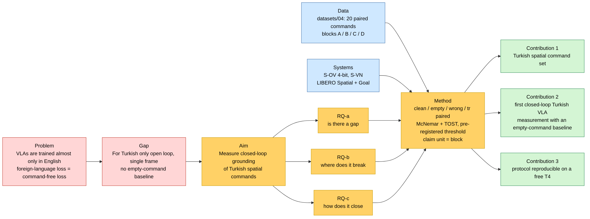
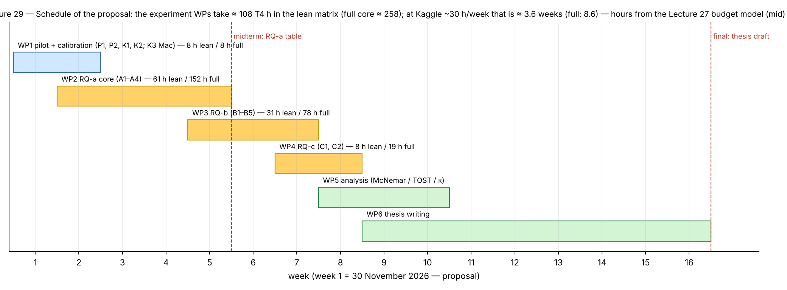
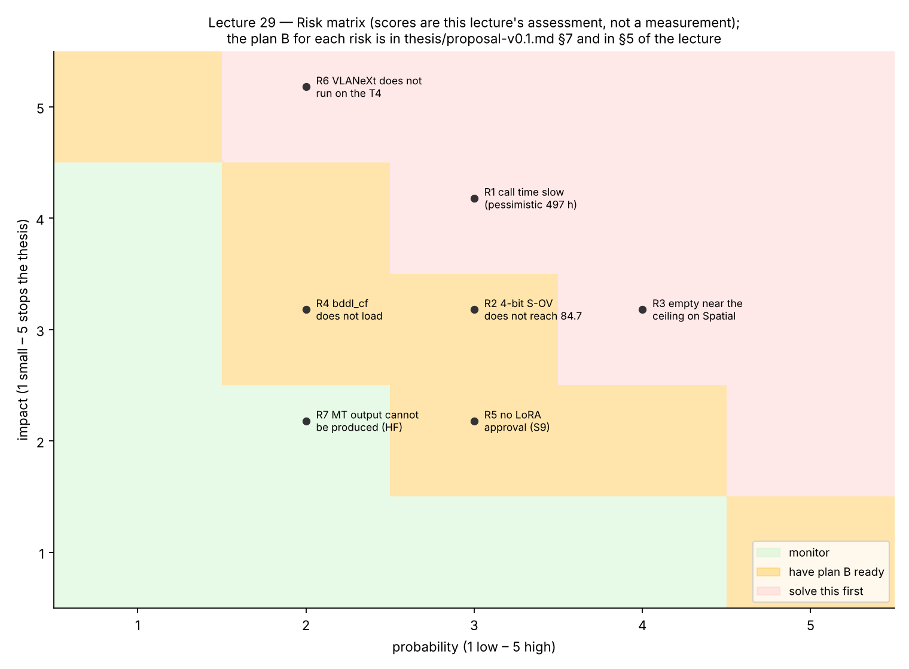

# Lecture 29 — Thesis Proposal: Problem, Aim, RQs, Method, Contribution, Schedule and Risk on One Page

**Phase 4 / Day 29** · **Time:** ~55 min (reading 40 + task 15)
**Prerequisites:** Lecture 26 (RQ-a/b/c, six fields), Lecture 27 (experiment matrix, budget, inverse power), Lecture 28 (baseline + ablation plan) · **Code:** `code/day29/` (`proposal_lint.py` draft check, `plot_day29.py` Gantt + risk matrix — both ran in this session) · **Output:** `thesis/proposal-v0.1.md` (680 words; every numeric claim tagged)

> **Today in one sentence:** Four weeks of work (RQs, matrix, budget, ablation) fit on one page, because the proposal is not the thesis itself but the answer given to a single question by the advisor and the institute: "*What will this student ask, how will they measure it, what will be in hand when it is done, and is this possible in four months with a free T4?*" — `thesis/proposal-v0.1.md` answers this question in seven sections (problem → gap → aim → three RQs → method → three contributions → schedule + risk). `proposal_lint.py` audited the draft: 680/700 words, 8/8 sections, all 12 of the 12 sentences containing numbers tagged `[Lecture NN]`, `[arXiv:…]` or `[proposal]`.

---

## 1. Why is the proposal one page — and who reads it?

A thesis proposal has two readers. One is the **advisor**: knows the subject better than you but has no time for details, and will decide in a single reading "is this work coherent, is it doable". The other is the **institute**: it will register the thesis topic and later check whether the thesis matches the proposed topic. Neither will read the evidence of 28 lectures; let the detail stay in the repo, the proposal *selects* from it.

The most solid checklist for this selection is DARPA's **Heilmeier questions**: what are you trying to do (without jargon)? How is it done today, what is the limit? What is new, why would it work? Who cares? What are the risks? How much and how long? What are the mid-term and final exams? Figure 04 shows the draft's counterparts of these seven questions. There is a section corresponding to every question; a question without an answer means a missing section.


**An honest status on the ALKU form:** on the student forms page of the ALKU (Alanya Alaaddin Keykubat University) Graduate School there is a thesis topic proposal form (the doctoral version `FR-320`; the master's version is also listed on the same page). But in this session I could not read the insides of the forms; I could not verify the section headings or the page/word limit. The same uncertainty applies to two topics: until when a thesis topic must be reported to the institute in a thesis master's programme, and whether the proposal asks for a Turkish/English abstract. These two **will be asked of the advisor** (Lecture 30 list). The draft's sections were written according to the common skeleton of Turkish institute forms and the TÜBİTAK 2210-C thesis proposal form (July 2026 version published): topic and significance, aim, method, work-time plan, risks, expected contribution. I also did not directly read the headings of the 2210-C form in this session. The known structure of ARDEB forms (original value / method / project management: work-time + risk / broad impact) is a **hypothesis**: when you open the form, match the headings. The draft's sections already distribute exactly onto these four headings. If the form asks for a different order the content does not change, it is only reordered.

---

## 2. The argument chain: each section answers the previous one's question

A good proposal is not a list of sections but a chain: the problem gives rise to a gap, the gap to the aim, the aim to the questions, the questions to the method, the method to the contributions. If one link of the chain breaks the reader stops there. For example if a contribution comes out of no RQ, or an RQ has no counterpart in the method, the reader gets stuck there.



The links in the draft and the basis of each:

| link | in the draft | basis |
|---|---|---|
| **Problem** | VLAs are almost only English; with a Korean command Spatial 97.6 → 49.2; foreign-language loss ≈ command-free loss (−27.8…−29.8 vs −27.5) | Dong et al. 2606.11906; Chen et al. 2606.15714 (Lectures 15, 24) |
| **Gap** | For Turkish the only study is open-loop, single frame; no empty-command baseline | Tatar et al. 2026 SIU (Lecture 5); literature map (Lecture 26) |
| **Aim** | measure closed-loop, relative to the empty-command baseline; find where the drop is; test the cheap fix | Lecture 25's three thesis sentences |
| **RQs** | is there a gap / where / how does it close | Lecture 26 |
| **Method** | LIBERO Spatial + Goal, 20 paired commands, 2 systems, 4 conditions, McNemar + TOST, claim at the block level | Lectures 18, 20, 26, 27 |
| **Contributions** | command set / first closed-loop Turkish measurement / reproducible protocol | Lectures 20, 22, 27 |

The motivation sentence is from the advisor's slide: *"Language is a beautiful compression of the world, but it is not the world"* (Pat Grady; Lecture 1). In the proposal this sentence is not decoration, it is the problem itself: the command is a compressed description of the world. If the model cannot unpack that description and attach it to the scene, a Turkish command is no different to it from an empty command. The empty-command baseline measures exactly this. The thesis axis thus comes down to a single sentence: *In the same scene, in two open VLAs, how far does a Turkish spatial description separate from the empty command?*

---

## 3. Compression: from six fields to one sentence, from five pages to one paragraph

`thesis/rq-candidates.md` carries seven fields and ~400 words per RQ; in the proposal each RQ is one sentence. What is dropped, what stays?

- **Stays:** the question itself and the single detail that makes it testable. In RQ-a "where relative to the empty-command baseline" (without this Lecture 19's A/B/C/D distinction is lost). In RQ-b "does a recipe not in training rise above the empty command" (the strong reading). In RQ-c "the closure ratio κ".
- **Dropped:** the numbers of the null hypotheses (H0-a1/a2…), δ values, code names like `tr_ascii`. These come down to a single number in the method paragraph ("p < 0.05 and at least 15 points") or do not come down at all. The place for detail is `rq-candidates.md`; the proposal refers to it.
- **The title** was chosen from three candidates: (i) *"Evaluating VLAs with Turkish Commands"* is too broad (no spatial, no empty command); (ii) *"Comparing the Turkish Performance of OpenVLA and VLANeXt"* puts the system comparison in front, which with Chen et al.'s warning can only be descriptive; (iii) the chosen title: *"Türkçe Mekânsal Komutların VLA Modellerinde Temellendirilmesi: Boş-Komut Tabanlı Kapalı-Döngü Bir Değerlendirme"* ("Grounding of Turkish Spatial Commands in VLA Models: A Closed-Loop Evaluation with an Empty-Command Baseline"). The title says both what is measured (grounding) and how it is measured (closed loop, empty-command baseline), and carries no model name. So if S-VN does not run the title does not have to change.

The proposal body is written in English (the project language); the Turkish title is kept next to the English one. If the institute requires a Turkish text, a Turkish version can be produced later from this draft; the technical terms would then be Turkified ("başlangıç durumu" = init state, "temellendirme" = grounding, "ayrıştırıcı" = parser) and the English term given in parentheses on first occurrence. Jargon without a gloss on first occurrence is still checked in the task (§8).

---

## 4. The method paragraph: which numbers go in?

The proposal carries in the method only the numbers that **affect the decision**. In the draft's method paragraph there are five of them: 50 init states per task (LIBERO's own ceiling; measured in Lecture 27), 20 paired commands and four blocks (Lecture 20), the threshold "p < 0.05 and at least 15 points" (Lecture 26), the smallest difference visible at the task level 23 points and at the block level 13 points (Lecture 27). The last two carry the proposal's most important methodological sentence: **the main claim is built at the block level.** This is the decision left open in Lecture 27. The draft proposed the block level, but if the advisor says "in every task" the method paragraph changes by one sentence, while the schedule grows by ~150 hours (full core 258, lean 108).

Two sentences are there deliberately:

- *"The comparison is at the system level, not causal."* If you do not write this the first question will be "does Qwen3-VL understand Turkish better?" This is a question our design cannot answer: the backbone, action head and training data change together (Chen et al.).
- *"Thresholds are written before the run (pre-registration)."* The proposal's timestamp is the commit hash of `rq-candidates.md`. This sentence is a promise to the advisor: "I will not see the result and move the threshold."

That S-OV will run 4-bit on the T4 is in the method too in one word ("4-bit on the T4"). The calibration detail (K1: against the published 84.7; K3: paired with bf16 on the Mac) is in the risk table. Baselines and ablations pass with a single reference: `thesis/ablation-plan.md` (Lecture 28). The ablation list must not take up space in the proposal, but if the reader asks "what is the control group?" they should see that the answer is one file away.

---

## 5. Schedule and risks: from budget to week, from week to plan B

The schedule's unit is not days but **T4 hours**. From Lecture 27's budget model to work packages: WP1 pilot + calibration 8 hours, WP2 RQ-a 61 hours, WP3 RQ-b 31 hours, WP4 RQ-c 8 hours; in the lean matrix a total of ≈ 108 hours. In the full core WP2 152, WP3 78, WP4 19, total ≈ 258 hours (`plot_day29.py` reads these numbers from `code/day27/results/budget*.csv`; middle scenario). With Kaggle's reported ~30 hours/week quota the lean matrix means ≈ 3.6 weeks of GPU. The schedule adds buffer for analysis and writing to this and spreads over 16 weeks.



I took week 1 as 30 November 2026; this is a **proposal**, to be aligned with the advisor against the academic calendar (end of term, exams, institute submission dates). The two "exams" are the answer to Heilmeier's last question. The mid-term exam is in week 5: the RQ-a table, that is two systems × two blocks × four conditions. If this table does not exist the schedule has slipped and we move to plan B. The final exam is in week 16: the thesis draft.



The scores in the risk matrix are this lecture's assessment, not a measurement. But every risk rests on something seen in a lecture and each one's plan B is written in advance:

| risk | basis | plan B |
|---|---|---|
| R1 model call slower than estimated | pessimistic scenario 497 hours (Lecture 27) | lean matrix; only A + C blocks; recompute `budget.py` with the K1/K2 measurement |
| R2 4-bit S-OV does not hold 84.7 | quantization can shift Goal by 14 points (VLAQuantBench, OFT; Lecture 27) | label "OpenVLA (4-bit)"; paired bf16 subset on the Mac (K3) |
| R3 `empty` near the ceiling on Spatial | command-free ceiling 9/10 (Lecture 19) | weight to Goal (command-free 1/10) |
| R4 counterfactual BDDL does not load | `bddl_cf/` not tested (Lecture 27) | block B descriptive, EN-B and LangGap's 11% as the external reference |
| R5 no LoRA approval | S9 (Lectures 24, 25) | RQ-c at the input level (MT + parser) |
| R6 VLANeXt does not run on the T4 | Lecture 12 patches not verified on the T4 | single system (S-OV) + Mac; the title carries no model name so it does not change |
| R7 MT output cannot be produced | HF access (Lecture 24) | parser only; the MT "oracle" version is human translation (Lecture 28) |

R6 has the highest impact (5): if S-VN does not run, the two-system design drops to one system. But its probability was kept low, because Lecture 18's notebook is already patched for the T4. The real reason to run P1 (the Lecture 18 pilot) in the first week is to close this risk early. Only five rows of the risk table entered the proposal (page limit); the plan B for R6 and R7 is in one sentence in the method files.

---

## 6. Auditing the draft: `proposal_lint.py`

Lecture 26's `rq_lint.py` audited the structure of the RQ file; `proposal_lint.py` does the same job for the proposal and adds one rule: **every sentence containing a number must have a source.** The source tags are of four kinds: `[Lecture NN]` (has evidence in the repo), `[arXiv:…]` (an external paper), `[calc…]` (output of our own script) and `[proposal]` (a decision not yet a measurement; like the schedule dates). A number without a tag leaves the reader's question "how do you know this?" unanswered.

The real output in this session (`results/lint.txt`):

```
body words: 680 / 700
numeric-claim units: 12, tagged: 12
RESULT: COMPLETE
```

In the selftest it caught 5 problems in a broken draft: 4 missing sections and 1 untagged claim ("Success drops from 97 to 49."). The tagged line (`n = 50 [Lecture 27]`) was not counted as a problem. The linter's limit is clear: it does not check whether the tag is *right*. You can write `[Lecture 27]` and put in a number that is not in Lecture 27; that check is the reviewer's job, that is the advisor's. Digits in model and tag names (RQ-a, S-OV, 4-bit, LLaMA-2, Qwen3-VL, T4) are not counted as numeric claims. `results/claims.csv` lists the 12 claim units and their tags; a "source ledger" that can be sent to the advisor with the proposal.

The limit is 700 words for the English text (the first, Turkish version of the draft was checked against 650; English is wordier, and the English draft runs 680 words). That comes to about one page on A4, 11 pt and single spacing (including title and table). If the institute form sets a different limit, change it with `--max-words`.

---

## 7. Bridges for the software developer

- **Proposal = the summary section of an RFC / design doc.** In the long design doc (Lectures 26–28) every decision has a rationale; the one-page "Summary / Goals / Non-goals / Plan / Risks" section on top is the only part management reads. The reader decides, and opens the detail only if they ask.
- **Tags = traceability matrix.** Like traceability from requirement to test: every number is tied to a source (`[Lecture NN]`), every source to a commit. `proposal_lint.py` is the CI check of this matrix; instead of an "orphan requirement" it catches an "orphan number".
- **The schedule = sprint plan, unit not story points but runner-hours.** Capacity (Kaggle quota) is fixed; the work (T4 hours) is an estimate. Sprint 5's demo is the mid-term exam: if the RQ-a table does not exist, scope is cut (lean matrix). `budget.py` draws the burn-down.
- **Risk table = runbook.** Each incident has a trigger (K1 result outside 84.7) and a pre-written action (change the label, run K3). At incident time you are not deciding; you are applying the decision you made before the incident.
- **No model name in the title = programming to the interface.** The title says "VLA models", not "OpenVLA and VLANeXt". If the implementation (system) changes, the contract (the thesis's topic) does not break.
- **Non-goals:** things not said in the proposal but that will be asked: backbone comparison (system difference is not enough), a real robot, training a new model (LoRA is conditional). As important as "non-goals" are in a design doc, so here; consider adding it with one line in v0.2.

---

## 8. Today's task (15 min)

Read `thesis/proposal-v0.1.md` aloud once and mark **three places** where you stumble. Where you stumble is usually either jargon (the English is not in parentheses on first occurrence) or a broken link (it is unclear which RQ a contribution comes from). For each, make a one-sentence fix directly in the file. Then write two decision lines in your own words. The first is the title: the chosen one, or your own proposal? The second is the real date of week 1 (according to the term calendar). Then run `cd code/day29 && python proposal_lint.py ../../thesis/proposal-v0.1.md`: it should stay COMPLETE. If you added an untagged number while correcting, the linter catches it. Change the file's "Version" line to `v0.2 — <date>, Mesut corrections` and commit (`Lecture 29: proposal v0.2`). If you were able to download the ALKU form from the institute page, add one line matching its headings with the draft's sections.

## If you get stuck

| Symptom | Fix |
|---|---|
| `proposal_lint.py` → `untagged numeric claim` | Add its source to the sentence: `[Lecture NN]`, `[arXiv:XXXX.XXXXX]`, `[proposal]` or `[calc: …]`. If the digit is inside a name (e.g. a new model name) add it to the `NAMES` regular expression |
| `body N words > 700 (one-page limit)` | First drop the parentheses in Method (the detail is in `rq-candidates.md`), then cut the risk table to 4 rows; References do not count |
| `'Contribution' section is missing` | The heading must be exactly in the form `## 5. Expected contributions` (the number is optional) |
| `plot_day29.py`: `budget_lean.csv` not found | First run `code/day27/budget.py` (produces `results/`); run the script from inside `code/day29/` |
| The hours in the Gantt differ from Lecture 27 | If Lecture 28 added ablation cells to the matrix, `budget.py` may have been re-run; the WPs sum only the A/B/C/K/P cells — to add an ablation WP add the cell set to `hours()` |
| The form is Word (`.doc`) and your proposal is Markdown | `pandoc thesis/proposal-v0.1.md -o oneri.docx`; move the table into the form's box by hand. A copyrighted/institutional form does not enter the repo, only the link |

---

## Next lecture (Lecture 30)
**Question and presentation list for the advisor meeting.** Once the proposal was written, the decisions left open became visible. These are decisions the advisor can give: the claim unit (task / block), suite weight (S7), LoRA permission and budget (S9), whether the thesis ends with the weak reading (S10), acceptance of 4-bit S-OV, the date to report the thesis topic to the institute and form requirements, the title. Lecture 30 turns them into a single meeting package: for each question the options, our recommendation and a "if the answer is this, what changes" line, a priority order (impact × urgency), a 20-minute agenda and a short 5–7 slide presentation draft (`slides/advisor-meeting-01.md`). The v0.1 of this proposal is also an attachment to that meeting.

---

## References
- Output: `thesis/proposal-v0.1.md` (v0.1; 680 words, 7 sections + references). Inputs: `thesis/rq-candidates.md` (Lecture 26), `thesis/experiment-matrix.csv` and `code/day27/results/budget*.csv` (Lecture 27), `thesis/ablation-plan.md` (Lecture 28), `datasets/04-tr-spatial-commands/` (Lecture 20), Lecture 1 (Grady slide), 5 (Tatar et al.), 15 and 24 (Dong, Chen), 19 (command-free ceiling), 22 (letter cost 4.9 / 0.9).
- **[1]** DARPA. *The Heilmeier Catechism.* [darpa.mil](https://www.darpa.mil/about/heilmeier-catechism) — the proposal checklist (seven questions; figure 04). For use in the lecture also: [R. Murray, Caltech](https://murray.cds.caltech.edu/Heilmeier_Catechism).
- **[2]** ALKU Graduate School — [student forms](https://enstitu.alanya.edu.tr/ogrenci/ogrenci-formlari/) (thesis topic proposal form; doctoral version [FR-320](https://enstitu.alanya.edu.tr/media/ufoe23oc/fr-320-tez-konusu-oneri-formu-dr.doc)), [thesis and term project writing guide](https://alanya.edu.tr/media/emzgwaqf/alku-lisansustu-egitim-enstitusu-tez-ve-donem-projesi-yazim-kilavuzu.pdf), [graduate education and training regulation](https://www.alanya.edu.tr/media/uhxlpqth/alku-lisansustu-yonetmeligi.pdf). Their contents could not be read in this session. The links come from a search result; the form headings and the submission date will be asked of the advisor.
- **[3]** TÜBİTAK BİDEB. *2210-C Thesis Proposal Form (content), July 2026.* [tubitak.gov.tr](https://tubitak.gov.tr/sites/default/files/2026-07/2210-C_Programi_Guncel_Tez_Oneri_Formu_icerik.docx). Its headings were not read in this session; the ARDEB skeleton (original value / method / project management / broad impact) is a hypothesis.
- **[4]** Hulley et al. *Designing Clinical Research* (FINER) and Bertinetto et al. (2021) pre-registration, [PMLR 148](https://proceedings.mlr.press/v148/bertinetto21a.html) (Lecture 26). The numbers in the problem paragraph: Dong et al. [arXiv:2606.11906](https://arxiv.org/abs/2606.11906), Chen et al. [arXiv:2606.15714](https://arxiv.org/abs/2606.15714), Hou & Zhao [arXiv:2603.00592](https://arxiv.org/abs/2603.00592); systems: OpenVLA [arXiv:2406.09246](https://arxiv.org/abs/2406.09246), [DravenALG/VLANeXt](https://github.com/DravenALG/VLANeXt); benchmark: LIBERO [arXiv:2306.03310](https://arxiv.org/abs/2306.03310).
- Code: `code/day29/` — `proposal_lint.py` (ran in this session: COMPLETE; selftest OK; `results/lint.txt`, `results/claims.csv`), `plot_day29.py` (ran; `results/plot_stdout.txt`).
- Figures: 01 and 04 are Mermaid (`.mmd` alongside); 02 Gantt: the week ranges are a proposal, the T4 hours are the middle scenario of Lecture 27's budget model (stated in the title); 03 risk matrix: the probability/impact scores are this lecture's assessment (stated in the title). The model was not run in this session.
