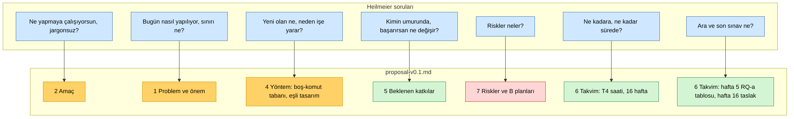

# Ders 29 — Tez Önerisi: Bir Sayfada Problem, Amaç, RQ, Yöntem, Katkı, Takvim ve Risk

**Faz 4 / Gün 29** · **Süre:** ~55 dk (okuma 40 + görev 15)
**Ön koşul:** Ders 26 (RQ-a/b/c, altı alan), Ders 27 (deney matrisi, bütçe, tersine güç), Ders 28 (baseline + ablation planı) · **Kod:** `code/day29/` (`proposal_lint.py` taslak kontrolü, `plot_day29.py` Gantt + risk matrisi — ikisi de bu oturumda koştu) · **Çıktı:** `thesis/proposal-v0.1.md` (568 sözcük; tüm sayısal iddialar etiketli)

> **Bugünün tek cümlesi:** Dört haftalık iş (RQ'lar, matris, bütçe, ablation) bir sayfaya sığıyor, çünkü öneri tezin kendisi değil, danışmanın ve enstitünün tek bir soruya verdiği cevap: "*Bu öğrenci ne soracak, nasıl ölçecek, bitince elde ne olacak ve bu ücretsiz bir T4'le dört ayda mümkün mü?*" — `thesis/proposal-v0.1.md` bu soruyu yedi bölümde cevaplıyor (problem → boşluk → amaç → üç RQ → yöntem → üç katkı → takvim + risk). `proposal_lint.py` taslağı denetledi: 568/650 sözcük, 8/8 bölüm, sayı içeren 12 cümlenin 12'si `[Ders NN]`, `[arXiv:…]` ya da `[öneri]` etiketli.

---

## 1. Öneri neden bir sayfa — ve kim okuyor?

Tez önerisinin iki okuyucusu var. Biri **danışman**: konuyu senden iyi biliyor ama ayrıntılara bakacak vakti yok, tek okumada "bu iş tutarlı mı, yapılabilir mi" diye karar verecek. Öbürü **enstitü**: tez konusunu kaydedecek ve ileride tezin önerilen konuya uyup uymadığına bakacak. İkisi de 28 dersin kanıtını okumayacak; ayrıntı repoda dursun, öneri ondan *seçer*.

Bu seçimin en sağlam kontrol listesi DARPA'nın **Heilmeier soruları**: ne yapmaya çalışıyorsun (jargonsuz)? Bugün nasıl yapılıyor, sınırı ne? Yeni olan ne, neden işe yarar? Kimin umurunda? Riskler neler? Ne kadara ve ne kadar sürede? Ara ve son sınav ne? Görsel 04 bu yedi sorunun taslaktaki karşılıklarını gösteriyor. Her soruya karşılık gelen bir bölüm var; cevabı olmayan soru, eksik bölüm demek.



**ALKÜ formu hakkında dürüst durum:** ALKÜ Lisansüstü Eğitim Enstitüsü'nün öğrenci formları sayfasında bir tez konusu öneri formu var (doktora sürümü `FR-320`; yüksek lisans sürümü de aynı sayfada listeleniyor). Ancak bu oturumda formların içini okuyamadım; bölüm başlıklarını ve sayfa/sözcük sınırını doğrulayamadım. Aynı belirsizlik iki konu için de geçerli: tezli yüksek lisansta tez konusunun enstitüye ne zamana kadar bildirileceği, ve önerinin Türkçe/İngilizce özet isteyip istemediği. Bu ikisi **danışmana sorulacak** (Ders 30 listesi). Taslağın bölümleri, Türkiye'deki enstitü formlarının ve TÜBİTAK 2210-C tez öneri formunun (Tem 2026 sürümü yayında) ortak iskeletine göre yazıldı: konu ve önem, amaç, yöntem, iş-zaman planı, riskler, beklenen katkı. 2210-C formunun başlıklarını da bu oturumda doğrudan okumadım. ARDEB formlarının bilinen yapısı (özgün değer / yöntem / proje yönetimi: iş-zaman + risk / yaygın etki) **hipotez**: formu açınca başlıkları eşle. Taslağın bölümleri zaten bu dört başlığa birebir dağılıyor. Form farklı bir sıra isterse içerik değişmez, yalnızca yeniden sıralanır.

---

## 2. Argüman zinciri: her bölüm bir öncekinin sorusunu cevaplar

İyi bir öneri bölüm listesi değil, bir zincirdir: problem bir boşluk doğurur, boşluk amacı doğurur, amaç soruları, sorular yöntemi, yöntem katkıları. Zincirin bir halkası koparsa okuyucu orada durur. Örneğin bir katkı hiçbir RQ'dan çıkmıyorsa, ya da bir RQ'nun yöntemde karşılığı yoksa okuyucu orada takılır.


Taslaktaki halkalar ve her birinin dayanağı:

| halka | taslakta | dayanak |
|---|---|---|
| **Problem** | VLA'lar neredeyse yalnız İngilizce; Korece komutla Spatial 97,6 → 49,2; yabancı dil kaybı ≈ komutsuz kayıp (−27,8…−29,8 vs −27,5) | Dong vd. 2606.11906; Chen vd. 2606.15714 (Ders 15, 24) |
| **Boşluk** | Türkçe için tek çalışma açık döngüde, tek karede; boş-komut tabanı yok | Tatar vd. 2026 SIU (Ders 5); literatür haritası (Ders 26) |
| **Amaç** | kapalı döngüde, boş-komut tabanına göre ölç; düşüşün yerini bul; ucuz düzeltmeyi sına | Ders 25'in üç tez cümlesi |
| **RQ'lar** | fark var mı / nerede / nasıl kapanır | Ders 26 |
| **Yöntem** | LIBERO Spatial + Goal, 20 eşli komut, 2 sistem, 4 koşul, McNemar + TOST, blok düzeyinde iddia | Ders 18, 20, 26, 27 |
| **Katkılar** | komut seti / ilk kapalı-döngü Türkçe ölçüm / tekrarlanabilir protokol | Ders 20, 22, 27 |

Motivasyon cümlesi danışmanın slaytından: *"Language is a beautiful compression of the world, but it is not the world"* (Pat Grady; Ders 1). Öneride bu cümle süs değil, problemin kendisi: komut dünyanın sıkıştırılmış bir tarifi. Model o tarifi açıp sahneye bağlayamıyorsa, Türkçe bir komut onun için boş bir komuttan farksızdır. Boş-komut tabanı tam olarak bunu ölçer. Tez ekseni böylece tek cümleye iniyor: *Türkçe mekânsal tarif, aynı sahnede, iki açık VLA'da boş komuttan ne kadar ayrılıyor?*

---

## 3. Sıkıştırma: altı alandan bir cümleye, beş sayfadan bir paragrafa

`thesis/rq-candidates.md` her RQ için yedi alan ve ~400 sözcük taşıyor; öneride her RQ tek cümle. Ne atılır, ne kalır?

- **Kalan:** sorunun kendisi ve onu sınanabilir yapan tek ayrıntı. RQ-a'da "boş-komut tabanına göre nerede" (bu olmadan Ders 19'un A/B/C/D ayrımı kaybolur). RQ-b'de "eğitimde olmayan tarif boş komutun üstüne çıkıyor mu" (güçlü okuma). RQ-c'de "kapanış oranı κ".
- **Atılan:** null hipotezlerin numaraları (H0-a1/a2…), δ değerleri, `tr_ascii` gibi kod adları. Bunlar yöntem paragrafına tek sayı olarak iner ("p < 0,05 ve en az 15 puan") ya da hiç inmez. Ayrıntının yeri `rq-candidates.md`; öneri ona atıf yapar.
- **Başlık** üç adaydan seçildi: (i) *"Türkçe Komutlarla VLA Değerlendirmesi"* çok geniş (mekânsal ve boş-komut yok); (ii) *"OpenVLA ve VLANeXt'in Türkçe Performansının Karşılaştırılması"* sistem karşılaştırmasını öne çıkarıyor, ki Chen vd.'nin uyarısıyla bu yalnızca betimsel olabilir; (iii) seçilen başlık: *"Türkçe Mekânsal Komutların VLA Modellerinde Temellendirilmesi: Boş-Komut Tabanlı Kapalı-Döngü Bir Değerlendirme"*. Başlık hem ne ölçüldüğünü (temellendirme), hem nasıl ölçüldüğünü (kapalı döngü, boş-komut tabanı) söylüyor ve model adı taşımıyor. Böylece S-VN koşmazsa başlık değişmek zorunda kalmaz.

Teknik terimler önerinin Türkçe gövdesinde Türkçeleştirildi ("başlangıç durumu" = init state, "temellendirme" = grounding, "ayrıştırıcı" = parser). Enstitü metni Türkçe okunacak; ilk geçişte parantez içinde İngilizcesi verilmeli. v0.1'de bu yapılmadı, görevin bir parçası (§8).

---

## 4. Yöntem paragrafı: hangi sayılar girer?

Öneri yöntemde yalnızca **kararı etkileyen** sayıları taşır. Taslaktaki yöntem paragrafında bunlar beş tane: görev başına 50 başlangıç durumu (LIBERO'nun kendi tavanı; Ders 27'de ölçüldü), 20 eşli komut ve dört blok (Ders 20), "p < 0,05 ve en az 15 puan" eşiği (Ders 26), görev düzeyinde görünen en küçük fark 23 puan ve blok düzeyinde 13 puan (Ders 27). Son ikisi önerinin en önemli metodolojik cümlesini taşıyor: **ana iddia blok düzeyinde kurulur.** Bu, Ders 27'de açık bırakılan karar. Taslak blok düzeyini önerdi, ama danışman "her görevde" derse yöntem paragrafı bir cümle değişir, takvim ise ~150 saat uzar (tam çekirdek 258, yalın 108).

İki cümle de kasıtlı olarak orada:

- *"Karşılaştırma sistem düzeyinde, nedensel değil."* Bunu yazmazsan ilk soru "Qwen3-VL Türkçe'yi daha mı iyi anlıyor?" olur. Bu, bizim tasarımın cevaplayamayacağı bir soru: omurga, action başı ve eğitim verisi birlikte değişiyor (Chen vd.).
- *"Eşikler koşudan önce yazılır (ön kayıt)."* Önerinin tarih damgası `rq-candidates.md`'nin commit hash'i. Bu cümle danışmana "sonucu görüp eşiği oynatmayacağım" sözü.

S-OV'un T4'te 4-bit koşacağı da yöntemde bir kelimeyle var ("T4'te 4-bit"). Kalibrasyon ayrıntısı (K1: yayımlanan 84,7 ile; K3: Mac'te bf16 ile eşli) risk tablosunda. Baseline ve ablation'lar tek atıfla geçiyor: `thesis/ablation-plan.md` (Ders 28). Öneride ablation listesi yer kaplamamalı, ama okuyucu "kontrol grubu ne?" diye sorarsa cevabın bir dosya ötede olduğunu görmeli.

---

## 5. Takvim ve riskler: bütçeden haftaya, haftadan B planına

Takvimin birimi gün değil **T4 saati**. Ders 27'nin bütçe modelinden iş paketlerine: İP1 pilot + kalibrasyon 8 saat, İP2 RQ-a 61 saat, İP3 RQ-b 31 saat, İP4 RQ-c 8 saat; yalın matriste toplam ≈ 108 saat. Tam çekirdekte İP2 152, İP3 78, İP4 19, toplam ≈ 258 saat (`plot_day29.py` bu sayıları `code/day27/results/budget*.csv`'den okuyor; orta senaryo). Kaggle'ın bildirilen ~30 saat/haftalık kotasıyla yalın matris ≈ 3,6 hafta GPU demek. Takvim buna analiz ve yazım için tampon ekliyor ve 16 haftaya yayılıyor.


Hafta 1'i 30 Kasım 2026 aldım; bu bir **öneri**, akademik takvimle (dönem sonu, sınavlar, enstitü teslim tarihleri) danışmanla hizalanacak. İki "sınav" Heilmeier'in son sorusunun cevabı. Ara sınav hafta 5'te: RQ-a tablosu, yani iki sistem × iki blok × dört koşul. Bu tablo yoksa takvim kaymış demektir ve B planına geçilir. Son sınav hafta 16'da: tez taslağı.


Risk matrisindeki puanlar bu dersin değerlendirmesi, ölçüm değil. Ama her risk bir derste görülmüş bir şeye dayanıyor ve her birinin B planı önceden yazılı:

| risk | dayanak | B planı |
|---|---|---|
| R1 model çağrısı tahminden yavaş | kötümser senaryo 497 saat (Ders 27) | yalın matris; yalnız A + C blokları; K1/K2 ölçümüyle `budget.py` yeniden |
| R2 4-bit S-OV 84,7'yi tutmaz | niceleme Goal'da 14 puan kaydırabiliyor (VLAQuantBench, OFT; Ders 27) | etiket "OpenVLA (4-bit)"; Mac'te bf16 eşli alt küme (K3) |
| R3 Spatial'da `empty` tavana yakın | komutsuz tavan 9/10 (Ders 19) | ağırlık Goal'a (komutsuz 1/10) |
| R4 karşı-olgusal BDDL yüklenmez | `bddl_cf/` test edilmedi (Ders 27) | B bloğu betimsel, EN-B ve LangGap'in %11'i dış referans |
| R5 LoRA onayı yok | S9 (Ders 24, 25) | RQ-c girdi düzeyinde (MT + ayrıştırıcı) |
| R6 VLANeXt T4'te koşmaz | Ders 12 yamaları T4'te doğrulanmadı | tek sistem (S-OV) + Mac; başlık model adı taşımadığı için değişmez |
| R7 MT çıktısı üretilemez | HF erişimi (Ders 24) | yalnız ayrıştırıcı; MT "kâhin" sürümü insan çevirisi (Ders 28) |

R6'nın etkisi en yüksek (5): S-VN koşmazsa iki sistemli tasarım tek sisteme iner. Ama olasılığı düşük tutuldu, çünkü Ders 18'in notebook'u zaten T4 için yamalı. P1'in (Ders 18 pilotu) ilk hafta koşulmasının asıl nedeni bu riski erken kapatmak. Öneriye risk tablosunun yalnızca beş satırı girdi (sayfa sınırı); R6 ve R7 için B planı tek cümleyle yöntem dosyalarında.

---

## 6. Taslağı denetlemek: `proposal_lint.py`

Ders 26'nın `rq_lint.py`'si RQ dosyasının yapısını denetliyordu; `proposal_lint.py` öneri için aynı işi yapıyor ve bir kural ekliyor: **sayı içeren her cümlenin bir kaynağı olmalı.** Kaynak etiketleri dört tür: `[Ders NN]` (repoda kanıtı olan), `[arXiv:…]` (dış makale), `[hesap…]` (bizim script'imizin çıktısı) ve `[öneri]` (henüz karar, ölçüm değil; takvim tarihleri gibi). Etiketi olmayan sayı, okuyucunun "bunu nereden biliyorsun?" sorusuna cevapsız kalır.

Bu oturumdaki gerçek çıktı (`results/lint.txt`):

```
gövde sözcük: 568 / 650
sayısal iddia birimi: 12, etiketli: 12
SONUÇ: TAM
```

Selftest'te bozuk bir taslakta 5 sorunu yakaladı: 4 eksik bölüm ve 1 etiketsiz iddia ("Başarı 97'den 49'a iniyor."). Etiketli satır (`n = 50 [Ders 27]`) sorun sayılmadı. Linter'ın sınırı açık: etiketin *doğru* olup olmadığına bakmaz. `[Ders 27]` yazıp Ders 27'de olmayan bir sayı koyabilirsin; o kontrol reviewer'ın, yani danışmanın işi. Model ve etiket adlarındaki rakamlar (RQ-a, S-OV, 4-bit, LLaMA-2, Qwen3-VL, T4) sayısal iddia sayılmıyor. `results/claims.csv` 12 iddia birimini ve etiketlerini listeliyor; danışmana öneriyle birlikte gönderilebilecek bir "kaynak dökümü".

650 sözcük sınırı Türkçe A4'te, 11 punto ve tek aralıkla yaklaşık bir sayfa ediyor (başlık ve tablo dahil). Enstitü formu farklı bir sınır koyarsa `--max-words` ile değiştir.

---

## 7. Yazılımcı için köprüler

- **Öneri = RFC / design doc'un özet bölümü.** Uzun design doc'ta (Ders 26–28) her karar gerekçeli; üstteki bir sayfalık "Summary / Goals / Non-goals / Plan / Risks" bölümü ise yönetimin okuduğu tek kısım. Okuyucu karar verir, ayrıntıyı ancak sorarsa açar.
- **Etiketler = traceability matrix.** Gereksinimden teste izlenebilirlik gibi: her sayı bir kaynağa (`[Ders NN]`), her kaynak bir commit'e bağlı. `proposal_lint.py` bu matrisin CI kontrolü; "orphan requirement" yerine "orphan number" yakalıyor.
- **Takvim = sprint planı, birim = story point değil runner-saati.** Kapasite (Kaggle kotası) sabit; iş (T4 saati) tahmin. Sprint 5'in demo'su ara sınav: RQ-a tablosu yoksa scope kesilir (yalın matris). Burn-down'u `budget.py` çiziyor.
- **Risk tablosu = runbook.** Her olayın tetikleyicisi (K1 sonucu 84,7'nin dışında) ve önceden yazılmış eylemi (etiketi değiştir, K3'ü koş) var. Olay anında karar vermiyorsun; olay öncesi verdiğin kararı uyguluyorsun.
- **Başlıkta model adı yok = interface'e programlamak.** Başlık "VLA modelleri" diyor, "OpenVLA ve VLANeXt" değil. Implementasyon (sistem) değişirse sözleşme (tezin konusu) bozulmaz.
- **Non-goals:** öneride söylenmeyen ama sorulacak şeyler: omurga karşılaştırması (sistem farkı yeterli değil), gerçek robot, yeni model eğitimi (LoRA koşullu). Design doc'ta "non-goals" ne kadar önemliyse burada da öyle; v0.2'de bir satırla eklemeyi düşün.

---

## 8. Bugünün görevi (15 dk)

`thesis/proposal-v0.1.md`'yi yüksek sesle bir kez oku ve sende takılan **üç yeri** işaretle. Takıldığın yer genelde ya jargon (ilk geçişte İngilizcesi parantezde yok) ya da kopuk bir halkadır (bir katkı hangi RQ'dan çıkıyor belli değil). Her biri için tek cümlelik düzeltmeyi doğrudan dosyada yap. Sonra iki karar satırını kendi sözünle yaz. Birincisi başlık: seçilen mi, yoksa senin önerin mi? İkincisi hafta 1'in gerçek tarihi (dönem takvimine göre). Ardından `cd code/day29 && python proposal_lint.py ../../thesis/proposal-v0.1.md` çalıştır: TAM kalmalı. Düzeltme sırasında etiketsiz bir sayı eklediysen linter yakalar. Dosyanın "Sürüm" satırını `v0.2 — <tarih>, Mesut düzeltmeleri` yap ve commit'le (`Ders 29: öneri v0.2`). ALKÜ formunu enstitü sayfasından indirebildiysen başlıklarını taslağın bölümleriyle eşleştiren tek bir satır da ekle.

## Takılırsan

| Belirti | Çözüm |
|---|---|
| `proposal_lint.py` → `etiketsiz sayısal iddia` | Cümleye kaynağını ekle: `[Ders NN]`, `[arXiv:XXXX.XXXXX]`, `[öneri]` ya da `[hesap: …]`. Rakam bir ad içindeyse (ör. yeni bir model adı) `NAMES` düzenli ifadesine ekle |
| `gövde N sözcük > 650` | Önce Yöntem'deki parantezleri at (ayrıntı `rq-candidates.md`'de), sonra risk tablosunu 4 satıra indir; Kaynaklar sayılmaz |
| `'Katkı' bölümü yok` | Başlık birebir `## 5. Beklenen katkılar` biçiminde olmalı (numara isteğe bağlı) |
| `plot_day29.py`: `budget_lean.csv` bulunamadı | Önce `code/day27/budget.py`'yi çalıştır (`results/` üretir); script'i `code/day29/` içinden çalıştır |
| Gantt'taki saatler Ders 27'den farklı | Ders 28 matrise ablation hücreleri eklediyse `budget.py` yeniden koşmuş olabilir; İP'ler yalnız A/B/C/K/P hücrelerini toplar — ablation İP'si eklemek için `hours()` içine hücre kümesini ekle |
| Form Word (`.doc`) ve önerin Markdown | `pandoc thesis/proposal-v0.1.md -o oneri.docx`; tabloyu formun kutusuna elle taşı. Telifli/kurumsal form repoya girmez, yalnızca bağlantı |

---

## Sonraki ders (Ders 30)
**Danışman toplantısı için soru ve sunum listesi.** Öneri yazılınca açık kalan kararlar görünür hâle geldi. Bunlar danışmanın verebileceği kararlar: iddia birimi (görev / blok), suite ağırlığı (S7), LoRA izni ve bütçesi (S9), tezin zayıf okumayla mı biteceği (S10), 4-bit S-OV'un kabulü, tez konusunun enstitüye bildirim tarihi ve form gereklilikleri, başlık. Ders 30 bunları tek bir toplantı paketine çeviriyor: her soru için seçenekler, bizim önerimiz ve "cevap şu olursa ne değişir" satırı, öncelik sırası (etki × aciliyet), 20 dakikalık bir gündem ve 5–7 slaytlık kısa bir sunum taslağı (`slides/advisor-meeting-01.md`). Bu önerinin v0.1'i de o toplantının ekidir.

---

## Kaynaklar
- Çıktı: `thesis/proposal-v0.1.md` (v0.1; 568 sözcük, 7 bölüm + kaynaklar). Girdiler: `thesis/rq-candidates.md` (Ders 26), `thesis/experiment-matrix.csv` ve `code/day27/results/budget*.csv` (Ders 27), `thesis/ablation-plan.md` (Ders 28), `datasets/04-tr-spatial-commands/` (Ders 20), Ders 1 (Grady slaytı), 5 (Tatar vd.), 15 ve 24 (Dong, Chen), 19 (komutsuz tavan), 22 (harf bedeli 4,9 / 0,9).
- **[1]** DARPA. *The Heilmeier Catechism.* [darpa.mil](https://www.darpa.mil/about/heilmeier-catechism) — öneri kontrol listesi (yedi soru; görsel 04). Ders kullanımı için ayrıca: [R. Murray, Caltech](https://murray.cds.caltech.edu/Heilmeier_Catechism).
- **[2]** ALKÜ Lisansüstü Eğitim Enstitüsü — [öğrenci formları](https://enstitu.alanya.edu.tr/ogrenci/ogrenci-formlari/) (tez konusu öneri formu; doktora sürümü [FR-320](https://enstitu.alanya.edu.tr/media/ufoe23oc/fr-320-tez-konusu-oneri-formu-dr.doc)), [tez ve dönem projesi yazım kılavuzu](https://alanya.edu.tr/media/emzgwaqf/alku-lisansustu-egitim-enstitusu-tez-ve-donem-projesi-yazim-kilavuzu.pdf), [lisansüstü eğitim ve öğretim yönetmeliği](https://www.alanya.edu.tr/media/uhxlpqth/alku-lisansustu-yonetmeligi.pdf). Bu oturumda içerikleri okunamadı. Bağlantılar arama sonucundan; form başlıkları ve teslim tarihi danışmana sorulacak.
- **[3]** TÜBİTAK BİDEB. *2210-C Tez Öneri Formu (içerik), Tem 2026.* [tubitak.gov.tr](https://tubitak.gov.tr/sites/default/files/2026-07/2210-C_Programi_Guncel_Tez_Oneri_Formu_icerik.docx). Başlıkları bu oturumda okunmadı; ARDEB iskeleti (özgün değer / yöntem / proje yönetimi / yaygın etki) hipotez.
- **[4]** Hulley vd. *Designing Clinical Research* (FINER) ve Bertinetto vd. (2021) ön kayıt, [PMLR 148](https://proceedings.mlr.press/v148/bertinetto21a.html) (Ders 26). Problem paragrafındaki sayılar: Dong vd. [arXiv:2606.11906](https://arxiv.org/abs/2606.11906), Chen vd. [arXiv:2606.15714](https://arxiv.org/abs/2606.15714), Hou & Zhao [arXiv:2603.00592](https://arxiv.org/abs/2603.00592); sistemler: OpenVLA [arXiv:2406.09246](https://arxiv.org/abs/2406.09246), [DravenALG/VLANeXt](https://github.com/DravenALG/VLANeXt); benchmark: LIBERO [arXiv:2306.03310](https://arxiv.org/abs/2306.03310).
- Kod: `code/day29/` — `proposal_lint.py` (bu oturumda koştu: TAM; selftest OK; `results/lint.txt`, `results/claims.csv`), `plot_day29.py` (koştu; `results/plot_stdout.txt`).
- Görseller: 01 ve 04 Mermaid (`.mmd` yanında); 02 Gantt: hafta aralıkları öneri, T4 saatleri Ders 27 bütçe modelinin orta senaryosu (başlıkta yazılı); 03 risk matrisi: olasılık/etki puanları bu dersin değerlendirmesi (başlıkta yazılı). Model bu oturumda çalıştırılmadı.
