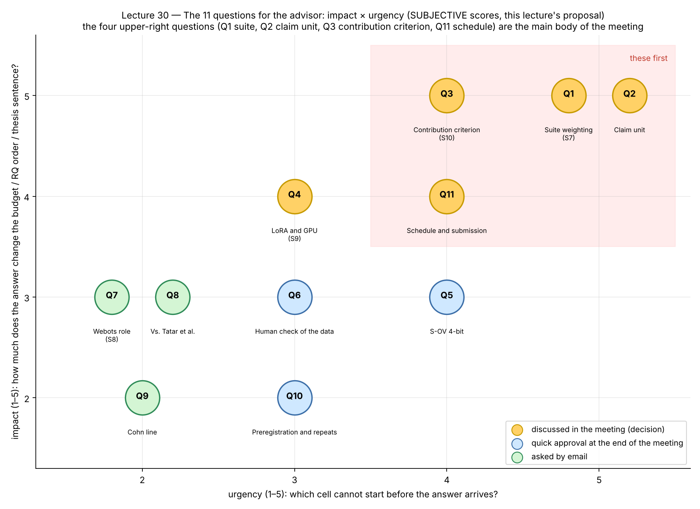
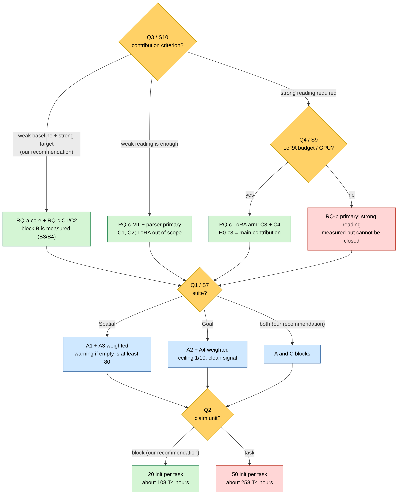
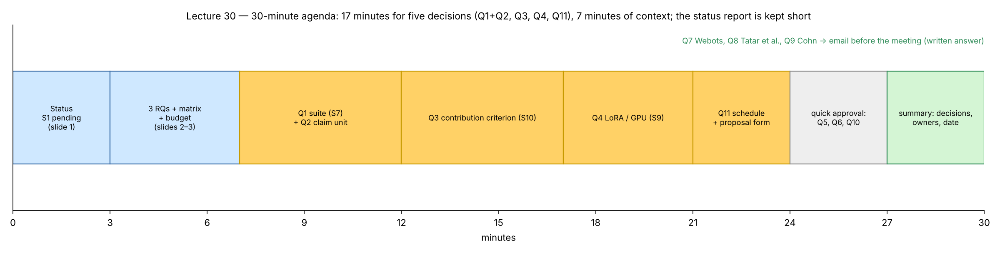
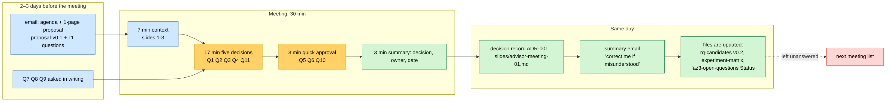

# Lecture 30 — Advisor Meeting: the 11 Open Decisions in the Repo, Impact × Urgency, a 30-Minute Agenda, 7 Slides and a Decision Record

**Phase 4 / Day 30** · **Time:** ~55 min (reading 40 + task 15)
**Prerequisites:** Lecture 21 (Webots decision note), Lecture 25 (S1–S10), Lecture 26 (RQ-a/b/c), Lecture 27 (experiment matrix, budget), Lecture 29 (`thesis/proposal-v0.1.md`) · **Code:** `code/day30/` (`collect_questions.py` scans the repo, `plot_day30.py` priority and agenda — both ran in this session) · **Output:** `slides/advisor-meeting-01.md` (agenda + 7 slides + question list + decision record template)

> **Today in one sentence:** All the "to be discussed with the advisor" notes accumulated over 29 lectures are in the repo; `collect_questions.py` found them in 184 lines across 37 files in the repo at the end of Lecture 27, we reduced them to 11 questions and ranked them by impact × urgency — 17 of the 30 minutes of the meeting go to five decisions (Q1 suite, Q2 claim unit, Q3 weak/strong reading, Q4 LoRA/GPU, Q11 schedule), because without these five answered half of the experiment matrix cannot start and the budget hangs between 108 and 258 T4 hours; a question does not enter the meeting if it is not written which cell its answer would change.

---

## 1. Why a separate lecture: the advisor's time is the scarcest resource

Up to this point every lecture left something as "to be clarified with the advisor": Lecture 21 Webots, Lecture 24 the LoRA budget, Lecture 25 S7–S10, Lecture 26 the RQ ordering, Lecture 27 the claim unit and 4-bit OpenVLA. If they stay scattered, one of two things happens: either they are not remembered in the meeting, or the meeting turns into "what have you been doing" storytelling and no decision comes out. Lecture 27's calculation showed the price of these decisions: the claim unit alone changes the budget by 2.4×. One answer from the advisor means weeks of T4 time.

Today's method is three steps: **collect** (every open decision that left a trace in the repo), **filter** (a question whose answer does not change a cell, an RQ or a thesis sentence is dropped from the list), **rank** (impact × urgency). The result is a single file: `slides/advisor-meeting-01.md`. It goes to the advisor by email 2–3 days earlier, with Lecture 29's one-page proposal (`thesis/proposal-v0.1.md`).

The guides written on advisor meetings (University Affairs' "six steps" article, the advisor-relationship section of the UW CSE PhD handbook, Imperial's agenda advice sheet, MIT OCW's "effective meetings with advisors" lesson; References [1]) were seen in this session only as search results, their contents could not be opened. The three rules below (send the agenda in advance, write the decisions in the meeting, a summary email the same day) are this lecture's suggestion; comparing them with those sources is your reading.

Link to the thesis: the framing of the Turkish spatial grounding thesis (which suite, which unit, which contribution level) is not a technical but an **academic** decision. Which result will count as a "contribution" for the jury is known by the advisor, not by you; Q3 (weak or strong reading) is the clearest example of this.

---

## 2. Collect: every open decision in the repo, with a file:line trace

`collect_questions.py` scans all the `.md` files in the repo with eight keys ("advisor", "S7", "S8", "S9", "S10", "decision", "claim unit", "4-bit") and writes every match with its source into a CSV (`results/questions_raw.csv`). The real output in this session (the repo at the end of Lecture 27, before Lectures 28–31 were written, when the lectures were still in Turkish; the key names below are translated — the script prints its internal names `danisman`, `karar`, `iddia_birimi`, `4bit`, which also match the English words):

```
184 lines, 37 files
per key: decision 85, advisor 55, 4-bit 43, S10 17, claim unit 10, S9 9, S7 7, S8 5
per folder: lectures 96, plan 36, code 18, thesis 13, resources 7, README 5, home 5, …
candidate lines containing 'advisor' + decision/question: 20
```

After Lectures 28–31 were added the same script finds 318 lines / 47 files (`results/collect_stdout.txt`), because the text of the new lectures also talks about these decisions (this lecture included). The number grows but the question set stays the same; this is where the value of filtering lies. Most of the 184 lines are repeats: the same S7 appears in `plan/faz3-open-questions.md`, in Lecture 25 and in the README. The filtering was done by hand and the rule is one: **what does the answer change?** A question for which you cannot write what it changes is a curiosity question; it is left for an email or the next meeting. For example "does Qwen3-VL read Turkish on the Chinese side?" (a Lecture 24 hypothesis) is a good question but the advisor's answer would not close it, the S1 run does. That is why it is not in the list. S1–S6 in `plan/faz3-open-questions.md` are not there either, because they are **your run**: they are taken to the advisor as "I ran S1, pattern B", not asked.

The purpose of keeping the source separate is to prevent invented questions. The `source` column of every question in `code/day30/questions.csv` points to a repo file. If someone asks in the meeting "where did you get this?" the answer is a line number.

---

## 3. Filter and rank: 11 questions, impact × urgency

Every question is written with six fields (the little brother of Lecture 26's RQ template): context (one sentence), options, **our recommendation**, what the answer changes (cell / RQ / thesis sentence), impact (1–5), urgency (1–5). Impact and urgency are **subjective scores**, this lecture's suggestion; you may change them before the meeting, and `plot_day30.py` redraws.



| rank | question | impact × urgency | where |
|---|---|---|---|
| 1 | **Q1** Main suite: Spatial / Goal / both (S7) | 5 × 5 = 25 | meeting |
| 2 | **Q2** Claim unit: task / block | 5 × 5 = 25 | meeting |
| 3 | **Q3** Contribution criterion: weak / strong reading (S10) | 5 × 4 = 20 | meeting |
| 4 | **Q11** Thesis proposal schedule and form | 4 × 4 = 16 | meeting |
| 5 | **Q4** Turkish LoRA, GPU access (S9) | 4 × 3 = 12 | meeting |
| 6 | **Q5** Accept OpenVLA 4-bit | 3 × 4 = 12 | quick approval |
| 7 | **Q6** A second reader for the Turkish set | 3 × 3 = 9 | quick approval |
| 8 | **Q10** Repeats only in the pilot (pre-registration change) | 2 × 3 = 6 | quick approval |
| 9 | **Q7** Role of Webots (S8) | 3 × 2 = 6 | email |
| 10 | **Q8** Relation to the Tatar et al. paper | 3 × 2 = 6 | email |
| 11 | **Q9** Is the Cohn line part of the thesis | 2 × 2 = 4 | email |

The definition of urgency is "which cell cannot start until the answer comes". Without Q1 and Q2, A1–A4 (the RQ-a core, 152 hours in the middle scenario) cannot be planned, so 5. Webots (Q7) is an impactful question, because if the answer is "yes" it adds weeks. But Lecture 21's decision note recommends staying in LIBERO and no core cell depends on it, so its urgency is 2. This is also the reason it is asked in writing: the advisor can read and answer Lecture 21's three questions in their own time. The same logic holds for Q8 (Tatar et al.) and Q9 (Cohn). Both determine the *positioning* of the thesis (the introduction and related-work chapters), not the flow of the experiment.

Q11 is the only question that does not come out of your repo. The institute's thesis proposal schedule and form are not written in the repo, and Lecture 29's draft was written without assuming a specific form. Asking, rather than guessing this information yourself, is the cheapest way.

---

## 4. Decision tree: which RQ do the advisor's answers make primary?

Lecture 26 tied the RQ ranking to the S1 pattern (a condition that comes from data). The advisor's answers are a second condition: the **framing**. The two are read together. If S1 says "Turkish is not read" (pattern B) and the advisor says "the weak reading is enough", the thesis is a measurement thesis closed with MT/parser. With the same S1, if the answer "the strong reading is required, there is no GPU" comes, the thesis's primary question shifts to RQ-b: the strong reading is measured but cannot be closed.



The order of the tree is deliberate: first Q3 (contribution criterion), because it determines the thesis's title sentence. Then Q4 (meaningful only in the "strong reading required" branch). Then Q1 (suite) and last Q2 (unit). Q2 determines the budget but eliminates no RQ. If in the meeting you ask the questions in this order, every answer narrows the options of the next.

The three "our recommendation" branches (weak baseline + strong target; both; block) were chosen with the rationales of Lectures 24–27. The rationale itself is one line on the slide, the detail is in the question table of `slides/advisor-meeting-01.md`. A question without a recommendation turns the meeting into a session that loads work on the advisor. A question with a recommendation becomes "do you approve, or if not why not?", and is settled faster.

---

## 5. Agenda and 7 slides



The proportions of the agenda are deliberate: **7 minutes context, 17 minutes decisions, 3 minutes quick approval, 3 minutes summary.** The urge to lengthen the context is strong, because 30 lectures have accumulated. But the advisor can read the detail from the one-page proposal in the email; the decision comes out only in the meeting.

The skeleton in `slides/advisor-meeting-01.md` contains for each slide a title, three bullets and a figure. The figures were taken from earlier lectures, no new drawing is needed:

| slide | title | figure |
|---|---|---|
| 1 | Thesis axis and where we are (S1 does not exist yet, honestly) | Lecture 25 / 01 |
| 2 | The three research questions | Lecture 26 / 03 |
| 3 | Experiment matrix and budget (108 / 258 h) | Lecture 27 / 03 |
| 4 | Decision: suite + claim unit (Q1, Q2) | Lecture 27 / 04 |
| 5 | Decision: contribution criterion + LoRA (Q3, Q4) | Lecture 30 / 01 |
| 6 | Risks and quick approvals (Q5, Q6, Q10) | Lecture 27 / 05 |
| 7 | Schedule and the next 4 weeks (Q11) | Lecture 29 Gantt |
| backup | Position in the literature | Lecture 26 / 05 |

The "S1 does not exist yet" line on slide 1 is there on purpose. Holding the meeting after running S1 (the Lecture 18 run, ~2 T4 hours) would be much stronger: the decision tree's two conditions (data + framing) would be on the table at the same time. If the schedule does not permit, slide 1 says this openly and shows that the RQ ordering is conditional (Lecture 26 §6 table can be a backup slide).

---

## 6. After the meeting: the decision record and updating the files



The output of the meeting is a **decision record** (ADR, Architecture Decision Record style). The template at the end of `slides/advisor-meeting-01.md` has these fields for every decision: title, date, status (accepted / rejected / deferred), one-sentence decision, the advisor's rationale, consequence (which file and cell change), owner, deadline. The template must be filled in before the meeting ends; a decision remembered the next day is not the decision the advisor made.

The same day three files are updated, otherwise the decision is considered not to have entered the repo:

- `plan/faz3-open-questions.md`: the **Status** column of rows S7–S10 (date + one-line result; the row is not deleted).
- `thesis/rq-candidates.md` → v0.2: the advisor condition in the ordering table, the repeat policy if Q10 is approved. In the spirit of pre-registration the change is written in the version section with date and rationale.
- `thesis/experiment-matrix.csv`: the `n_init` and suite columns according to Q1/Q2, `status` according to Q4/Q5. Then `budget.py` is re-run and the new total is written in the ADR's "Consequence" field.

The last step is a summary email: a one-line list of the decisions, "could you correct me if I misunderstood anything?" and a date suggestion for the next meeting. This email works as a written approval; it is the proof of "we decided this together" six months later. A question left unanswered (if the advisor said "let me think") is carried to the next meeting's list with the `deferred` status.

---

## 7. Bridges for the software developer

- **Advisor meeting = architecture review board.** You do not bring a code walkthrough to the presentation; you bring the options, your recommendation and the cost of each option. The board approves or rejects with a rationale. Asking "A is what I recommend, because X; B costs Y. Do you approve?" instead of "What should I do?" shortens the meeting.
- **ADR = a decision record, not a commit message.** Like `docs/adr/0001-use-postgres.md`: context, decision, consequences, status. Six months later the answer to "why is it Goal-weighted?" sits not in the advisor's memory but in `ADR-001`. An ADR whose status is `superseded` is not deleted, it is linked to the new one.
- **Impact × urgency = backlog prioritization.** The same idea as priority × severity in Jira or WSJF (cost of delay / job size). The question "which cell is waiting?" is cost of delay itself: as long as Q2 stays unanswered, 150 hours of work are blocked.
- **`collect_questions.py` = a TODO/FIXME scanner.** Like an analyzer collecting `// TODO(arch-review)` lines in a codebase. The raw output is noisy (184 lines), the value is in the filtering (11 questions). Each item having a file:line trace is like an issue being tied to code.
- **Quick approval = consent agenda.** Items that need no discussion (Q5, Q6, Q10) are presented in bulk and pass if there is no objection. Meeting time is spent only on the items really to be discussed.
- **Summary email = PR description + "LGTM?"** What was discussed in the meeting is reviewed in writing before merge; silence is not approval, an answer is awaited.

---

## 8. Today's task (15 min)

Open `code/day30/questions.csv` and re-score the **impact** and **urgency** columns with your own judgment. Look especially at Q4 (you may already know the GPU access) and Q11 (if you know the institute's schedule, the urgency changes). Then run `cd code/day30 && python plot_day30.py` and see whether the ranking changed. If in `slides/advisor-meeting-01.md` there is a row in the "our recommendation" column you disagree with, replace it with your own recommendation; you are the one who will defend it in front of the advisor. Finally write the meeting date at the top of the file and add the first paragraph of the agenda email (3 sentences: where I am, five decisions, attachments) as a draft at the bottom of the file. Commit: `Lecture 30: advisor meeting 01 preparation`.

## If you get stuck

| Symptom | Fix |
|---|---|
| `plot_day30.py`: `ValueError: invalid literal for int()` | In `questions.csv` a cell containing a comma was left unquoted (like a Turkish decimal "16,8"); put the cell in `"…"` |
| `collect_questions.py` finds too many lines | Normal (raw scan). To narrow, remove `decision` from the `KEYS` dictionary or filter the output to those containing `advisor` in the `keys` column |
| Circles overlap in the priority matrix | It means there are more than 3 questions in the same (impact, urgency) cell; change one of the scores or increase the `dx` multiplier |
| The advisor opened a new topic in the meeting | Add it to the ADR template with the `deferred` status; do not shift the agenda, protect the last 3 minutes for the summary |
| S1 will not be done before the meeting | Say "conditional" on slide 1, make Lecture 26 §6's ordering table a backup slide; still ask Q1–Q3, because the framing decision is independent of the data |

---

## Next lecture (Lecture 31)
**Final: a "let's do a project" simulation and the close of Stage 0 — the last lecture.** The last line of the plan: Claude proposes a project, you design it. This time neither the RQ nor the matrix is handed ready-made; how fast and how accurately the toolbox built over 30 lectures (literature → testable question → experiment matrix → budget → baseline/ablation → advisor decision) works end to end on a new question is measured. Lecture 31 also takes the inventory of Stage 0: which script really ran, which dataset cards exist, what stayed a hypothesis. After this lecture no new lectures are written; the plan for the next stage is yours.

---

## References
- Output: `slides/advisor-meeting-01.md` (agenda, 7 slides + backup, 11 questions, ADR template; v0.1). Inputs: `plan/faz3-open-questions.md` (S7–S10), `thesis/rq-candidates.md` (Lecture 26), `thesis/experiment-matrix.md` (Lecture 27 open decisions), `thesis/proposal-v0.1.md` (Lecture 29), `lectures/lecture-21.md` §6 (Webots decision note + three questions), `lectures/lecture-05.md` (Tatar et al., SIU 2026), `lectures/lecture-23.md` (Cohn line, seven papers), `datasets/04-tr-spatial-commands/dataset-card.md` (native-speaker reading left to v0.2), `plan/lecture-plan.md` "Open decisions".
- **[1]** Advisor-meeting guides. In this session they were seen only as search results, their contents could not be opened; listed as further reading: [University Affairs — Six steps for stellar student-supervisor meetings](https://universityaffairs.ca/career-advice/six-steps-for-stellar-student-supervisor-meetings/) · [UW CSE PhD handbook — Building a relationship (advising guide)](https://www.cs.washington.edu/academics/phd/handbook/advising-guide/building-a-relationship) · [MIT OCW RES.16-9960 — Effective meetings with advisors (transcript)](https://ocw.mit.edu/courses/res-16-9960-the-engineering-students-guide-to-effective-technical-communication-spring-2026/mitres16-9960-effective_meetings_with_advisors_transcript.pdf) · [Imperial College — Effective PhD supervision meeting agendas (advice sheet)](https://t4awstest.cc.ic.ac.uk/media/imperial-college/administration-and-support-services/staff-development/public/pfdc/Download-C.4.9---Advice-sheet---Effective-PhD-supervision-meeting-agendas.pdf). The three rules in this lecture (agenda in advance, decision record in the meeting, summary email the same day) and the ADR adaptation are this lecture's suggestion.
- **[2]** ADR: Michael Nygard, *Documenting Architecture Decisions* (2011) — the decision record format in software engineering; adapted here to an academic decision record. Prioritization: an impact × urgency matrix (Eisenhower type), the scores are subjective.
- Basis numbers: Lecture 27 (`code/day27/results/budget_stdout.txt`: pilot + core 258 h, lean 108 h, task MDE 23 / block n=120 → 13), Lecture 24 (`qlora_budget.py` 65–98 T4 h, estimate), Lecture 19 (command-free ceiling Spatial 9/10, Goal 1/10), OpenVLA Table 2 (bf16 16.8 GB) and VLAQuantBench Table 1 (OFT W4 Goal 96 → 82), in Lecture 27's references.
- Code: `code/day30/` — `collect_questions.py` (ran in this session: 184 lines / 37 files in the repo at the end of Lecture 27; 318 / 47 after Lectures 28–31 were added — `results/questions_raw.csv` and `collect_stdout.txt` are the last run), `questions.csv` (11 questions, filtered by hand; `source` on every row), `plot_day30.py` (ran; `results/priority.csv`, `priority_stdout.txt`).
- Figures: 01 and 04 are Mermaid (`.mmd` alongside); 02 priority matrix (the scores are **subjective**, stated in the title); 03 agenda (this lecture's suggestion). No model run. A preparation file, not a meeting simulation: the real answers will come from the advisor.
