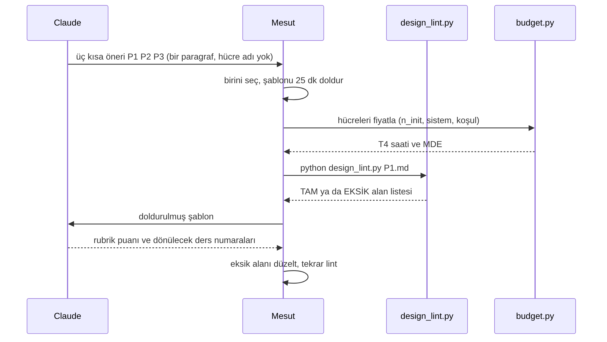
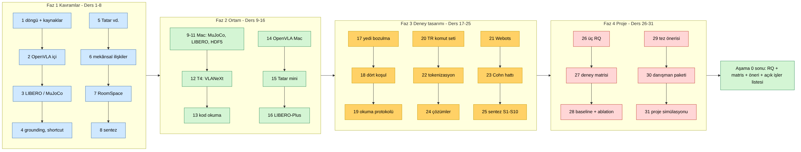

# Ders 31 — Final: "Bir Proje Yapalım" Simülasyonu — Claude Önerir, Sen Tasarlarsın; Rubrik, Aşama 0 Bilançosu ve Devreden İşler

**Faz 4 / Gün 31** · **Süre:** ~60 dk (okuma 30 + simülasyon 30) · Son ders
**Ön koşul:** Ders 26 (altı alan, `rq_power.py`), Ders 27 (`experiment-matrix.csv`, `budget.py`), Ders 28 (`thesis/ablation-plan.md`), Ders 29 (`thesis/proposal-v0.1.md`), Ders 30 (`slides/advisor-meeting-01.md`) · **Kod:** `code/day31/` (`phase0_inventory.py` repo taraması, `design_lint.py` şablon denetçisi, `plot_day31.py`; üçü de bu oturumda koştu) · **Çıktı:** doldurduğun bir proje tasarımı (`code/day31/templates/P1–P3.md`'den biri)

> **Bugünün tek cümlesi:** Aşama 0'ın amacı "bir proje yapalım" dendiğinde araştırma sorusu ve deney planı üretebilmekti. Bugün bu sınanıyor. Claude üç kısa proje önerisi yapıyor, sen birini sekiz alanlı şablona dökersin (soru, null, değişkenler, hücreler, bütçe, sayısal ölçüt, riskler, evet/hayır). `design_lint.py` yapıyı ve n ile MDE'nin tutarlılığını denetliyor, rubrik de eksik alanın hangi derse dönülerek kapanacağını söylüyor. Bilanço kısmında repo taraması (`inventory.csv`) şunu gösteriyor: anlatılanla senin elinle kanıtlanan arasında bir boşluk var ve Aşama 0'dan devreden asıl iş, kapalı döngüde koşulmuş ilk tablodur (S1).

---

## 1. Simülasyonun kuralları

Plan tablosundaki son satır şöyleydi: "Claude proje önerir, sen tasarlarsın." Bu bir sınav değil, bir provadır. Danışman ya da bir ekip arkadaşı bir gün "şunu bir deneyelim mi?" diyecek. Senden beklenen, o cümleyi yarım saat içinde koşulabilir, fiyatı belli ve sonucu önceden yorumlanmış bir plana çevirmen. Ders 26 bunu RQ düzeyinde altı alanla yaptı. Ders 27 hücre ve bütçe ekledi. Bugünkü şablon ikisini birleştiriyor ve sekiz alan içeriyor:

| alan | ne yazılır | nereden öğrendin |
|---|---|---|
| **Soru** | tek cümle; sistem, sahne, koşul ve "neye göre" içinde geçer | Ders 26 §1 |
| **Null hipotez** | H0 + eşdeğerlik sınırı δ (sayı) | Ders 26 §2 |
| **Değişkenler** | bağımsız / bağımlı / ortak / sabit | Ders 26 §3 |
| **Hücreler** | `experiment-matrix.csv` biçiminde: sistem, suite, blok, koşullar, n_init, tekrar | Ders 27 §1 |
| **Bütçe** | T4 saati (`budget.py`), havuz n, MDE | Ders 27 §4–5 |
| **Başarı ölçütü** | sayısal: p < 0,05 ve \|Δ\| ≥ …; ya da κ ≥ …; ya da TOST δ | Ders 19, 26 |
| **Riskler** | en az iki madde ve her biri için B planı | Ders 27 §6, Ders 28 |
| **Evet / hayır çıkarsa** | iki dal, iki cümle | Ders 26 §1 |

Süre 30 dakika: 5 dakikada bir öneri seçilir, 20 dakikada şablon doldurulur, 5 dakikada lint çalıştırılıp düzeltilir. Şablonlar `code/day31/templates/` altında. Standardı görmen için `P0-ornek.md`'yi Claude doldurdu: "Goal görev 8'de `wrong` hedefi kaydırıyor mu", S-VN, 50 init, 3,2 T4 saati, MDE 23. Lint sonucu TAM. P1–P3 boş ve onlar senin.

---

## 2. Claude'un üç önerisi

Öneriler, bir toplantıda duyacağın kadar kısa tutuldu. Hücre adı, n ya da eşik verilmiyor; bunları senin çıkarman gerekiyor.

**P1 — "Türkçe komut S-VN'de ne kadar kaybettiriyor?"** LIBERO Spatial'ın eğitilmiş altı görevinde (blok A) aynı sahneler dört komutla koşulur: İngilizce, boş, yanlış hedef, Türkçe. Yalnız S-VN kullanılır, çünkü T4'te ucuz (chunk 8). Bir ön çalışmadan ilk kapalı döngü tablosu çıkar ve RQ-a'nın S-VN yarısı cevaplanır. *Seni zorlayacak yer:* Spatial'da komutsuz tavan 9/10 (Ders 19). `empty` zaten yüksekse `tr` düşüşü neye göre okunacak? Bütçe görev başına kaç init ister, iddia birimi görev mi blok mu?

**P2 — "Harf bedeli: Türkçe karakterleri silmek kimi kurtarır?"** Aynı Türkçe komut iki yüzeyle verilir: `tr_a` (ç, ğ, ı, ö, ş, ü ile) ve `tr_ascii` (onlarsız). İki sistemde de koşulur. Ders 22'ye göre Türkçe harflerin token bedeli LLaMA-2'de 4,9, Qwen3'te 0,9. Tokenizasyon açıklaması doğruysa ASCII'leştirmek S-OV'u kurtarır, S-VN'yi kurtarmaz. *Seni zorlayacak yer:* "zıt yön" iddiası iki ayrı eşli fark ve bir etkileşim demek. Hangi testi yazarsın? S-OV'un 4-bit olması (Ders 27 §3) yorumu nasıl kısıtlar?

**P3 — "Türkçeyi İngilizceye indirmek açığı kapatır mı?"** Türkçe komut modele gitmeden önce kural tabanlı parser'dan (Ders 24) ya da MT'den geçirilir. Açığın ne kadarı kapanıyor (κ), ne kadarı ara katmanın hatasından geliyor? *Seni zorlayacak yer:* Parser set içinde 79/80 birebir çevirdiği için hücrelerin çoğu `clean` episode'unun kendisi (Ders 27, string önbelleği). O zaman deney neyi ölçüyor? Held-out cümleler (5/12) nereye girer? κ'nın paydası küçükse (clean − tr ≈ 0) ne olur?

Üçü de tez eksenine oturuyor: P1 iddianın "ölçülebilir düşüş" yarısı, P2 "nerede kırılıyor" sorusunun en ucuz testi, P3 katkı cümlesinin "zayıf okuma" sürümü. Hangisini seçeceğin, Ders 30'daki danışman toplantısında S7/S10 kararlarının nasıl çıktığına bağlı olabilir. Toplantı henüz olmadıysa P1'i seç, çünkü öbür ikisi onun tablosunu kullanır.

---

## 3. Rubrik: "yeterli" neye benziyor?

`design_lint.py` rubriğin otomatik yarısı. Her alanın var olup olmadığına, doldurulup doldurulmadığına ve beklenen yapıyı taşıyıp taşımadığına bakıyor: H0 ve δ = sayı, Bağımsız/Bağımlı ayrımı, hücrede S-VN/S-OV + `libero_*` + `n_init`, ölçütte sayısal eşik, en az iki risk maddesi, iki dal. Bir de bütçe tutarlılığını kontrol ediyor: yazdığın havuz n için MDE'yi `code/day27/budget.py`'nin güç fonksiyonuyla (McNemar exact, r = 0,05) hesaplıyor ve ±2 puan dışındaysa uyarıyor. Selftest bu oturumda üç durumu doğruladı: örnek TAM, boş şablon 8/8 eksik, örnekte "MDE = 10" yazınca "n = 50 için MDE 23" uyarısı geldi.

Rubriğin insan yarısı lint'in göremediği şeyler. Doldurduğun şablonu Claude'a verdiğinde bunlara göre puanlanır:

| alan | yeterli | sık görülen eksik | dön |
|---|---|---|---|
| Soru | sistem, sahne, koşul ve karşılaştırma tabanı tek cümlede | "Türkçe çalışıyor mu?" (taban yok) | Ders 26 §1 |
| Null | iki yönlü: "fark var" için H0, "fark yok" için δ; δ sonuçtan bağımsız gerekçeli | yalnız H0; δ yok ya da "küçük" | Ders 26 §2 |
| Değişkenler | ortak değişken adıyla (token sayısı, komutsuz tavan); sabitler listeli | init state ve checkpoint sabit diye yazılmamış | Ders 26 §3, Ders 19 |
| Hücreler | her hücre koşulabilir; `empty` tabanı her blokta var | `empty` unutulmuş; tavan kontrolü yok | Ders 18, 27 |
| Bütçe | saat + n + MDE tutarlı; MDE ölçütteki eşikten küçük ya da eşit | MDE 23 iken eşik 15 (görülemeyecek farkı aramak) | Ders 27 §5 |
| Ölçüt | önceden yazılı sayı; "belirsiz" dalı tanımlı | eşik sonuçtan sonra seçilecek gibi | Ders 26 §2 |
| Riskler | teknik (render, 4-bit, bddl_cf) + istatistiksel (tavan, n) + yorum (sistem farkı) | yalnız teknik risk | Ders 27 §2–3, 28 |
| Evet / hayır | iki dal da tezde bir cümleye dönüşüyor; hiçbiri "boşa gitti" değil | "hayır çıkarsa tekrar deneriz" | Ders 26 §1 |

En kritik satır bütçe ile ölçütün birbirine bağlanması. P1'de görev başına 20 init seçip görev düzeyinde 15 puanlık fark iddia edersen lint geçer (MDE doğru hesaplanmıştır), ama rubrik düşer: n = 20 ile MDE 46, 15 puanı göremezsin. İddiayı bloğa taşıman ya da bütçeyi artırman gerekir. Ders 27'nin asıl dersi buydu.

---

## 4. Aşama 0 bilançosu: repo ne diyor?

`phase0_inventory.py` repoyu tarıyor ve bütün sayıları dosyalardan çıkarıyor. "Çalıştırıldı" bilgisi `plan/daily-log.md`'deki **Kod:** satırlarından, devreden işlerin durumu ise dosyaların varlığından ve `___` boşluklarının doldurulup doldurulmadığından okunuyor. Ders 1–31'in tamamı eklendikten sonraki tarama (script her çalıştırmada günceller; sayılar `code/day31/results/inventory.csv`'de):

| metrik | değer (Ders 1–31) |
|---|---|
| ders / toplam kelime | 31 / 73.779 |
| görsel (PNG) / Mermaid kaynağı | 152 / 64 |
| kod dosyası (.py/.ipynb/.mjs) / `code/dayNN` klasörü | 87 / 23 |
| log'da script başına "çalıştırıldı/doğrulandı" (alt sınır) / yalnız `py_compile` | 39 / 6 |
| derslerde geçen farklı arXiv kimliği | 49 |
| "hipotez" geçişi | 107 |
| veri kartı (`datasets/`) / tez dosyası (`thesis/`) | 5 / 5 |
| senin proje klasörün (`projects/`) | 2 (project-1 MuJoCo sahnesi, project-2 LIBERO episode'ları) |

Grafiğin üst yarısında dersler Faz 2'den sonra uzuyor (Faz 1'de ~1.200 kelime, Faz 3'te ~3.000–4.000), çünkü kod, ölçüm ve kaynak yoğunluğu artıyor. Alt yarıda yeşil çubuklar (ders oturumunda gerçekten koşan script) Faz 3'te belirginleşiyor. Faz 2'deki kurulum günlerinde script'lerin çoğu `py_compile` ile ya da senin koşman için yazıldı. "Alt sınır" deme sebebim şu: bazı log satırları "hepsi çalıştırıldı" diye toplu yazılmış ve script tek tek sayılmıyor.

"107 hipotez" kusur değil, disiplindi: emin olunmayan her şey işaretlendi. Ama bunun anlamı, tezin bugün dayandığı sayıların büyük kısmının makale tabloları ve ders oturumlarındaki kuru koşular olduğu, senin kapalı döngü koşuların değil. Bu, bir sonraki bölümün konusu.

---

## 5. Yetkinlik haritası: anlatılan ile kanıtlanan

31 ders dört fazda ilerledi. Görsel 02 zinciri gösteriyor: Faz 1 kavramları, Faz 2 araçları, Faz 3 deneyin dilini (koşullar, okuma protokolü, Türkçe set, tokenizasyon), Faz 4 projeyi (RQ → matris → ablation → öneri → danışman → simülasyon) kurdu.

Görsel 04 aynı yolu sekiz yetkinliğe izdüşürüyor. Sarı alan **ders kapsamı**: o yetkinliği işleyen ders sayısı, normalize edilmiş (`self_assessment.csv`'deki eşleme; gerçek). Yeşil alan **senin elinden kanıt**: proje klasörü ya da senin doldurduğun bir blok var mı (`dolu:` = dosyada `___` kalmamış; gerçek tarama). Mavi kesikli çizgi senin öz-değerlendirmen (0–4). `mesut_0_4` sütunu boş olduğu için henüz çizilmedi.

Taramaya göre yeşil yalnızca üç eksende 1: kavramlar (`literature/rapor.md`), ortam (`projects/project-2`), literatür (`literature/makaleler.md`). Kod okuma, kapalı döngü deney, Türkçe dil analizi, istatistik (Ders 26 tahmin bloğu boş) ve proje tasarımı (Ders 27 iddia birimi boş) eksenlerinde 0. Bu bir not değil, bir yapılacaklar listesi. Sarı ile yeşil arasındaki boşluk tam olarak Aşama 0'ın devrettiği iş. Öz-değerlendirmeni doldurduğunda üçüncü çizgi, kendine ne kadar güvendiğinle repodaki kanıt arasındaki farkı da gösterecek.

---

## 6. Devreden işler (handoff)

`phase0_inventory.py` bu listeyi `results/handoff.md` olarak yazıyor. Her satırın repoda bir kanıt tanımı var, yani "yaptım" demek yetmiyor, dosyanın görünmesi gerekiyor. Tarama anındaki hâli:

| iş | kanıt | durum | neden önemli |
|---|---|---|---|
| **S1** — Ders 18 dört koşul koşusu (T4) | `projects/05-spatial0-4kosul/` | yok | birincil RQ'yu seçen tablo (Ders 26 §6); P1'in pilotu |
| Ders 12 / 14 / 15 / 16 koşuları | `projects/01–04-*` | yok | T4 ve Mac boru hatlarının senin elinde çalıştığının kanıtı |
| `results/runs.csv` | dosya | yok | her koşunun tek satırlık kaydı (CLAUDE.md kuralı) |
| S1–S10 Durum sütunu | `plan/faz3-open-questions.md` | 10/10 "bekliyor/sorulmadı" | danışman soruları (S7, S9, S10) burada kapanır |
| Ders 26 ön kayıt tahminleri | `thesis/rq-candidates.md` | `___` duruyor | koşudan **önce** commit'lenmezse ön kayıt değeri kalmaz |
| Ders 27 iddia birimi + kota | `thesis/experiment-matrix.md` | `___` duruyor | bütçe 303 ile 126 saat arasında (matris v0.2) bu karara bağlı |
| K1/K2 kalibrasyon (gerçek t_call) | `budget.py --calls-*` çıktısı | yok | bütçenin %90'ı tahmin edilen çağrı süresi |
| Ders 28–30 çıktıları | `thesis/ablation-plan.md`, `thesis/proposal-v0.1.md`, `slides/advisor-meeting-01.md` | ✔ var | danışman toplantısının malzemesi |

Sıralama önerim kısa: **(1)** Ders 26 tahmin bloğunu doldur ve commit'le. Bu 10 dakikalık bir iş ve geri alınamaz değerde. **(2)** S1'i koş, aynı Kaggle oturumunda K2 de çıkar. **(3)** Ders 30 paketiyle danışmana git. **(4)** Dönüşte iddia birimini ve S7/S9/S10'u dosyalara işle. Ondan sonrası senin planın.

Tez bağlantısı son kez: Türkçe mekânsal komutların VLA'larda grounding'i sorusu bugün dört dosyada duruyor. Sorular `rq-candidates.md`'de, nasıl ve kaça yapılacağı `experiment-matrix.md`'de, neyle karşılaştırılacağı `ablation-plan.md`'de, bir sayfalık hâli `proposal-v0.1.md`'de. Eksik olan tek şey, bu dosyaların hepsinin beklediği ilk gerçek tablo.

---

## 7. Yazılımcı için köprüler

- **Simülasyon = mimari kata (architecture kata).** Takımca yapılan "şu gereksinim gelse nasıl tasarlardık" egzersizi gibi: kod yok, ama sınırlar, maliyet ve risk yazılı. Gerçek iş geldiğinde ilk kez düşünmüyorsun.
- **Şablon = ADR (Architecture Decision Record).** Bağlam (soru), karar (hücreler), alternatifler (null ve evet/hayır dalları), sonuçlar (riskler). ADR'de olduğu gibi asıl değer, "neden böyle yaptık" sorusunun altı ay sonra cevaplanabilmesinde.
- **`design_lint.py` = PR şablonu kontrolü + bir birim testi.** Yapısal kontroller "Description boş mu" seviyesinde. MDE kontrolü ise gerçek bir assertion: yazdığın sayı başka bir modülün (`budget.py`) çıktısıyla tutarlı mı? Konfigürasyonda `timeout: 5` yazıp kodda 30 kullanmak gibi bir tutarsızlığı CI'da yakalar.
- **Envanter = SBOM / teknik borç raporu.** Ne var, ne çalıştı, ne yalnız derlendi. "107 hipotez" backlog'daki `TODO: doğrula` etiketlerinin sayısı. Sıfıra indirmek hedef değil, ama her birinin bir sahibi olmalı.
- **Handoff = sprint sonu devir notu.** "Done" tanımı dosya düzeyinde: `projects/05-*` yoksa S1 yapılmamıştır, Slack'te "koştum" demek sayılmaz. Bir ticket'ı ancak PR merge'üyle kapatman gibi.
- **Radar = beceri matrisi (skills matrix).** Ekip lead'lerinin kullandığı "bildiği / tek başına yapabildiği / öğretebildiği" tablosu. Sarı "bildiği", yeşil "yaptığı". Aradaki fark eğitim bütçesiyle değil, pratik koşuyla kapanır.

---

## 8. Bugünün görevi (15 dk + simülasyon)

Simülasyonu yap: P1, P2 ya da P3'ten birini seç ve `code/day31/templates/P_.md`'yi doldur. Bütçe satırı için `cd code/day27 && python budget.py` kullan (hücreyi `experiment-matrix.csv`'ye geçici bir satır olarak ekleyip saati okuyabilirsin). Sonra `cd code/day31 && python design_lint.py templates/P1.md` TAM verene kadar düzelt. Ardından iki şey: `self_assessment.csv`'nin `mesut_0_4` sütununu 0–4 arası doldurup `python plot_day31.py` ile radarı yeniden çiz, ve `python phase0_inventory.py --png ../../lectures/images/lecture-31` ile bilançoyu güncelle. Doldurduğun şablonu Claude'a verip rubrik puanını iste. Commit: `Ders 31: proje simülasyonu (P_) + öz-değerlendirme`.

## Takılırsan

| Belirti | Çözüm |
|---|---|
| `design_lint.py`: `ModuleNotFoundError: budget` | Script'i `code/day31/` içinden çalıştır; `code/day27/budget.py`'yi göreli yoldan içe aktarıyor |
| Lint: `n = 120 için MDE 13 puan, sen 15 yazmışsın` | Uyarı ±2 puan dışını yakalar; MDE'yi `budget.py`'nin tersine tablosundan ya da `python -c "import sys; sys.path.insert(0,'../day27'); from budget import mde; print(mde(120))"` ile al |
| Lint: `Hücreler: … n_init sayısı eksik` | Hücre satırında `n_init 20` biçimi aranıyor (sözcük + boşluk + sayı) |
| Lint: `Başarı ölçütü: sayısal eşik yok` | `p < 0,05`, `\|Δ\| ≥ 15`, `κ ≥ 0,5`, `δ = 10` ya da `… puan` geçmeli |
| `phase0_inventory.py` tüm handoff satırlarını "yok" diyor | Kanıt yolları birebir: `projects/05-…` (iki haneli numara + tire), `results/runs.csv` repo kökünde |
| Radar'da mavi çizgi yok | `mesut_0_4` sütununda boş hücre kalmamalı (8 satırın hepsi) |

---

## Sonraki ders (yok — Aşama 0 sonu)
**Sonraki ders yok, Aşama 0 burada bitiyor.** 31 dersin sonunda elinde şunlar var: bir kavram haritası ve okuma listesi (`literature/`), Mac ve T4 için kurulum ve eval boru hatları (`code/day09–18`), beş veri kartı (`datasets/01–05`), üç aday araştırma sorusu ve ön kayıt taslağı (`thesis/rq-candidates.md`), fiyatlandırılmış bir deney matrisi (`thesis/experiment-matrix.*`), baseline/ablation planı, bir sayfalık tez önerisi taslağı, bir danışman toplantısı paketi ve bugünkü simülasyon şablonu. Devreden işler §6'daki tabloda ve `code/day31/results/handoff.md`'de. Bundan sonrası, yani hangi deneyin ne zaman koşulacağı, danışmanla hangi yönün seçileceği ve repo düzeninin nasıl devam edeceği, senin kendi planına kalıyor. Bu repo o plan için bir başlangıç noktası, yeni bir ders takvimi değil.

---

## Kaynaklar
- Girdiler: `thesis/rq-candidates.md` (Ders 26), `thesis/experiment-matrix.csv` + `code/day27/budget.py` (Ders 27; MDE ve saat hesapları buradan), `thesis/ablation-plan.md` (Ders 28), `thesis/proposal-v0.1.md` (Ders 29), `slides/advisor-meeting-01.md` (Ders 30), `plan/faz3-open-questions.md` (S1–S10), `plan/daily-log.md` (**Kod:** satırları), `datasets/04/data/pairs.csv` (blok A), Ders 22 (harf bedeli 4,9 / 0,9), Ders 24 (parser 79/80, held-out 5/12), Ders 19 (komutsuz tavan 9/10, 1/10).
- Ön kayıt ve şablon disiplini: Bertinetto vd. (2021), [PMLR 148](https://proceedings.mlr.press/v148/bertinetto21a.html); eşdeğerlik: Lakens (2017), [PMC5502906](https://pmc.ncbi.nlm.nih.gov/articles/PMC5502906). ADR kavramı: Nygard (2011), [*Documenting Architecture Decisions*](https://cognitect.com/blog/2011/11/15/documenting-architecture-decisions).
- Kod: `code/day31/` — `phase0_inventory.py` (bu oturumda koştu; `results/inventory.csv`, `lectures.csv`, `handoff.md`), `design_lint.py` (koştu; selftest OK, `results/lint_demo.txt`), `plot_day31.py` (koştu), `templates/` (boş şablon, P0 örneği, P1–P3), `self_assessment.csv`.
- Görseller: 01 **gerçek tarama** (`phase0_inventory.py`; Ders 1–31 eklendikten sonra yeniden çalıştırıldı); 02 ve 03 Mermaid (`.mmd` yanında); 04 ders kapsamı ve kanıt eksenleri gerçek tarama, öz-değerlendirme çizgisi senin dolduracağın sütun (boş bırakıldı, temsili değer konmadı).
