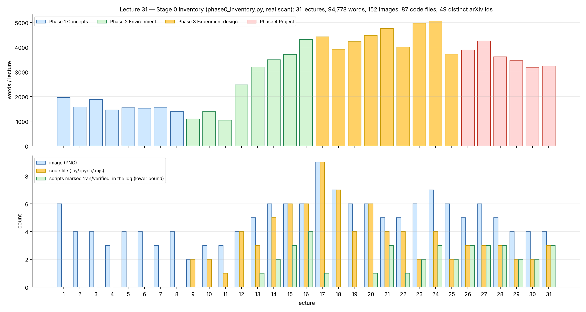
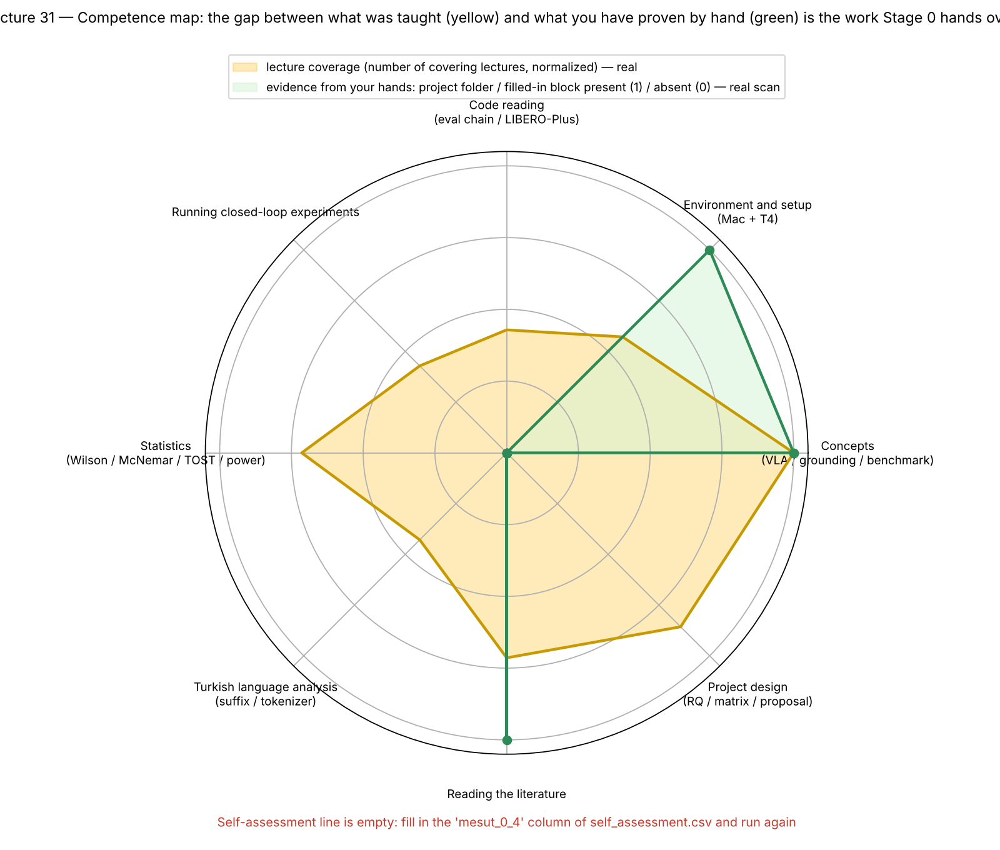

# Lecture 31 — Final: "Let's Do a Project" Simulation — Claude Proposes, You Design; Rubric, Stage 0 Ledger and Carried-Over Work

**Phase 4 / Day 31** · **Time:** ~60 min (reading 30 + simulation 30) · Last lecture
**Prerequisites:** Lecture 26 (six fields, `rq_power.py`), Lecture 27 (`experiment-matrix.csv`, `budget.py`), Lecture 28 (`thesis/ablation-plan.md`), Lecture 29 (`thesis/proposal-v0.1.md`), Lecture 30 (`slides/advisor-meeting-01.md`) · **Code:** `code/day31/` (`phase0_inventory.py` repo scan, `design_lint.py` template checker, `plot_day31.py`; all three ran in this session) · **Output:** a project design you fill in (one of `code/day31/templates/P1–P3.md`)

> **Today in one sentence:** The aim of Stage 0 was to be able to produce a research question and an experiment plan when someone says "let's do a project". Today that is tested. Claude makes three short project proposals, you pour one of them into an eight-field template (question, null, variables, cells, budget, numeric criterion, risks, if yes/no). `design_lint.py` checks the structure and the consistency of n and MDE, and the rubric says which lecture to go back to in order to close a missing field. In the ledger part the repo scan (`inventory.csv`) shows this: there is a gap between what has been told and what has been proven by your own hand, and the real work carried over from Stage 0 is the first table run in closed loop (S1).

---

## 1. The rules of the simulation

The last line in the plan table was: "Claude proposes a project, you design." This is not an exam, it is a rehearsal. One day an advisor or a teammate will say "shall we try this?". What is expected of you is to turn that sentence within half an hour into a plan that is runnable, with a known price and a result interpreted in advance. Lecture 26 did this at the RQ level with six fields. Lecture 27 added cells and budget. Today's template merges the two and contains eight fields:

| field | what is written | where you learned it |
|---|---|---|
| **Question** | one sentence; the system, scene, condition and "relative to what" appear in it | Lecture 26 §1 |
| **Null hypothesis** | H0 + equivalence bound δ (a number) | Lecture 26 §2 |
| **Variables** | independent / dependent / covariate / fixed | Lecture 26 §3 |
| **Cells** | in the `experiment-matrix.csv` format: system, suite, block, conditions, n_init, repeats | Lecture 27 §1 |
| **Budget** | T4 hours (`budget.py`), pool n, MDE | Lecture 27 §4–5 |
| **Success criterion** | numeric: p < 0.05 and \|Δ\| ≥ …; or κ ≥ …; or TOST δ | Lectures 19, 26 |
| **Risks** | at least two items and a plan B for each | Lecture 27 §6, Lecture 28 |
| **If yes / if no** | two branches, two sentences | Lecture 26 §1 |

The time is 30 minutes: in 5 minutes one proposal is chosen, in 20 minutes the template is filled in, in 5 minutes lint is run and corrected. The templates are under `code/day31/templates/`. For you to see the standard, Claude filled in `P0-ornek.md`: "does `wrong` shift the target on Goal task 8", S-VN, 50 init, 3.2 T4 hours, MDE 23. The lint result is COMPLETE. P1–P3 are empty and they are yours.

---

## 2. Claude's three proposals

The proposals were kept as short as what you would hear in a meeting. No cell name, n or threshold is given; you have to derive them.

**P1 — "How much does the Turkish command cost S-VN?"** On the six trained tasks of LIBERO Spatial (block A) the same scenes are run with four commands: English, empty, wrong target, Turkish. Only S-VN is used, because it is cheap on the T4 (chunk 8). From a pilot comes the first closed-loop table and the S-VN half of RQ-a is answered. *Where it will challenge you:* on Spatial the command-free ceiling is 9/10 (Lecture 19). If `empty` is already high, what will the `tr` drop be read against? How many init does the budget want per task, is the claim unit the task or the block?

**P2 — "Letter cost: who does deleting the Turkish characters save?"** The same Turkish command is given in two surfaces: `tr_a` (with ç, ğ, ı, ö, ş, ü) and `tr_ascii` (without them). It is run on both systems. According to Lecture 22 the token cost of Turkish letters is 4.9 in LLaMA-2 and 0.9 in Qwen3. If the tokenization explanation is right, ASCII-fying saves S-OV and does not save S-VN. *Where it will challenge you:* the "opposite direction" claim means two separate paired differences and an interaction. Which test do you write? How does S-OV being 4-bit (Lecture 27 §3) constrain the interpretation?

**P3 — "Does reducing Turkish to English close the gap?"** Before the Turkish command goes to the model it is passed through the rule-based parser (Lecture 24) or MT. How much of the gap closes (κ), how much comes from the error of the intermediate layer? *Where it will challenge you:* because the parser translated 79/80 in-set exactly, most of the cells are the `clean` episode itself (Lecture 27, string cache). Then what is the experiment measuring? Where do the held-out sentences (5/12) go? What happens if the denominator of κ is small (clean − tr ≈ 0)?

All three sit on the thesis axis: P1 is the "measurable drop" half of the claim, P2 the cheapest test of the "where does it break" question, P3 the "weak reading" version of the contribution sentence. Which you choose may depend on how the S7/S10 decisions came out in the advisor meeting of Lecture 30. If the meeting has not happened yet, choose P1, because the other two use its table.

---

## 3. Rubric: what does "good enough" look like?

`design_lint.py` is the automatic half of the rubric. It looks at whether each field exists, is filled in, and carries the expected structure: H0 and δ = number, the Independent/Dependent split, in the cell S-VN/S-OV + `libero_*` + `n_init`, a numeric threshold in the criterion, at least two risk items, two branches. It also checks budget consistency: for the pool n you wrote it computes the MDE with `code/day27/budget.py`'s power function (McNemar exact, r = 0.05) and warns if it is outside ±2 points. The selftest verified three cases in this session: the example is COMPLETE, the empty template is 8/8 incomplete, and writing "MDE = 10" in the example produced the warning "for n = 50 the MDE is 23 points (r = 0.05), you wrote 10".

The human half of the rubric is what lint cannot see. When you give Claude the template you filled in, it is scored on these:

| field | good enough | commonly missing | go back to |
|---|---|---|---|
| Question | system, scene, condition and comparison baseline in one sentence | "Does Turkish work?" (no baseline) | Lecture 26 §1 |
| Null | two-sided: H0 for "there is a difference", δ for "there is none"; δ justified independently of the result | only H0; no δ or "small" | Lecture 26 §2 |
| Variables | with the covariate named (token count, command-free ceiling); fixed ones listed | init state and checkpoint not written as fixed | Lecture 26 §3, Lecture 19 |
| Cells | every cell runnable; the `empty` baseline in every block | `empty` forgotten; no ceiling check | Lectures 18, 27 |
| Budget | hours + n + MDE consistent; MDE less than or equal to the threshold in the criterion | MDE 23 while the threshold is 15 (looking for a difference that cannot be seen) | Lecture 27 §5 |
| Criterion | a number written in advance; the "unclear" branch defined | the threshold seems to be chosen after the result | Lecture 26 §2 |
| Risks | technical (render, 4-bit, bddl_cf) + statistical (ceiling, n) + interpretive (system difference) | only technical risk | Lecture 27 §2–3, 28 |
| If yes / no | both branches turn into a sentence in the thesis; neither is "wasted" | "if no, we will try again" | Lecture 26 §1 |

The most critical row is the linking of the budget and the criterion. If in P1 you choose 20 init per task and claim a 15-point difference at the task level, lint passes (the MDE was computed right), but the rubric drops: at n = 20 the MDE is 46, you cannot see 15 points. You must move the claim to the block or raise the budget. That was the real lesson of Lecture 27.

---

## 4. Stage 0 ledger: what does the repo say?

`phase0_inventory.py` scans the repo and extracts all the numbers from files. The "ran" information is read from the **Code:** lines in `plan/daily-log.md`, and the status of carried-over work from the existence of files and whether the `___` blanks have been filled. The scan after all of Lectures 1–31 were added (the script updates it on every run; the numbers are in `code/day31/results/inventory.csv`):

| metric | value (Lectures 1–31) |
|---|---|
| lectures / total words | 31 / 94,778 |
| figures (PNG) / Mermaid sources | 152 / 64 |
| code files (.py/.ipynb/.mjs) / `code/dayNN` folders | 87 / 23 |
| per-script "ran/verified" in the log (lower bound) / `py_compile` only | 39 / 6 |
| distinct arXiv IDs appearing in the lectures | 49 |
| "hypothesis" mentions | 108 |
| dataset cards (`datasets/`) / thesis files (`thesis/`) | 5 / 5 |
| your project folders (`projects/`) | 2 (project-1 MuJoCo scene, project-2 LIBERO episodes) |

In the upper half of the chart the lectures get longer after Phase 2 (~1,600 words in Phase 1, ~4,000–5,000 in Phase 3), because code, measurement and source density increases. In the lower half the green bars (scripts that really ran in the lecture session) become pronounced in Phase 3. On the setup days of Phase 2 most scripts were `py_compile`d or written for you to run. The reason I say "lower bound" is this: some log lines were written in bulk as "all ran" and the scripts are not counted one by one.

"108 hypotheses" is not a flaw but discipline: everything not certain was marked. But it means that most of the numbers the thesis rests on today are paper tables and dry runs in lecture sessions, not your closed-loop runs. This is the subject of the next section.

---

## 5. Competence map: told versus proven

The 31 lectures progressed in four phases. Figure 02 shows the chain: Phase 1 built the concepts, Phase 2 the tools, Phase 3 the language of the experiment (conditions, reading protocol, Turkish set, tokenization), Phase 4 the project (RQ → matrix → ablation → proposal → advisor → simulation).

Figure 04 projects the same path onto eight competences. The yellow area is **lecture coverage**: the number of lectures covering that competence, normalized (the mapping in `self_assessment.csv`; real). The green area is **evidence from your own hand**: is there a project folder or a block you filled in (`filled:` = no `___` left in the file; real scan). The blue dashed line is your self-assessment (0–4). Since the `mesut_0_4` column is empty it has not been drawn yet.

According to the scan green is 1 on only three axes: concepts (`literature/rapor.md`), environment (`projects/project-2`), literature (`literature/makaleler.md`). On the axes of code reading, closed-loop experiment, Turkish language analysis, statistics (the Lecture 26 predictions block is empty) and project design (the Lecture 27 claim unit is empty) it is 0. This is not a grade, it is a to-do list. The gap between yellow and green is exactly the work Stage 0 carries over. When you fill in your self-assessment the third line will also show the difference between how much you trust yourself and the evidence in the repo.

---

## 6. Carried-over work (handoff)

`phase0_inventory.py` writes this list as `results/handoff.md`. Each row has a definition of evidence in the repo, so saying "I did it" is not enough, the file must be visible. Its state at scan time:

| work | evidence | status | why it matters |
|---|---|---|---|
| **S1** — the Lecture 18 four-condition run (T4) | `projects/05-spatial0-4kosul/` | ✘ missing | the table that chooses the primary RQ (Lecture 26 §6); the pilot of P1 |
| Lecture 12 / 14 / 15 / 16 runs | `projects/01–04-*` | ✘ missing | proof that the T4 and Mac pipelines work in your hands |
| `results/runs.csv` | file | ✘ missing | the one-line record of every run (CLAUDE.md rule) |
| S1–S10 Status column | `plan/faz3-open-questions.md` | 10/10 "waiting/not asked" | the advisor questions (S7, S9, S10) close here |
| Lecture 26 pre-registration predictions | `thesis/rq-candidates.md` | `___` remains | if not committed **before** the run the pre-registration value is lost |
| Lecture 27 claim unit + quota | `thesis/experiment-matrix.md` | `___` remains | the budget is between 303 and 126 hours (matrix v0.2), depending on this decision |
| K1/K2 calibration (real t_call) | `budget.py --calls-*` output | ✘ missing | 90% of the budget is the estimated call time |
| Lecture 28–30 outputs | `thesis/ablation-plan.md`, `thesis/proposal-v0.1.md`, `slides/advisor-meeting-01.md` | ✔ present | the material for the advisor meeting |

My suggested order is short: **(1)** Fill in the Lecture 26 predictions block and commit it. This is a 10-minute job and of irreversible value. **(2)** Run S1, K2 also comes out in the same Kaggle session. **(3)** Go to the advisor with the Lecture 30 package. **(4)** On return enter the claim unit and S7/S9/S10 into the files. After that it is your plan.

Link to the thesis one last time: the question of grounding of Turkish spatial commands in VLAs stands today in four files. The questions are in `rq-candidates.md`, how and for how much it will be done in `experiment-matrix.md`, what it will be compared with in `ablation-plan.md`, its one-page form in `proposal-v0.1.md`. The only thing missing is the first real table that all these files are waiting for.

---

## 7. Bridges for the software developer

- **Simulation = architecture kata.** Like the team exercise "how would we design it if this requirement came": no code, but boundaries, cost and risk written down. When the real work comes you are not thinking for the first time.
- **Template = ADR (Architecture Decision Record).** Context (question), decision (cells), alternatives (null and the yes/no branches), consequences (risks). As in an ADR, the real value is that the question "why did we do it this way" can be answered six months later.
- **`design_lint.py` = a PR template check + a unit test.** The structural checks are at the "is the Description empty" level. The MDE check is a real assertion: is the number you wrote consistent with the output of another module (`budget.py`)? It catches in CI an inconsistency like writing `timeout: 5` in the configuration and using 30 in the code.
- **Inventory = SBOM / technical debt report.** What exists, what ran, what was only compiled. "108 hypotheses" is the number of `TODO: verify` labels in the backlog. Bringing it to zero is not the goal, but each should have an owner.
- **Handoff = end-of-sprint handover note.** The "done" definition is at the file level: if `projects/05-*` does not exist, S1 has not been done, saying "I ran it" on Slack does not count. Like closing a ticket only with a PR merge.
- **Radar = skills matrix.** The "knows / can do alone / can teach" table team leads use. Yellow is "knows", green is "did". The gap between them is closed not with a training budget but with hands-on runs.

---

## 8. Today's task (15 min + simulation)

Do the simulation: choose one of P1, P2 or P3 and fill in `code/day31/templates/P_.md`. For the budget line use `cd code/day27 && python budget.py` (you can add the cell to `experiment-matrix.csv` as a temporary row and read the hours). Then fix until `cd code/day31 && python design_lint.py templates/P1.md` gives COMPLETE. Then two things: fill in the `mesut_0_4` column of `self_assessment.csv` between 0–4 and redraw the radar with `python plot_day31.py`, and update the ledger with `python phase0_inventory.py --png ../../lectures/images/lecture-31`. Give the template you filled in to Claude and ask for the rubric score. Commit: `Lecture 31: project simulation (P_) + self-assessment`.

## If you get stuck

| Symptom | Fix |
|---|---|
| `design_lint.py`: `ModuleNotFoundError: budget` | Run the script from inside `code/day31/`; it imports `code/day27/budget.py` via a relative path |
| Lint: `for n = 120 the MDE is 13 points (r = 0.05), you wrote 15` | The warning catches anything outside ±2 points; take the MDE from `budget.py`'s inverse table or from `python -c "import sys; sys.path.insert(0,'../day27'); from budget import mde; print(mde(120))"` |
| Lint: `Cells: system (S-VN/S-OV), suite (libero_*) or the n_init number is missing` | In the cell row the form `n_init 20` is searched for (word + space + number) |
| Lint: `Success criterion: no numeric threshold (p < 0.05, |Δ| ≥ …, κ ≥ …, δ = …)` | `p < 0.05`, `\|Δ\| ≥ 15`, `κ ≥ 0.5`, `δ = 10` or `… points` must appear |
| `phase0_inventory.py` says "✘ missing" for every handoff row | The evidence paths are exact: `projects/05-…` (two-digit number + hyphen), `results/runs.csv` at the repo root |
| No blue line in the radar | There must be no empty cell in the `mesut_0_4` column (all 8 rows) |

---

## Next lecture (none — end of Stage 0)
**There is no next lecture, Stage 0 ends here.** At the end of 31 lectures you have: a concept map and a reading list (`literature/`), setup and eval pipelines for the Mac and the T4 (`code/day09–18`), five dataset cards (`datasets/01–05`), three candidate research questions and a pre-registration draft (`thesis/rq-candidates.md`), a priced experiment matrix (`thesis/experiment-matrix.*`), a baseline/ablation plan, a one-page thesis proposal draft, an advisor meeting package and today's simulation template. The carried-over work is in the table in §6 and in `code/day31/results/handoff.md`. What comes after this, that is which experiment will be run when, which direction will be chosen with the advisor and how the repo layout will continue, is left to your own plan. This repo is a starting point for that plan, not a new lecture calendar.

---

## References
- Inputs: `thesis/rq-candidates.md` (Lecture 26), `thesis/experiment-matrix.csv` + `code/day27/budget.py` (Lecture 27; the MDE and hour calculations come from here), `thesis/ablation-plan.md` (Lecture 28), `thesis/proposal-v0.1.md` (Lecture 29), `slides/advisor-meeting-01.md` (Lecture 30), `plan/faz3-open-questions.md` (S1–S10), `plan/daily-log.md` (**Code:** lines), `datasets/04/data/pairs.csv` (block A), Lecture 22 (letter cost 4.9 / 0.9), Lecture 24 (parser 79/80, held-out 5/12), Lecture 19 (command-free ceiling 9/10, 1/10).
- Pre-registration and template discipline: Bertinetto et al. (2021), [PMLR 148](https://proceedings.mlr.press/v148/bertinetto21a.html); equivalence: Lakens (2017), [PMC5502906](https://pmc.ncbi.nlm.nih.gov/articles/PMC5502906). The ADR concept: Nygard (2011), [*Documenting Architecture Decisions*](https://cognitect.com/blog/2011/11/15/documenting-architecture-decisions).
- Code: `code/day31/` — `phase0_inventory.py` (ran in this session; `results/inventory.csv`, `lectures.csv`, `handoff.md`), `design_lint.py` (ran; selftest OK, `results/lint_demo.txt`), `plot_day31.py` (ran), `templates/` (empty template, P0 example, P1–P3), `self_assessment.csv`.
- Figures: 01 **real scan** (`phase0_inventory.py`; re-run after Lectures 1–31 were added); 02 and 03 are Mermaid (`.mmd` alongside); 04 lecture coverage and evidence axes are a real scan, the self-assessment line is a column you will fill in (left empty, no representative value was put in).
