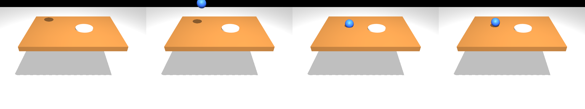

# Proje 1 — İlk MuJoCo sahnesi (Mac'te kurulum doğrulaması)

**Durum:** tamam · **İlgili dersler:** [Ders 9](../../lectures/lecture-09.md)

## Amaç
Mac'te (M2, MPS) `vla` conda ortamının ve MuJoCo offscreen render'ının çalıştığını doğrulamak: masa + tabak + düşen top sahnesini kendi makinemde üretmek.

## Çalıştırma
```bash
conda activate vla
python check_env.py      # python / numpy / mujoco / torch(MPS) sürümleri
python first_scene.py    # first_scene.png üretir
```

## Sonuçlar
Dört deneme; XML'de konum/boyut/kamera değiştirilerek sahne tekrar render edildi.

| Deneme | Çıktı |
|---|---|
| 1 |  |
| 2 |  |
| 3 |  |
| 4 |  |

## Bulgular ve notlar
- Offscreen render Mac'te `MUJOCO_GL` ayarı olmadan çalıştı.
- Sonraki adım: Proje 2 (robosuite + LIBERO).
