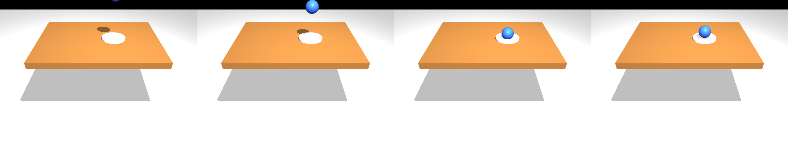
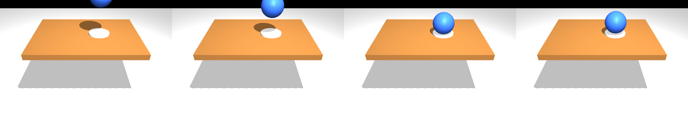
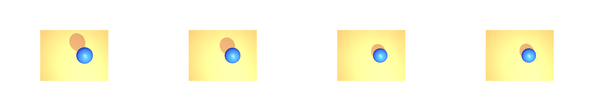

# Project 1 — First MuJoCo scene (setup verification on the Mac)

**Status:** done · **Related lectures:** [Lecture 9](../../lectures/lecture-09.md)

## Goal
Verify that the `vla` conda environment and MuJoCo offscreen rendering work on the Mac (M2, MPS): produce the table + plate + falling ball scene on my own machine.

## Running
```bash
conda activate vla
python check_env.py      # python / numpy / mujoco / torch(MPS) versions
python first_scene.py    # produces first_scene.png
```

## Results
Four trials; the scene was re-rendered after changing positions/sizes/camera in the XML.

| Trial | Output |
|---|---|
| 1 |  |
| 2 |  |
| 3 |  |
| 4 |  |

## Findings and notes
- Offscreen rendering worked on the Mac without setting `MUJOCO_GL`.
- Next step: Project 2 (robosuite + LIBERO).
