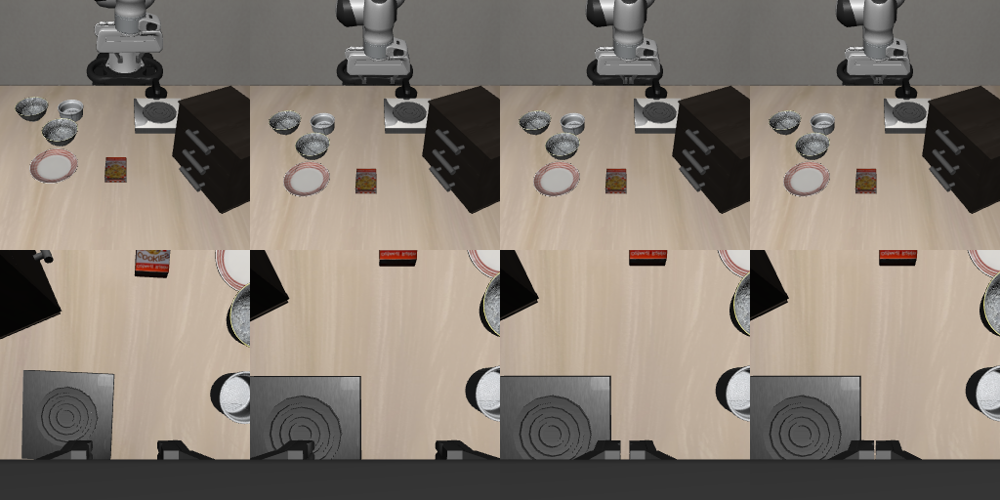
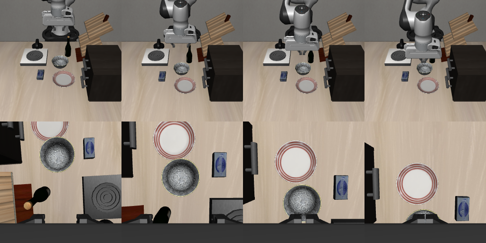
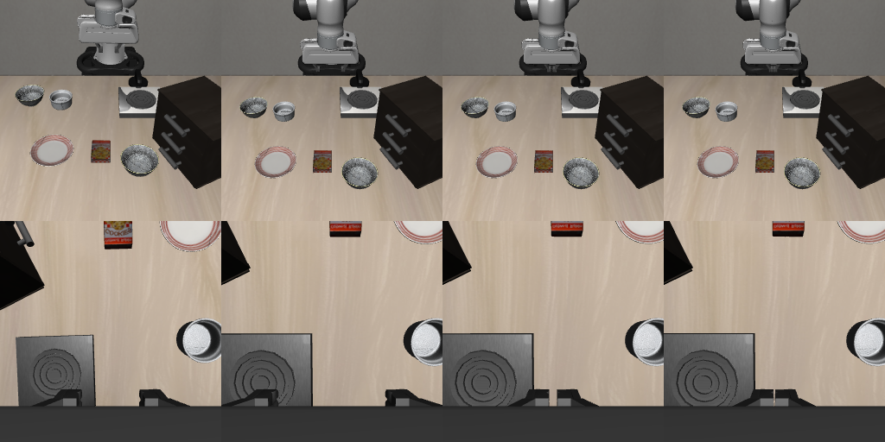
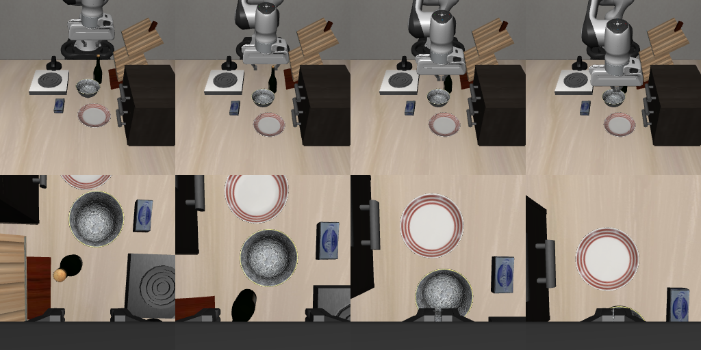
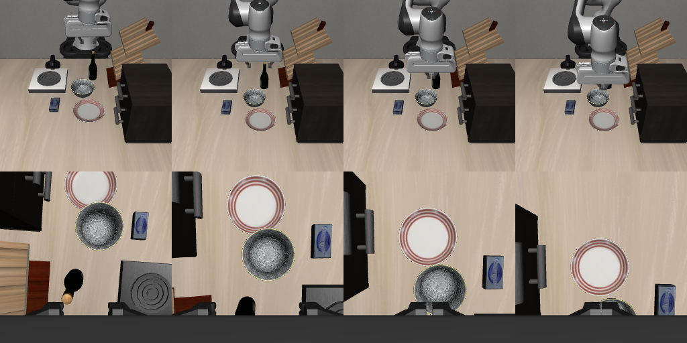
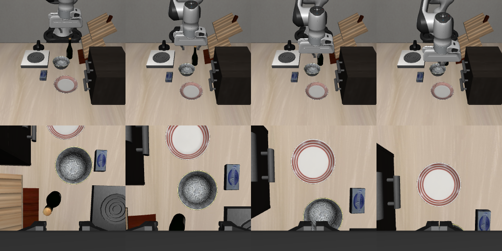

# Proje 2 — LIBERO'da ilk episode'lar (Spatial ve Goal, görev 0–4)

**Durum:** tamam · **İlgili dersler:** [Ders 10](../../lectures/lecture-10.md), [Ders 3](../../lectures/lecture-03.md)

## Amaç
LIBERO'yu Mac'te kurup (`mujoco==2.3.7`, `robosuite==1.4.1`) Spatial ve Goal suite'lerinin ilk beş görevini açmak; `reset()` / `set_init_state()` / `step()` döngüsünü çalıştırıp agentview ve bilek kamerası görüntülerini kaydetmek. Policy yok; action elle verildi (aşağı in, gripper kapat).

## Çalıştırma
```bash
conda activate vla
python list_tasks.py                                   # 40 görevin İngilizce komutları
python libero_first_episode.py --suite libero_spatial --task 0
python libero_first_episode.py --suite libero_goal    --task 0
```
LIBERO klonu bu klasörün altında (`LIBERO/`), repoya girmez (`.gitignore`).

## Sonuçlar
Üst sıra `agentview`, alt sıra `robot0_eye_in_hand`; soldan sağa t = 0, 20, 40, 59.

| Görev | LIBERO-Spatial | LIBERO-Goal |
|---|---|---|
| 0 |  |  |
| 1 |  |  |
| 2 |  |  |
| 3 |  |  |
| 4 |  |  |

## Bulgular ve notlar
- Spatial görev 0–4'te sahne aynı mutfak: iki siyah kâse, tabak, ramekin, kurabiye kutusu, ocak, dolap. Komutlar yalnızca kâsenin yerini söylüyor (Ders 10) — hangi kâsenin alınacağı görüntüden değil komuttan çıkıyor.
- Goal suite'te aynı sahne, farklı hedef; görüntüler Spatial ile neredeyse aynı (Ders 4'teki "dil zorunlu" suite).
- Bilek kamerası başlangıçta ocağı görüyor; Spatial'da kâseye hizalı değil. Bir VLA'nın ilk adımlarda bilek görüntüsünden çok agentview'a dayanması beklenir.
- Sonraki adım: aynı görevlerde bir checkpoint ile gerçek eval (Ders 12–13, Colab) ve Türkçe komut koşulu (Ders 18).
