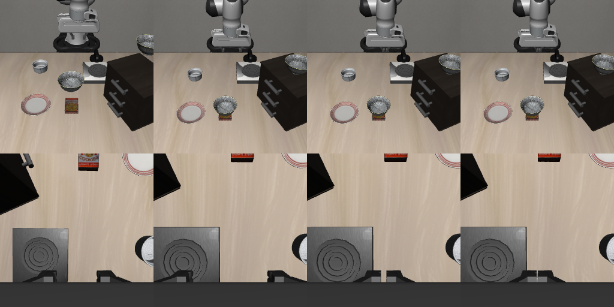
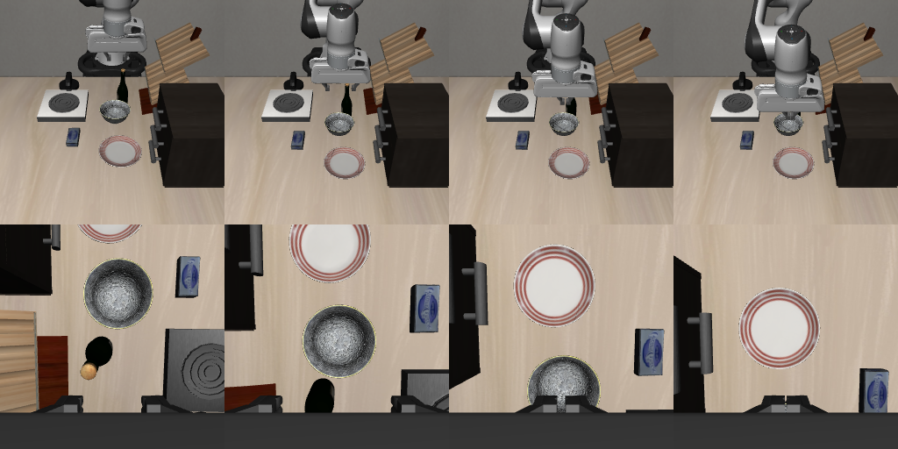
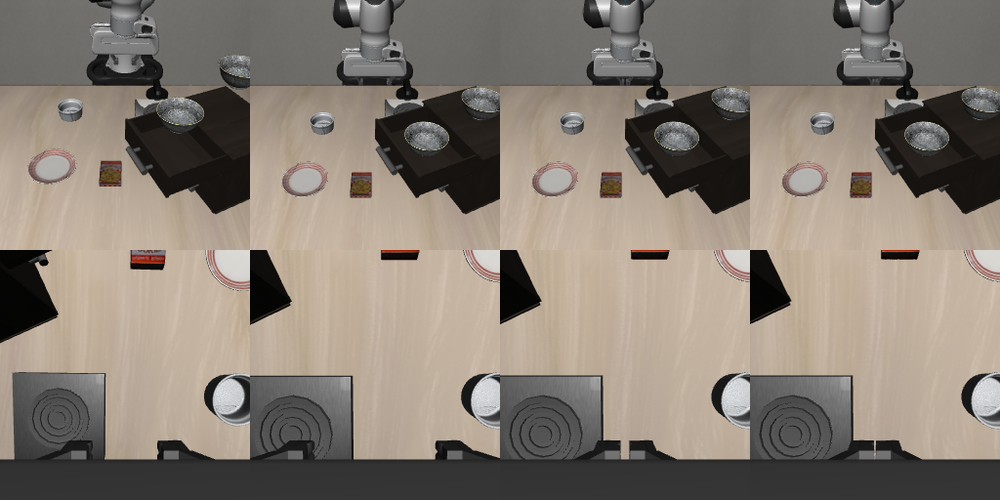
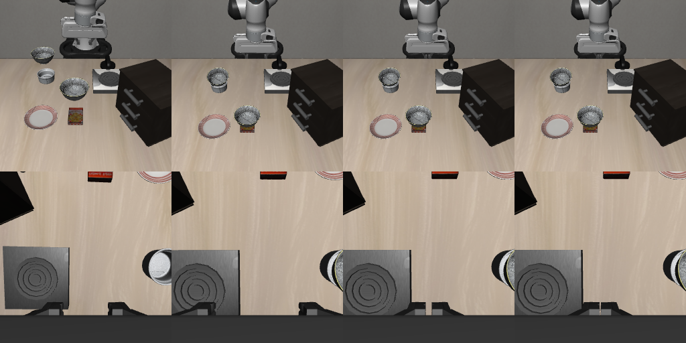

# Project 2 — First episodes in LIBERO (Spatial and Goal, tasks 0–4)

**Status:** done · **Related lectures:** [Lecture 10](../../lectures/lecture-10.md), [Lecture 3](../../lectures/lecture-03.md)

## Goal
Install LIBERO on the Mac (`mujoco==2.3.7`, `robosuite==1.4.1`) and open the first five tasks of the Spatial and Goal suites; run the `reset()` / `set_init_state()` / `step()` loop and save the agentview and wrist camera images. No policy; the action was given by hand (move down, close the gripper).

## Running
```bash
conda activate vla
python list_tasks.py                                   # English commands of the 40 tasks
python libero_first_episode.py --suite libero_spatial --task 0
python libero_first_episode.py --suite libero_goal    --task 0
```
The LIBERO clone lives under this folder (`LIBERO/`) and does not enter the repo (`.gitignore`).

## Results
Top row `agentview`, bottom row `robot0_eye_in_hand`; left to right t = 0, 20, 40, 59.

| Task | LIBERO-Spatial | LIBERO-Goal |
|---|---|---|
| 0 |  |  |
| 1 |  |  |
| 2 |  |  |
| 3 |  |  |
| 4 |  |  |

## Findings and notes
- In Spatial tasks 0–4 the scene is the same kitchen: two black bowls, a plate, a ramekin, a cookie box, a stove, a cabinet. The commands only say where the bowl is (Lecture 10) — which bowl to pick comes from the command, not from the image.
- In the Goal suite it is the same scene with a different goal; the images are almost identical to Spatial (the "language is required" suite from Lecture 4).
- The wrist camera initially sees the stove; in Spatial it is not aligned with the bowl. A VLA is expected to rely on agentview more than the wrist image in the first steps.
- Next step: a real eval with a checkpoint on the same tasks (Lectures 12–13, Colab) and the Turkish command condition (Lecture 18).
